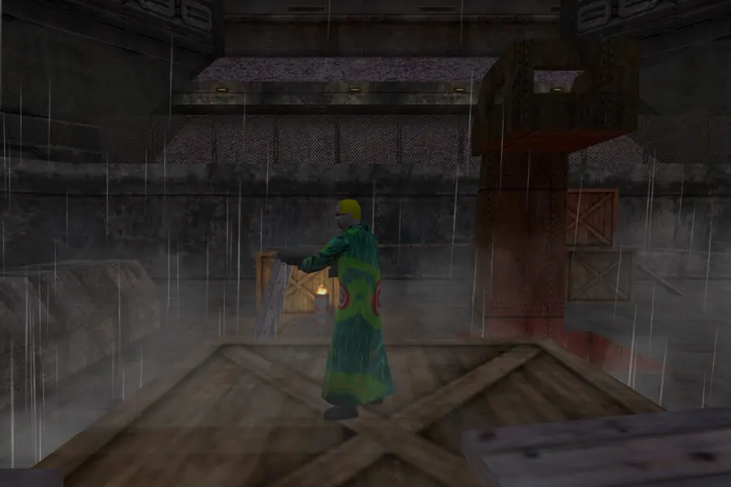

# Bounty Killer

Bounty Killer maps (`bk_*`) put one player on the run as **the Hunted** while every other player hunts them as a
**Bounty Killer**, and whoever kills the Hunted becomes the next Hunted. Killing the Hunted is worth 10 points, and the
Hunted scores 2 for every Bounty Killer they kill. There are no rounds, so players who die respawn after a few seconds,
and the map runs until its time or frag limit is reached.

Bounty Killer is also SBO's default game mode: any map whose name doesn't start with `co_` or `br_`, such as a
Half-Life deathmatch map, plays Bounty Killer.

## Joining

When you join a Bounty Killer server, you choose a loadout the same way as in Co-op, and you spawn as soon as you
choose it, with **you are a Bounty Killer!** on your screen. The first Hunted is picked at random. See [Loadout](../playing/loadout.md) for more details.

## The Hunted {#the-hunted}

The Hunted has a distinct player model, so Hunters can easily spot them. When you become the Hunted, a message on
your screen shows **Run!!! you are the hunted!!**. When a Bounty Killer kills the Hunted:

- The killer becomes the Hunted right away, with the Hunted's player model
- The player who was the Hunted respawns as a Bounty Killer

The Hunted stays the Hunted if they kill themselves, or if a monster or the world, such as a fall or drowning, kills
them.

*The Hunted, seen by a Bounty Killer*

When the Hunted leaves the server or enters persistent spectator mode, every player's screen shows **The HUNTED IS
DEAD !!!**. Five seconds later, every player with a loadout respawns with it, and the first of them in the server's
player list becomes the new Hunted.

## Respawn

Bounty Killer has no rounds, so players who die respawn by themselves after 5 seconds by default, as in Half-Life
deathmatch, or sooner if they press a key.

## Score

| Event | Score |
|---|---|
| A Bounty Killer kills the Hunted | +10 for the killer |
| The Hunted kills a Bounty Killer | +2 for the Hunted |
| A Bounty Killer kills another Bounty Killer | +1 for the killer |
| A monster kills you | −5 |
| You kill yourself, or the world kills you | 0 |

## End of the map

The map ends when its time is up, after 20 minutes by default, or when a player reaches the server's frag limit,
which is off by default. The scoreboard then shows, and the server loads the next map from the map cycle.

## Scoreboard

The [scoreboard](../playing/hud-and-scoreboard.md#scoreboard) lists alive players under **Alive Ops**, with the
Hunted in the first row and **(Hunted)** after the player's name, and dead players under **Dead Ops**. Bounty Killer
does not have a **No Loadout** group, so a player who hasn't chosen a loadout yet is listed under **Dead Ops**.

## Map entities

| Entity | Effect |
|---|---|
| [`info_player_deathmatch`](../mapping/entities/info_player_deathmatch.md) | A spawn point |
| [`game_player_equip`](../mapping/entities/game_player_equip.md) | Players get its items at every spawn on top of their fists and the loadout they chose, unless its **Use Only** flag is set |

The game triggers the entities named `game_round_start` when the Hunted is picked, and `game_round_end` when the
Hunted leaves or enters persistent spectator mode. Bounty Killer does not have rounds, so it never
triggers `game_round_<N>`. See
[Round hooks](../mapping/guide/round-hooks.md) for more details.

## Settings

Most of these server settings affect every game mode. Only `mp_forcerespawn` is used by Bounty Killer alone. You set them in `server.cfg` or in the server console. See
[Server settings](../server/settings.md) for more details.

| Cvar | Default | Effect |
|---|---|---|
| [`mp_forcerespawn`](../server/settings.md#players) | 1 | Respawns dead players by themselves after 5 seconds. Setting it to 0 makes them respawn only when they press a key |
| [`mp_timelimit`](../server/settings.md#rounds-and-missions) | 20 | How many minutes a map lasts. Setting it to 0 turns the limit off |
| [`mp_fraglimit`](../server/settings.md#rounds-and-missions) | 0 | How many frags end the map. Setting it to 0 turns the limit off |
| [`mp_chattime`](../server/settings.md#rounds-and-missions) | 10 | How many seconds the scoreboard stays up before the next map loads |

## Changes since 1.38

- Suicides no longer cost points in Battle Royale and Bounty Killer. In SBO 1.38 a suicide cost 5 points in Battle
  Royale and 10 in Bounty Killer, which only made matches last longer
- In Bounty Killer, a death from a fall, water or a hazard no longer costs points. A kill by a monster still costs 5

## See also

- [Game modes](index.md) - the three modes side by side
- [Co-op](coop.md) - all players against the monsters
- [Battle Royale](battle-royale.md) - the last player alive wins the round
