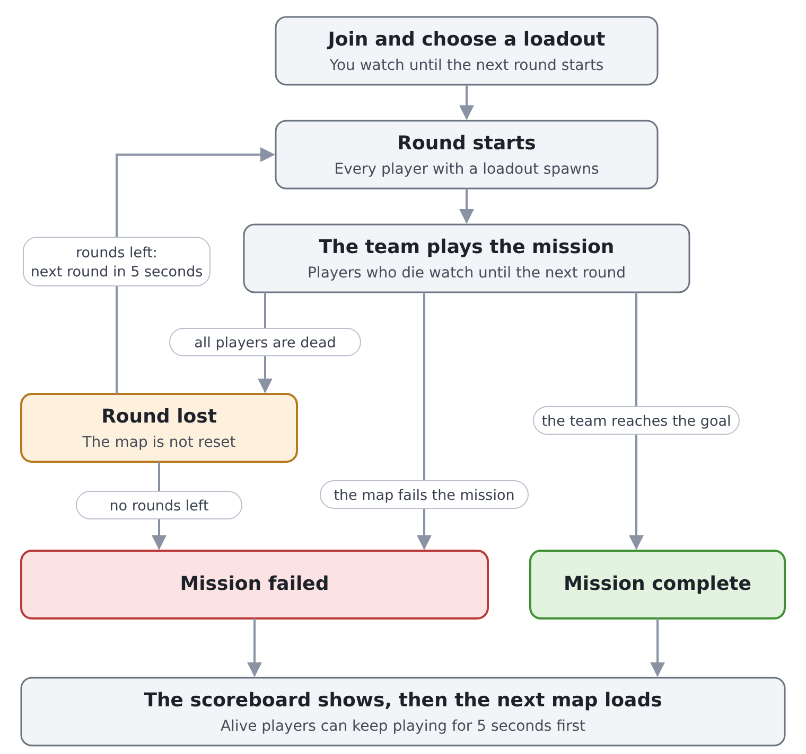

# Co-op

Co-op maps (`co_*`) group players on one team to complete missions and fight against monsters in rounds. When the
team loses a round, the players respawn and try again until they finish the mission or run out of rounds and fail the
mission, at which point they will be taken to the next map.

Along the way, damaging monsters and healing players with the medikit earns you XP, and every level you gain makes
you faster and gives you more health. Many monsters aim better and hit harder the more players are in the round.
When the server allows it, one player can become the [Game Master](#game-master) and place monsters, weapon drops and
teleporters on the map.

*How a Co-op map runs, from joining to the next map*

## Joining

When you join a Co-op server, you see the server's message of the day, then the map briefing, and then the
[loadout](../playing/loadout.md) window, where you choose a blade, a light weapon, a heavy weapon, a cyberware, an
equipment item, your armor choice, and your agent choice (male or female). Once you choose your loadout, you spectate
until the next round starts, so if a round is already in progress, you join when it ends.

Until you choose a loadout, the [scoreboard](../playing/hud-and-scoreboard.md#scoreboard) lists you under **No
Loadout**. You can open the map briefing again at any time with the map briefing key (Default: <kbd>B</kbd>).

## Rounds

### Round start

A round starts when at least one player has a loadout and no other player is still choosing one. The game checks
this about every 20 seconds, and again as soon as the wait for a player runs out.

A player who hasn't chosen a loadout can hold up the round start for up to 45 seconds by default, counted from when
they joined or last used the briefing or loadout windows. When that time runs out, the round starts without them, and
they join the next round once they choose a loadout. A server can also make every round wait for every player (see
[Settings](#settings)).

At the start of a round:

- Every player with a loadout spawns at a spawn point of the active spawn zone, with the weapons of their loadout
- The screen shows **ROUND START**
- Players can walk through each other for 15 seconds by default

The map is **not reset** between rounds: opened doors stay open, killed monsters stay dead, and players keep spawning
in the spawn zone the map last moved them to. A map can put some of its entities back at each round start with
[round hooks](../mapping/guide/round-hooks.md).

### Losing a round

A player who dies spectates until the next round. The team loses the round when one of these happens:

- Nobody is alive anymore
- The number of players who died reaches the server's share of the players who started the round, rounded down

By default the share is all of them, so the round is lost when every player of the round is dead. A server can set a
smaller share, such as half, which with 5 players means the round is lost after 2 deaths, and with a share of 0, the
round is lost when the first player dies.

After a lost round, the screen shows **FAILED ROUND** and the next round starts 5 seconds later. A player who goes to
spectator mode, leaves the server or becomes the [Game Master](#game-master) during a round stops counting for that
round, as if they had never been in it.

### Number of rounds

The mission fails when the team loses its last round. The number of rounds depends on the map and on the server's
easy mode setting (`mp_easymode`):

| The map has | Rounds with easy mode on (the default) | Rounds with easy mode off |
|---|---|---|
| A [`max_round`](../mapping/entities/max_round.md) entity | 1.5 times its **Maximum rounds** value, rounded up. A value of 0 or less counts as 5 | Its **Maximum rounds** value. A value of 0 or less counts as 5 |
| No `max_round` entity | 10 | 7 |

The scoreboard shows the current round and the number of rounds.

## Mission end

The mission ends with a success or a failure:

| Result | Screen text | Cause |
|---|---|---|
| Success | **SUCCESSFULL MISSION** | A [`game_end`](../mapping/entities/game_end.md) is triggered, or a player touches a [`change_touch`](../mapping/entities/change_touch.md) |
| Failure | **FAILED MISSION** | A [`mission_failed`](../mapping/entities/mission_failed.md) is triggered, or the team loses its last round |

Only the first result counts.

After the result, the players who are still alive can keep moving for 5 seconds by default. Then the scoreboard
shows, and 10 seconds later by default the server loads the next map from the map cycle, whether the mission succeeded
or failed. The time limit and the frag limit never end a Co-op map.

If the server sets a longer wait than 5 seconds (`mp_missionendtime`), the players who are still alive start
spectating where they stand 5 seconds after the result. This doesn't count as a death, so it adds no death, no penalty
and no kill feed entry.

## Score, XP and levels

### Score

In Co-op, the scoreboard shows your **Level** instead of a score. The score only appears in a server browser's
player list, where it rises by 1 with every level-up and drops by 5 when you kill a teammate or yourself, but never
below 0.

Killing a monster doesn't add to your score. XP is how you level up, and you earn it by dealing damage to monsters and
by healing players with the medikit. See [XP](#xp) for more details.

### XP

You earn XP in two ways:

- **Damage to monsters:** each point of damage you deal to a monster gives XP at that monster's rate, which the
  table below lists
- **Healing with the medikit:** each medikit heal that raises the health of a living player, yourself included, gives
  a random 500 to 1000 XP

| Monster | XP per point of damage |
|---|---|
| Apache ([`monster_apache`](../mapping/entities/monster_apache.md)) | 100 |
| Fed with heavy weapons ([`dark_grunt`](../mapping/entities/dark_grunt.md)) | 10 |
| Fed ([`monster_human_grunt`](../mapping/entities/monster_human_grunt.md), [`monster_grunt_hunter`](../mapping/entities/monster_grunt_hunter.md)) | 8 |
| Cop ([`monster_barney`](../mapping/entities/monster_barney.md)), Sectum ([`monster_dark`](../mapping/entities/monster_dark.md)) | 2 |
| Imp ([`monster_imp`](../mapping/entities/monster_imp.md), [`monster_imp_hunter`](../mapping/entities/monster_imp_hunter.md)), Assassin ([`monster_human_assassin`](../mapping/entities/monster_human_assassin.md)) | 1.5 |
| Demon Slave ([`monster_alien_slave`](../mapping/entities/monster_alien_slave.md), [`monster_hunter`](../mapping/entities/monster_hunter.md)), Cyborg ([`monster_cyborg`](../mapping/entities/monster_cyborg.md)), Cyber Minotaur ([`monster_cyberminotor`](../mapping/entities/monster_cyberminotor.md)), Gargantua ([`monster_gargantua`](../mapping/entities/monster_gargantua.md)), Scientist ([`monster_scientist`](../mapping/entities/monster_scientist.md)), Werewolf ([`monster_werewolf`](../mapping/entities/monster_werewolf.md), [`monster_werewolf_hunter`](../mapping/entities/monster_werewolf_hunter.md)) | 1 |
| Zombie Grunt ([`monster_zombie_grunt`](../mapping/entities/monster_zombie_grunt.md)) | 0.4 |
| Zombie ([`monster_zombie`](../mapping/entities/monster_zombie.md), [`monster_zombie_hunter`](../mapping/entities/monster_zombie_hunter.md)) | 0.2 |

Other monsters give no XP.

### Levels

You level up when your XP reaches 5000, or 7500 when the XP comes from the medikit, and your XP then starts again
from 0. A single hit or heal gives at most one level.

At each level-up:

- The screen shows **LEVEL UP**
- You get a random 10 to 20 HP, up to your maximum health
- Your base speed rises by 5 right away
- Your spawn health rises by 2, from your next spawn on
- Your score rises by 1

When you die, the XP you gathered toward the next level is halved. Levels and XP last until you leave the server or
the map changes, and the scoreboard shows each player's level and the total XP they earned on the map.

A map can also set, raise or lower a player's level and XP with a
[`game_player_settings`](../mapping/entities/game_player_settings.md) entity.

### Teamkills and suicides

Friendly fire is on by default, so players can hurt each other. If you kill a teammate, or kill yourself with your
own weapon or by typing `kill` in the console, you lose:

- 5 levels, which takes 25000 XP off your total on the scoreboard and lowers your base speed right away. Levels have no
  lower limit
- 25 spawn health, from your next spawn on, but your spawn health never goes below 10

Below level −40, your base speed stays capped at 100 regardless of how much lower your level goes. A server can also
make a player with 5 or more teamkills on the map spawn with 3 health and no weapons (see [Settings](#settings)).

When a player kills a teammate, the [kill feed](../playing/hud-and-scoreboard.md#teamkills) shows the weapon icon in
green.

## Heavy weapon limits

Co-op maps have the following limits: 3 Vindico grenade launchers and 2 nuclear rocket launchers at any given time. A
launcher becomes free again when the player who chose it leaves the server, chooses another loadout or enters
persistent spectator mode. See [Loadout](../playing/loadout.md#heavy-weapon-limits-in-co-op) for more details.

## Monsters

Many monsters aim better and hit harder the more players are in the round, in four steps: 1 or 2 players, 3 or 4,
5 or 6, and 7 or more, and spectators and players waiting for a round don't count. The server also sets how hard
monsters hit, how well Feds and Cops aim, how much health monsters have, and how many monsters the
[`monstermaker`](../mapping/entities/monstermaker.md) entities make and how fast. See [Settings](#settings) for more
details.

## Spectators

Players in spectator mode are not in the round, so they never count toward the round start, losing a round or how
strong the monsters are. See [Spectating](../playing/spectating.md) for more details.

## Game Master

When the server allows it, one player at a time can become the **Game Master** with the Game Master key (Default:
<kbd>K</kbd>), alive or dead. The Game Master leaves the round without dying and flies around the map unseen and
unhurt, and the game keeps their loadout for later. A player in persistent
spectator mode can't become the Game Master.

The Game Master can:

- Place monsters, weapon and ammo drops, and teleporter pairs from a spawn window, which opens from the menus of the
  Game Master key
- Select monsters and send their own monsters to a spot, after a player or to hold a position
- Destroy the monsters they select, including those the map placed
- See the nearest players, and a health bar over every player and over their own monsters
- Watch players in every spectator mode

The Game Master's monsters fight the players like any other monster, and their kills show in the kill feed with the
Game Master's name and the monster, for example "Sadako's Fed". For every two players their monsters kill, the Game
Master's score rises by 1 and their screen shows **LEVEL UP**.

A teleporter pad sends a player to its exit pad, and players can shoot a pad to destroy the pair. On the scoreboard,
the Game Master is in the **Game Master** section, and their chat messages start with the `*GM*` prefix.

To stop, the Game Master chooses **Leave GM Mode** in the menus. They are then dead where they were, with no kill
counted, and they join the next round with their loadout. Their teleporters disappear, but their monsters and drops
stay. Game Master mode ends for everybody at the end of the mission, and for a single player when they leave the
server.

## Map entities

These entities control Co-op on a map. See each entity's page for its keys.

| Entity | Effect |
|---|---|
| [`info_player_deathmatch`](../mapping/entities/info_player_deathmatch.md) | A spawn point of spawn zone 1 |
| [`info_player_go2`](../mapping/entities/info_player_go2.md) … [`info_player_go5`](../mapping/entities/info_player_go5.md) | Spawn points of spawn zones 2 to 5 |
| [`multispawn`](../mapping/entities/multispawn.md) | When triggered, moves the active spawn zone to the next one, up to zone 5, or makes a named [spawn set](../mapping/basics/map-names-and-spawns.md#spawn-sets) active. Players spawn there from the next round on |
| [`max_round`](../mapping/entities/max_round.md) | Sets the number of rounds |
| [`game_end`](../mapping/entities/game_end.md) | When triggered, ends the mission with a success |
| [`change_touch`](../mapping/entities/change_touch.md) | Ends the mission with a success when a player touches it |
| [`mission_failed`](../mapping/entities/mission_failed.md) | When triggered, ends the mission with a failure |

The game also triggers the entities with these names, so a map can react to rounds and to the mission end. See
[Round hooks](../mapping/guide/round-hooks.md) for more details.

| Name | When | Activator |
|---|---|---|
| `game_round_start` | At the start of every round, after the players spawned | The world |
| `game_round_<N>` | Right after `game_round_start` of round N, for example `game_round_3` | The world |
| `game_round_end` | At the end of every round | The world |
| `game_round_failed` | When a round is lost, after `game_round_end`. The last round fires `game_mission_failed` instead | The world |
| `game_mission_success` | When the mission succeeds, after the round's `game_round_end` | The world |
| `game_mission_failed` | When the mission fails, after the round's `game_round_end` | The world |
| `game_playerdie` | When a player dies | The player who died |
| `game_playerkill` | When a player kills another player | The killer |

## Settings

These server settings affect Co-op, and some of them apply to every game mode. You set them in `server.cfg` or in the server console. See
[Server settings](../server/settings.md) for more details.

| Cvar | Default | Effect |
|---|---|---|
| [`mp_loadouttime`](../server/settings.md#rounds-and-missions) | 45 | How many seconds a player without a loadout can hold up the round start. Setting it to 0 makes the round wait for every player |
| [`mp_semiclip`](../server/settings.md#semiclip) | 1 | Lets players walk through each other after a round starts. Setting it to 0 turns this off |
| [`mp_semiclip_time`](../server/settings.md#semiclip) | 15 | How many seconds players can walk through each other after a round starts |
| [`mp_hardcore`](../server/settings.md#rounds-and-missions) | 100 | Sets the percentage of the players alive at the round start who must die for the round to be lost. Setting it to 0 loses the round at the first death |
| [`mp_easymode`](../server/settings.md#rounds-and-missions) | 1 | Gives a map 1.5 times the rounds its `max_round` sets, or 10 rounds instead of 7 on a map without one. Setting it to 0 gives the map exactly the rounds its `max_round` sets, or 7 |
| [`mp_missionendtime`](../server/settings.md#rounds-and-missions) | 5 | How many seconds pass from the mission result to the scoreboard |
| [`mp_chattime`](../server/settings.md#rounds-and-missions) | 10 | How many seconds the scoreboard stays up before the next map loads |
| [`mp_friendlyfire`](../server/settings.md#players) | 1 | Lets players hurt each other. Setting it to 0 turns this off |
| [`mp_ban`](../server/settings.md#players) | 0 | Makes a player with 5 or more teamkills on the map spawn with 3 health and no weapons when set to 1 |
| [`mp_juniorpowmonst`, `mp_junioracmar`, `mp_juniorpvmonst`, `mp_makermon`, `mp_speedmon`](../server/settings.md#monsters) | 1 | How hard monsters hit, how well Feds and Cops aim, how much health monsters have, and how many monsters the monster makers make and how fast |
| [`mp_gmmode`](../server/settings.md#game-master) | 0 | Lets one player at a time become the Game Master when set to 1 |

## Changes since 1.38

- A player who has not chosen a loadout, or **go** in Battle Royale, holds up the round start for at most 45 seconds. In
  SBO 1.38 the round waited for that player with no time limit
- Fixed an empty server counting rounds, so the first real round could be round 2 or later. With nobody on the server,
  the game started and counted a new round every 20 seconds
- Fixed a mission result reached between two rounds starting a new round first, which respawned everyone. The game acted
  on a mission result only during a round
- After a failed mission the server goes to the next map
- The "Reload map?" vote after a failed mission is gone. A failed mission now moves on to the next map
- Levels can go below -40, but speed stops dropping at -40
- The speed you lose for team kills and suicides applies right away
- The speed you gain from leveling up applies right away. In SBO 1.38 the new speed took effect only after your next
  weapon switch
- The spawn health penalty never takes you below 10 health. In SBO 1.38 a spawn health of 27 to 35 dropped to 2 to 10
- Players pass through each other for the first 15 seconds of a round
- Cops give XP for every hit, not only the killing one. In SBO 1.38 a Cop gave XP only for hits during its death
  animation
- The medikit gives XP only when it heals a player. In SBO 1.38 it also gave XP for hitting a wall, a monster or a body
- In Co-op, the scoreboard shows the level and XP of each player, and the round with the number of rounds
- Game Master mode is built into the game: on Co-op maps the Game Master can fly around, spawn monsters by tier, place
  weapon and ammo drops and teleporters, select monsters and give them orders, and see health bars over players and
  monsters
- Fixed `max_round` 1 and 2 being changed to 5. The game turned any value of 2 or less into 5
- The game triggers entities named `game_round_start` and `game_round_end` at each round start and end,
  `game_round_<N>` when round N starts, `game_round_failed` when a round is lost, and `game_mission_success` or
  `game_mission_failed` when the mission ends

## See also

- [Game modes](index.md) - the three modes side by side
- [Map names and spawns](../mapping/basics/map-names-and-spawns.md) - how a map's name and spawn points set it up
- [Round hooks](../mapping/guide/round-hooks.md) - how a map reacts to rounds and the mission end
- [Server settings](../server/settings.md) - every server setting, with its default
