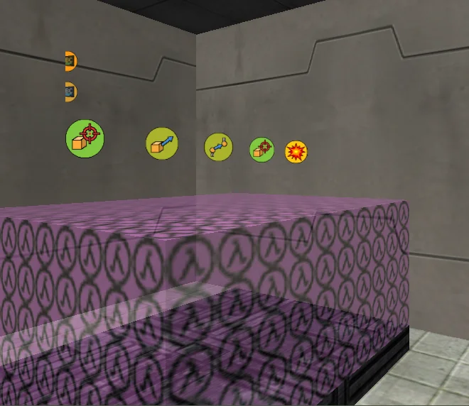
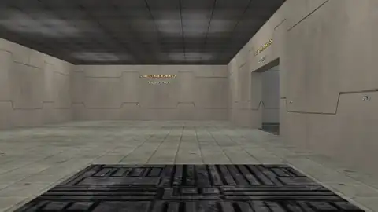

# calc_ entities: working out a value

The `calc_` entities work out a value the moment another entity's [locus key](../mapping/guide/locus.md) names
them, such as a point in front of the player, the direction from one place to another or the player's speed, and you
can chain them. Most entities act when you trigger them, but the `calc_` entities work the other way round: they sit
in the map and do nothing until a key asks them for a value. Because their own keys are locus keys too, each one in a
chain works on the answer of the one before.

The first sections explain how a chain is worked out, followed by five setups you can build one step at a time. If
you haven't used locus keys yet, start with the [Locus guide](locus.md). See
[Locus system](../mapping/guide/locus.md#calculation-entities) for what each `calc_` entity gives.

## How a chain is worked out

When an entity needs a locus key's value, it asks the entity named there, which asks the entities named in its own
keys, and so on down the chain. Nothing is stored on the way, so the game works out the whole chain again each time,
from what the map looks like at that moment.

The whole chain is worked out for one entity, the activator of the trigger that started it, so `*locus` and
`!activator` in a `calc_` entity mean the player who pressed the button, or the entity that touched the trigger.
Most `calc_` keys that name an entity have `*locus` as their default, so if you leave them empty, they work on the
activator.

The one exception is [`calc_subvelocity`](../mapping/entities/calc_subvelocity.md), whose **Scale factor** and
**Add offset** are worked out for its **Entity to use**, not for the activator, so `*locus` in those two keys means
the entity it reads.

If any step of a chain fails, for example because an entity is missing or a number is divided by zero, the whole
value fails, and the entity that asked does nothing that time.

:::tip

With `developer 1` set in the console, the console shows which value was bad.

:::

## Match the value types

Each `calc_` entity gives one type of value: a position, a vector or a number. A key that wants a number must name
an entity that gives a number, and a key that wants a position or a vector must name an entity that gives one of
those. If you mix them up, the value doesn't fail, and you get what any plain entity gives instead: the entity's own
position, a velocity of 0 0 0, or the number 0, which makes this mistake hard to spot.

## How to read the diagrams

In the diagrams, an arrow that points down (or to the right) is a trigger, and an arrow that points up (or to the
left) is a value that goes back to the entity that asked for it. Read the values from the end of the chain back to
the start, which is the order the chain gives its answers in.

## Setup 1: an explosion in front of the player

When a player presses a button, an explosion goes off 200 units in front of their eyes, in the direction they look.

1. Place a [`func_button`](../mapping/entities/func_button.md). Set its **Target** to `boom`
2. Place a `calc_subvelocity`. Set its **Name** to `ahead`
3. Leave **Entity to use** of `ahead` at its default `*locus`
4. Set **Value to calculate from** to "View angles (player)"
5. Set **Scale factor** to `200`
6. Place a [`calc_position`](../mapping/entities/calc_position.md). Set its **Name** to `spot`
7. Leave **Entity to use** of `spot` at `*locus`
8. Set **Position to calculate** to Eyes
9. Set **Add offset** to `ahead`
10. Place an [`env_explosion`](../mapping/entities/env_explosion.md). Set its **Name** to `boom`
11. Set the **Position** of `boom` to `spot`
12. Set the flags **Repeatable** and **No Damage**, so you can test it safely

In game, the explosion asks `spot` for a position, and `spot` takes the player's eye position and adds the vector
from `ahead`: the direction the player looks, made 200 units long.

<Flow caption="spot adds the vector from ahead to the eye position of the player who pressed the button">
  <FlowNode kind="player" name="Player">presses the button</FlowNode>
  <FlowArrow label="triggers boom" />
  <FlowNode cls="env_explosion" name="boom">Position: spot</FlowNode>
  <FlowArrow back label="the eye position + 200 units forward" />
  <FlowNode cls="calc_position" name="spot">Position to calculate: Eyes Add offset: ahead</FlowNode>
  <FlowArrow back label="the view direction, 200 units long" />
  <FlowNode cls="calc_subvelocity" name="ahead">View angles (player) Scale factor: 200</FlowNode>
  <FlowArrow back label="the view direction" />
  <FlowNode kind="player" name="Player">the activator</FlowNode>
</Flow>

## Setup 2: a field that pushes players away from its center

Players who walk into a room are pushed away from the middle of it, from whichever side they come in.

1. Place an [`info_target`](../mapping/entities/info_target.md) in the middle of the room. Set its **Name** to
   `center`
2. Place a [`calc_velocity_path`](../mapping/entities/calc_velocity_path.md). Set its **Name** to `away`
3. Set **Start position** of `away` to `center`
4. Set **Destination** to `*locus`
5. Leave **Destination is** at Position
6. Set **Length calculation** to Normalize, so the vector is 1 unit long and only its direction counts
7. Place a [`trigger_push`](../mapping/entities/trigger_push.md) that fills the room. Set its **Push direction** to
   `away`
8. Set **Speed of push** to `400`

A `trigger_push` works out its locus keys for each entity that touches it, so `*locus` in `away` is the player who
is pushed. In game, the push points from `center` to that player, and **Speed of push** gives it its strength.

<Flow caption="For each player who touches it, the trigger_push asks away for the direction from center to that player">
  <FlowNode kind="player" name="Player">walks into the room</FlowNode>
  <FlowArrow label="touches" />
  <FlowNode cls="trigger_push">Push direction: away Speed of push: 400</FlowNode>
  <FlowArrow back label="the direction from center to the player" />
  <FlowNode cls="calc_velocity_path" name="away">Start position: center Destination: `*locus` Length calculation: Normalize</FlowNode>
  <FlowArrow back label="the player's position" />
  <FlowNode kind="player" name="Player">the toucher</FlowNode>
</Flow>

## Setup 3: a speed trap

A player who moves through a corridor faster than 350 units per second gets a warning on their screen.

1. Place a [`trigger_multiple`](../mapping/entities/trigger_multiple.md) across the corridor. Set its **Target** to
   `check`
2. Set **Delay before reset** of the trigger to `1`
3. Place a [`calc_numfromvec`](../mapping/entities/calc_numfromvec.md). Set its **Name** to `speed`
4. Leave **Vector to use** of `speed` at `*locus`
5. Leave **Vector value is** at Velocity
6. Set **Number to get** to Length
7. Place a [`trigger_compare`](../mapping/entities/trigger_compare.md). Set its **Name** to `check`
8. Set **Base value** of `check` to `speed`
9. Set **Compare value** to `350`
10. Set **Comparison to pass** to Greater
11. Set **Fire on comparison pass** to `warn`
12. Place a [`game_text`](../mapping/entities/game_text.md). Set its **Name** to `warn`
13. Set **Message Text** to `Slow down!`

The player who touches the trigger is the activator, so `speed` reads that player's velocity and gives its length,
which is how fast they move. In game, only that player sees the text, because a `game_text` without the flag **All
Players** shows its text only to the activator.

<Flow caption="check asks speed for a number, and speed gives the length of the player's velocity">
  <FlowNode kind="player" name="Player">runs through the corridor</FlowNode>
  <FlowArrow label="touches, triggers check" />
  <FlowNode cls="trigger_compare" name="check">Base value: speed Compare value: 350 Comparison to pass: Greater</FlowNode>
  <FlowArrow back label="the speed, such as 420" />
  <FlowNode cls="calc_numfromvec" name="speed">Number to get: Length</FlowNode>
  <FlowArrow back label="the player's velocity" />
  <FlowNode kind="player" name="Player">the activator</FlowNode>
</Flow>

## Setup 4: a window that gets more solid as you get hurt

When a player presses a button, a glass window shows how much health they have lost. It is clear at full health and
almost solid when they are nearly dead.

1. Place a [`func_wall`](../mapping/entities/func_wall.md) for the glass. Set its **Name** to `glass`
2. Set **Render Mode** of `glass` to Texture
3. Set **FX Amount** of `glass` to `40`
4. Place a `func_button`. Set its **Target** to `shade`
5. Place a [`calc_ratio`](../mapping/entities/calc_ratio.md). Set its **Name** to `hurt`
6. Leave **Based on number** of `hurt` at `*locus`
7. Set **Transformation** to "Reversed (1-X)"
8. Place an [`env_render`](../mapping/entities/env_render.md). Set its **Name** to `shade`
9. Set **Target** of `shade` to `glass`
10. Set **Render Mode** to Texture
11. Set **FX Amount** to `255`
12. Set **FX Amount factor** to `hurt`

A player read as a number gives their health divided by their maximum health, so a player with 75 of their 100
health gives 0.75, and `hurt` turns that into 1 − 0.75 = 0.25. The `env_render` multiplies its **FX Amount** by that
factor, so in game the window gets an FX Amount of about 64. With a **Fade Time** set on the `env_render`, the window
changes smoothly.

<Flow caption="shade multiplies its FX Amount of 255 by the number from hurt and gives the result to glass">
  <FlowNode kind="player" name="Player">75 of 100 health, presses the button</FlowNode>
  <FlowArrow label="triggers shade" />
  <FlowNode cls="env_render" name="shade">Target: glass FX Amount: 255 FX Amount factor: hurt</FlowNode>
  <FlowArrow back label="0.25" />
  <FlowNode cls="calc_ratio" name="hurt">Transformation: Reversed (1-X)</FlowNode>
  <FlowArrow back label="0.75" />
  <FlowNode kind="player" name="Player">the activator</FlowNode>
</Flow>

## Setup 5: an explosion where the player looks

While a player stands on a platform, an explosion goes off every 2 seconds on the wall they look at. This setup
chains four `calc_` entities to draw a line from the player's eyes, 4000 units long in the direction they look, which
stops at the first wall.

1. Place a `trigger_multiple` on the platform. Set its **Target** to `boom5`
2. Set **Delay before reset** of the trigger to `2`
3. Place a `calc_position`. Set its **Name** to `eyes`
4. Leave **Entity to use** of `eyes` at `*locus`
5. Set **Position to calculate** to Eyes
6. Place a `calc_subvelocity`. Set its **Name** to `aim`
7. Set **Value to calculate from** to "View angles (player)"
8. Set **Scale factor** to `4000`
9. Place a `calc_velocity_path`. Set its **Name** to `ray`
10. Set **Start position** of `ray` to `eyes`
11. Set **Destination** to `aim`
12. Set **Destination is** to Offset
13. Set **Line is blocked by** to Walls
14. Place a `calc_position`. Set its **Name** to `hit`
15. Set **Entity to use** of `hit` to `eyes`
16. Set **Position to calculate** to "Calc Position of the entity"
17. Set **Add offset** to `ray`
18. Place an `env_explosion`. Set its **Name** to `boom5`
19. Set the **Position** of `boom5` to `hit`
20. Set the flag **Repeatable**

`aim` gives the view direction, 4000 units long. `ray` starts at `eyes` and goes along `aim`, but it stops where it
first hits a wall, so it is the vector from the eyes to that wall. `hit` asks `eyes` for its position and adds `ray`,
which gives the point on the wall. In game, the explosion goes off on that point.

<Flow caption="The answers go back down the chain: aim gives a direction, ray cuts it short at the wall, and hit adds it to the eye position">
  <FlowNode kind="player" name="Player">stands on the platform</FlowNode>
  <FlowArrow label="triggers boom5" />
  <FlowNode cls="env_explosion" name="boom5">Position: hit</FlowNode>
  <FlowArrow back label="the point on the wall" />
  <FlowNode cls="calc_position" name="hit">Entity to use: eyes Calc Position of the entity Add offset: ray</FlowNode>
  <FlowArrow back label="the vector from the eyes to the wall" />
  <FlowNode cls="calc_velocity_path" name="ray">Start position: eyes Destination: aim Line is blocked by: Walls</FlowNode>
  <FlowArrow back label="the view direction, 4000 units long" />
  <FlowNode cls="calc_subvelocity" name="aim">View angles (player) Scale factor: 4000</FlowNode>
  <FlowArrow back label="the view direction" />
  <FlowNode kind="player" name="Player">the activator</FlowNode>
</Flow>

*Left to right: `eyes`, `aim`, `ray`, `hit` and `boom5` above the platform's `trigger_multiple`*

*An explosion at the center of the player's view*

## Tips

- Use [`calc_eval_number`](../mapping/entities/calc_eval_number.md) when you need to keep a result. It is the one
  `calc_` entity that also does something when you trigger it: it works out its number and can store it in a
  [`game_number`](../mapping/entities/game_number.md)
- Use [`locus_variable`](../mapping/entities/locus_variable.md) when you need a value from the past, such as where a
  player was a moment ago, because a chain only sees the present
- A [`calc_ratio`](../mapping/entities/calc_ratio.md) adds **Offset by** first and multiplies by **Scale factor**
  after that, so an offset of 1 and a factor of 2 turn 3 into 8, not 7

## Further reading

- [Locus guide](locus.md) - the idea behind locus keys, with six more setups
- [Locus system](../mapping/guide/locus.md) - every rule, and the list of keys that take locus values
- [Entity triggering](../mapping/guide/entity-triggering.md) - `!activator` and the other target keywords
