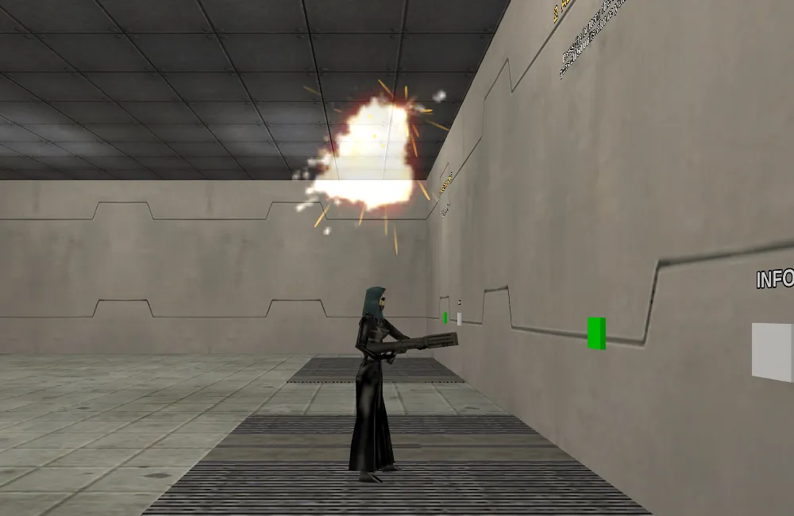
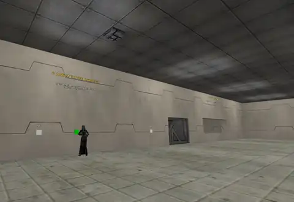

# Locus: passing a position or value between entities

Most entities have fixed settings: an explosion goes off where you put it, and a door opens as far as you set it
to. The locus system lets some keys ask another entity for a value at the moment they need it, so an explosion can
go off wherever the player is standing, or a button can check how much health the player has left.

Below are six small setups you can build one step at a time, each with what happens in game and a diagram of how the
value travels between the entities. See [Locus system](../mapping/guide/locus.md) for every rule, and the
[calc_ entities guide](calc-entities.md) for longer chains.

## The idea

A locus key holds either a fixed value or the name of an entity. If you put a name in it, the game asks that entity
for its value every time it needs one, so the answer can change from one moment to the next.

In the editor, a locus key has a tag at the end of its name that tells you what kind of value it takes:

- **[LP]** - a position, which is a point in the world given as its X Y Z map coordinates, such as `128 0 64`
- **[LV]** - a vector, which is a direction and an amount but not a place, such as `0 0 50` for 50 units straight up
- **[LR]** - a number, such as `5` or `0.5`

:::warning

A value that starts with a digit or a minus sign is a fixed value, and any other value is an entity name. The game
reads `.5` as the name of an entity, so always write `0.5`.

:::

## The activator

Every chain of triggers has an **activator**, which is the entity that started it. When a player presses a button,
they become the activator of everything the button triggers, and of everything those entities trigger in turn.

In a locus key, [`!activator`](../mapping/guide/entity-triggering.md#target-selectors) and `*locus` name the
activator, and `*player` names it only when it is a player. So one setup works for every player, because each
player who presses the button gets their own answer.

## How to read the diagrams

In the diagrams, an arrow that points down (or to the right) is a trigger, and an arrow that points up (or to the
left) is a value that goes back to the entity that asked for it. Each box shows the class name, the entity's name and
the keys you set.

## Setup 1: an explosion where the player stands

When a player presses a button, an explosion goes off where that player stands.

1. Place a [`func_button`](../mapping/entities/func_button.md). Set its **Target** to `boom`
2. Place an [`env_explosion`](../mapping/entities/env_explosion.md). Set its **Name** to `boom`
3. Set the **Position** of `boom` to `!activator`
4. Set the flag **Repeatable** on `boom`, so it works more than once

In game, the button makes the player the activator, and the explosion asks the activator for its position. Each
player who presses the button gets an explosion at their own position.

<Flow caption="The explosion asks the player who pressed the button for a position">
  <FlowNode kind="player" name="Player" />
  <FlowArrow label="presses" />
  <FlowNode cls="func_button">Target: boom</FlowNode>
  <FlowArrow label="triggers boom (activator: the player)" />
  <FlowNode cls="env_explosion" name="boom">Position: !activator</FlowNode>
  <FlowArrow back label="the player's position" />
  <FlowNode kind="player" name="Player">the activator</FlowNode>
</Flow>

## Setup 2: an explosion above the player's head

This time the explosion goes off 50 units above the eyes of the player who presses the button. A
[`calc_position`](../mapping/entities/calc_position.md) works out that point.

1. Place a `func_button`. Set its **Target** to `boom`
2. Place a `calc_position`. Set its **Name** to `overhead`
3. Leave **Entity to use** of `overhead` at its default `*locus`, which is the activator
4. Set **Position to calculate** to Eyes
5. Set **Add offset** to `0 0 50`, which is 50 units up
6. Place an `env_explosion`. Set its **Name** to `boom`
7. Set the **Position** of `boom` to `overhead`
8. Set the flag **Repeatable** on `boom`

In game, the explosion asks `overhead` for a position, and `overhead` asks the player where their eyes are, adds 50
units up and gives the result to the explosion.

<Flow caption="The explosion asks overhead for a position, and overhead reads the eyes of the player who pressed the button">
  <FlowNode kind="player" name="Player">presses the button</FlowNode>
  <FlowArrow label="triggers boom" />
  <FlowNode cls="env_explosion" name="boom">Position: overhead</FlowNode>
  <FlowArrow back label="the eye position + 50 units up" />
  <FlowNode cls="calc_position" name="overhead">Entity to use: `*locus` Position to calculate: Eyes Add offset: 0 0 50</FlowNode>
  <FlowArrow back label="the eye position" />
  <FlowNode kind="player" name="Player">the activator</FlowNode>
</Flow>

*A fireball above the head of the player who pressed the button*

The example map <SdkFile path="sdk/examples/maps/co_example_locus/" /> has setups 1 to 4, one bay each.

## Setup 3: remember where a player came in

A [`locus_variable`](../mapping/entities/locus_variable.md) records a position when you trigger it and gives it back
later. This trap records where the last player came in, and a button sets off an explosion there.

1. Place a [`trigger_multiple`](../mapping/entities/trigger_multiple.md) across the entrance. Set its **Target** to
   `spot`
2. Place a `locus_variable`. Set its **Name** to `spot`
3. Leave the other keys of `spot` at their defaults, so it records the activator's position
4. Place a `func_button` further in. Set its **Target** to `boom`
5. Place an `env_explosion`. Set its **Name** to `boom`
6. Set the **Position** of `boom` to `spot`
7. Set the flag **Repeatable** on `boom`

In game, each player who walks through the entrance triggers `spot`, which records their position at that moment.
When any player presses the button, the explosion goes off where the last player came in.

<Flow caption="Step 1: a player walks in, and spot records their position">
  <FlowNode kind="player" name="Player A">walks through the entrance</FlowNode>
  <FlowArrow label="touches" />
  <FlowNode cls="trigger_multiple">Target: spot</FlowNode>
  <FlowArrow label="triggers spot (activator: player A)" />
  <FlowNode cls="locus_variable" name="spot">records player A's position</FlowNode>
</Flow>

<Flow caption="Step 2: later, a player presses the button, and the explosion asks spot for the position it recorded">
  <FlowNode kind="player" name="Player B">presses the button</FlowNode>
  <FlowArrow label="triggers boom" />
  <FlowNode cls="env_explosion" name="boom">Position: spot</FlowNode>
  <FlowArrow back label="player A's recorded position" />
  <FlowNode cls="locus_variable" name="spot">keeps the position until it records again</FlowNode>
</Flow>

## Setup 4: a healing button that only works when you are hurt

A [`trigger_compare`](../mapping/entities/trigger_compare.md) compares two numbers and triggers a target if the
comparison passes. A player read as a number gives their health divided by their maximum health, so a player with
40 of their 100 health gives 0.4.

1. Place a `func_button`. Set its **Target** to `check`
2. Place a `trigger_compare`. Set its **Name** to `check`
3. Set **Base value** to `!activator`
4. Set **Compare value** to `0.5`
5. Set **Comparison to pass** to Less
6. Set **Fire on comparison pass** to `heal`
7. Place a [`game_player_hurt`](../mapping/entities/game_player_hurt.md). Set its **Name** to `heal`
8. Set **Damage To Apply** to `-25`, because a negative damage heals

In game, a player with less than 50 health who presses the button gets 25 health back. A player with 50 health or
more gets nothing.

<Flow caption="check asks the player for a number. If it is less than 0.5, check triggers heal, which gives the player 25 health">
  <FlowNode kind="player" name="Player">40 of 100 health, presses the button</FlowNode>
  <FlowArrow label="triggers check" />
  <FlowNode cls="trigger_compare" name="check">Base value: !activator Compare value: 0.5 Comparison to pass: Less</FlowNode>
  <FlowArrow back label="0.4" />
  <FlowNode kind="player" name="Player">the activator</FlowNode>
</Flow>

## Setup 5: open a door after five kills

A [`game_number`](../mapping/entities/game_number.md) holds a number until you change it. Here a
[`calc_eval_number`](../mapping/entities/calc_eval_number.md) adds 1 to it at each kill, and a `trigger_compare`
opens the door at 5.

1. Place a [`func_door`](../mapping/entities/func_door.md). Set its **Name** to `gate`
2. Place a `game_number`. Set its **Name** to `kills`
3. Place a `calc_eval_number`. Set its **Name** to `count`
4. Set **First operand** of `count` to `kills`
5. Set **Second operand** to `1`
6. Set **Operation** to Add
7. Set **Store result in** to `kills`
8. Set **Trigger after operation** to `check`
9. Place a `trigger_compare`. Set its **Name** to `check`
10. Set **Base value** of `check` to `kills`
11. Set **Compare value** to `5`
12. Set **Comparison to pass** to Greater or equal
13. Set **Fire on comparison pass** to `gate`
14. On each monster, set **TriggerTarget** to `count`
15. On each monster, set **Trigger Condition** to Death

In game, each death triggers `count`. It reads `kills`, adds 1, stores the result back in `kills` and then triggers
`check`. When `kills` reaches 5, `check` opens the door.

<Flow caption="A monster dies, and count reads kills and stores kills + 1 back in it">
  <FlowNode name="Monster">dies</FlowNode>
  <FlowArrow label="triggers count" />
  <FlowNode cls="calc_eval_number" name="count">kills + 1 Store result in: kills</FlowNode>
  <FlowArrow back label="4, the number kills holds" />
  <FlowNode cls="game_number" name="kills">4, then 5 after count stores the result</FlowNode>
</Flow>

<Flow caption="Then count triggers check, which reads kills. 5 is greater than or equal to 5, so check opens gate">
  <FlowNode cls="calc_eval_number" name="count">Trigger after operation: check</FlowNode>
  <FlowArrow label="triggers check" />
  <FlowNode cls="trigger_compare" name="check">Base value: kills Compare value: 5 Fire on comparison pass: gate</FlowNode>
  <FlowArrow back label="5" />
  <FlowNode cls="game_number" name="kills">5</FlowNode>
</Flow>

:::info

A `game_number` doesn't trigger anything when its number changes, which is why `count` triggers the check.

:::

## Setup 6: a beam that follows the player

A [`locus_beam`](../mapping/entities/locus_beam.md) makes a beam each time you trigger it. If one end is an entity,
the beam follows that entity while it moves.

1. Place an [`info_target`](../mapping/entities/info_target.md) in the ceiling. Set its **Name** to `zapper`
2. Place a `func_button`. Set its **Target** to `tether`
3. Place a `locus_beam`. Set its **Name** to `tether`
4. Set **Start & End are** to "Position & Entity"
5. Set **Start at** to `zapper`
6. Leave **End at** at its default `*locus`, which is the activator
7. Set **Brightness** to `255`
8. Set **Color** to `0 128 255`
9. Set **Width** to `20`
10. Set **Duration** to `3`
11. Set the flag **End sparks**

In game, a blue beam runs from the ceiling to the player who pressed the button. It follows that player for 3
seconds, and sparks fly where it touches them.

<Flow caption="The beam starts at the position of zapper and ends on the player who pressed the button">
  <FlowNode kind="player" name="Player">presses the button</FlowNode>
  <FlowArrow label="triggers tether" />
  <FlowNode cls="locus_beam" name="tether">Start at: zapper End at: `*locus`</FlowNode>
  <FlowArrow back label="the start position" />
  <FlowNode cls="info_target" name="zapper">in the ceiling</FlowNode>
</Flow>

*A beam that follows the player who pressed the button*

## If nothing happens

If a key names an entity that doesn't exist, or a `calc_` entity can't work out its value, the entity that asked
does nothing that time.

:::tip

With `developer 1` set in the console, the console shows which value was bad, such as
`env_explosion "boom" has bad or missing [LP] value "spot"`.

:::

## Further reading

- [Locus system](../mapping/guide/locus.md) - every rule, what each entity gives and the keys that take locus values
- [calc_ entities guide](calc-entities.md) - setups that chain `calc_` entities
- [Entity triggering](../mapping/guide/entity-triggering.md) - names ending in `*`, `!activator` and `!caller`
- [Trigger modes](../mapping/guide/trigger-modes.md) - On, Off, Toggle and Set
