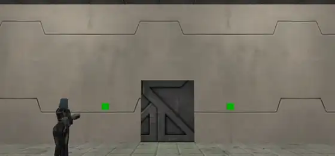

# Masters and multisource: locking entities

A master locks other entities, so a door, a button or a trigger with a **Master** only works while that master is
on, and the setups below show how to build power switches, key doors, alarms and exits that open once every Fed is
dead. While the master is off, the entity ignores players and triggers, and a locked button plays its locked sound.
The master itself never triggers the entities it locks, so nothing happens at the moment a master turns on, and the
locked entity simply works the next time someone uses it.

The first sections explain the masters you can use, followed by seven small setups you can build. See
[Masters and states](../mapping/guide/masters-and-states.md) for the full rules.

## The masters

To lock an entity, put the master's name in that entity's **Master** key. These entities can be masters:

- [`multisource`](../mapping/entities/multisource.md) - on while every entity that targets it has switched its
  input on
- [`env_state`](../mapping/entities/env_state.md) - on and off like a switch, flipped with triggers
- [`calc_state`](../mapping/entities/calc_state.md) - combines two other masters with AND, OR and the other logic
  operations
- [`trigger_compare`](../mapping/entities/trigger_compare.md) - on while its comparison of two numbers passes
- [`player_hasweapon`](../mapping/entities/player_hasweapon.md) - on while the activator carries a weapon
- [`player_hasinventory`](../mapping/entities/player_hasinventory.md) - on while the activator carries an item
- [`env_global`](../mapping/entities/env_global.md) with the flag **Act as Master** - on while its global state is On
- [`multi_watcher`](../mapping/entities/multi_watcher.md) - on while the states of the entities it watches pass its
  logical test, such as "all of these doors are closed"
- [`watcher_count`](../mapping/entities/watcher_count.md) - on while the number of entities of one name that aren't
  off passes its comparison, such as "no Fed is left alive"

Some masters give a different answer for each player, because they check the activator, which is the player who
uses the locked entity. For example, a `player_hasweapon` master opens a door for one player and keeps it shut for
another.

A `~` in front of the name makes the master work the other way round, so an entity with the master `~alarm` works
while `alarm` is off.

## How a multisource counts its inputs

A [`multisource`](../mapping/entities/multisource.md) is the master from Half-Life. Its inputs are the entities whose
**Target** is the name of the multisource, and the multisource finds them right after the map starts, up to 32 of
them. A [`multi_manager`](../mapping/entities/multi_manager.md) that lists the multisource as one of its targets is
an input too.

Each input is either on or off, and each time an input triggers the multisource, that input flips. The use type
doesn't matter, because On, Off and Toggle all flip the input. The multisource is on while all of its inputs are on,
and at the moment the last input turns on, it also fires its own **Target**.

This has two results you must know about:

- If an input fires twice, it is off again, so a button that someone presses twice undoes its own press. Set the
  **delay before reset** of each input button to `-1`, so it fires only once, or make the inputs fire once in a
  different way
- When the multisource fires its **Target**, there is no activator, so `!activator` finds nothing in the entities it
  triggers

If you set **Global State Master**, the multisource also needs that [global state](../mapping/entities/env_global.md)
to be On before it counts as on.

## Setup 1: a door that needs two buttons

A door only opens after players have pressed two buttons, in any order.

1. Make two [`func_button`](../mapping/entities/func_button.md) entities
2. Set **Target** to `both` on each button
3. Set **delay before reset** to `-1` on each button, so each one stays pressed and fires only once
4. Make a `multisource` named `both`, with **Target** set to `door1`
5. Make a [`func_door`](../mapping/entities/func_door.md) named `door1`

*A door that opens once both buttons are pressed*

When the second button is pressed, both inputs are on, and the multisource fires the door. If you want players to
open the door themselves, leave the **Target** of the multisource empty and set **Master** to `both` on the door.
The door then stays locked until both buttons are pressed.

## Setup 2: power for a lift

A lift button only works after a player has switched the power on.

1. Make a `func_button` for the power switch, with **Target** set to `power` and **delay before reset** set to `-1`
2. Make an [`env_state`](../mapping/entities/env_state.md) named `power`
3. Make a `func_button` for the lift, with **Master** set to `power` and **Target** set to the name of the lift
4. Choose a **Locked Sound** for the lift button

Before the power is on, the lift button plays its locked sound and does nothing. The power switch sends Toggle to
`power`, which turns it on, and from then on the lift button works.

To make the power fail again later, trigger `power` with Off, for example from a
[`trigger_relay`](../mapping/entities/trigger_relay.md) whose **Trigger State** is Off.

## Setup 3: a door that locks while the alarm is on

A security door works normally, but while the alarm is on, it stays shut.

1. Make an `env_state` named `alarm`, and turn it on and off from your map
2. Make a `func_door` with **Master** set to `~alarm`

The `~` turns the master around, so the door works while `alarm` is off and is locked while `alarm` is on. The
master only decides if the door reacts when someone uses it, so the alarm doesn't close a door that is already open.

## Setup 4: either of two keys opens the vault

A vault opens if players have found the red key or the blue key, and one of them is enough.

1. Make two `env_state` entities named `red` and `blue`
2. Turn `red` on when a player finds the red key, and turn `blue` on when a player finds the blue key
3. Make a [`calc_state`](../mapping/entities/calc_state.md) named `either`, with **Operand 1** set to `red`,
   **Operand 2** set to `blue` and **Operation** set to OR
4. Set **Master** to `either` on the `func_button` of the vault

<Flow caption="The vault button asks either if it is on, and either asks the two env_state entities">
  <FlowNode kind="player">Player</FlowNode>
  <FlowArrow label="presses" />
  <FlowNode cls="func_button">Master: either</FlowNode>
  <FlowArrow back label="on or off" />
  <FlowNode cls="calc_state" name="either">Operation: OR</FlowNode>
  <FlowArrow back label="the states of both" />
  <FlowNode cls="env_state" name="red and blue" />
</Flow>

A `calc_state` works out its result each time a locked entity asks, so the vault button works as soon as one of the
two keys is found. With **Operation** AND, players need both keys, and with XOR, they need exactly one of them.

## Setup 5: only players with a medikit can open the infirmary

1. Make a [`player_hasweapon`](../mapping/entities/player_hasweapon.md) named `medic`, with **Weapon classname** set
   to `weapon_medikit`
2. Make a `func_button` for the infirmary, with **Master** set to `medic` and **Target** set to the name of the door

The button asks `medic` about the player who presses it, so it works for a player who carries the medikit and plays
its locked sound for all other players.

## States: masters that watch other entities

Every entity is in a state: On, Off, Turn On, Turn Off or In Use. For example, a door is On while it is open and Turn
On while it opens, a monster is On while it is alive, and a light is On while it is lit. See
[Entity states](../mapping/guide/masters-and-states.md#entity-states) for the states of every entity.

A [`multi_watcher`](../mapping/entities/multi_watcher.md) and a
[`watcher_count`](../mapping/entities/watcher_count.md) read these states, so they see when a door opens or the last
monster dies without the door or the monster having to trigger anything. Both are masters, and both can also fire
targets when their result changes. The other masters and the **Master** key don't read states.

### Setup 6: a lamp that shows when both doors are closed

1. Make two [`func_door`](../mapping/entities/func_door.md) entities named `door_a` and `door_b`
2. Make a [`light`](../mapping/entities/light.md) named `lamp`, with the flag **Initially dark**
3. Make a `multi_watcher`, with **Logical test** set to "None (NOR)" and **Entity to notify** set to `lamp`
4. Set the flags **'Turn On'** (32) and **'Turn Off'** (64) on the `multi_watcher`
5. Turn SmartEdit off and give the `multi_watcher` the keys `door_a` and `door_b`, each with the value `0`

"None (NOR)" is true while no door is On. A door that opens or closes isn't On either, so without the two flags,
the lamp would light while a door moves. With the flags, Turn On and Turn Off count too, so the lamp is lit only
while both doors are fully closed. The watcher sends On to the lamp when the test becomes true, and Off when it
becomes false.

### Setup 7: the exit opens when every Fed is dead

1. Give all your [`monster_human_grunt`](../mapping/entities/monster_human_grunt.md) entities the name `feds`
2. Make a `watcher_count` named `cleared`, with **Count entities named...** set to `feds` and **Comparison number**
   set to `0`
3. Set **Type of comparison** to "'On' when count = number" on `cleared`
4. Set **Fire on turning on** to the name of the exit door on `cleared`

A Fed counts while it is alive or dying, so when the last Fed has died, the count is 0 and the door opens. You can
also set **Master** to `cleared` on the button of the exit, so players can only open the exit themselves when the
area is clear. **Fire when count decreases** fires each time a Fed dies, for example to play a sound.

## Finding out why something stays locked

- If a master's name matches no entity, or an entity that can't be a master, the entity isn't locked at all, and
  with `developer 1` set in the console, the console shows `Master was null or not a master!`
- For an [`env_global`](../mapping/entities/env_global.md) master, the **Master** key needs the name of the
  `env_global`, not the name of its global state
- An `env_state` or a `calc_state` with the flag **Debug Mode** shows each trigger it gets and each result it works
  out, with `developer 1` set in the console

## Further reading

- [Masters and states](../mapping/guide/masters-and-states.md) - every master and its keys
- [Trigger modes](../mapping/guide/trigger-modes.md) - On, Off, Toggle and Set
- [Round hooks](../mapping/guide/round-hooks.md) - putting an `env_state` back at each round start
- [Entity states](../mapping/guide/masters-and-states.md#entity-states) - the states of every entity
