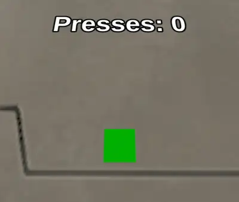

# Changing values: trigger_changevalue, trigger_copyvalue and trigger_condition

Three entities let you read and change other entities' settings while the map runs, so you can count, keep score,
change a monster or a sign, and react when a value passes a limit. Without them, most entities keep the settings you
gave them in the editor for the whole map:

- [`trigger_changevalue`](../mapping/entities/trigger_changevalue.md) writes a new value into a key of another entity
- [`trigger_copyvalue`](../mapping/entities/trigger_copyvalue.md) copies a key from one entity to another
- [`trigger_condition`](../mapping/entities/trigger_condition.md) checks a key and fires a target when the check is
  true or false

The first two sections cover what you must know, followed by four small setups you can build. See
[Changing keys](../mapping/guide/changing-keys.md) for the full rules.

## You work with key names

These entities don't use the names the editor shows, but the key names behind them, so you write `health` and not
**Health**, and `message` and not **Entity Message**. To see an entity's key names in J.A.C.K., turn off SmartEdit in
its properties, and the list then shows each key as the map stores it.

You can also make up keys of your own, called [custom keys](../mapping/guide/entity-keyvalues.md#custom-keys), which
work like variables. A custom key's name starts with `$i_` for a whole number, `$f_` for a number with
decimals, `$v_` for three numbers and `$s_` for text, such as `$i_presses`. You can give a custom key to any entity,
and an [`info_target`](../mapping/entities/info_target.md) is a good place to keep them, because it does nothing
else. Give each custom key a start value in the editor, with SmartEdit off, so the first change has a value to work
on.

## Not every key changes what you see

A key the entity reads each time it uses it changes the entity at once, which is true for `health`, `rendercolor`,
`renderamt`, `target`, `message`, `speed` and many more. For example, if you change a door's `target`, the door fires
the new target the next time it opens. If an entity only reads a key when it spawns, such as a door's `lip`, a change
sets the stored value but doesn't change what the entity does.

The entities refuse the `model` key and the sound keys, because the game can't load a new file while the map runs,
and they also refuse `classname`. See [What can change](../mapping/guide/changing-keys.md#what-can-change) for the
full list.

## Setup 1: a sign that counts button presses

A sign above a button shows how often players have pressed it, for example "Presses: 3".

1. Make an `info_target` named `counter`
2. Turn SmartEdit off and give `counter` the custom key `$i_presses` with the value `0`
3. Make a [`point_worldtext`](../mapping/entities/point_worldtext.md) named `sign`, with **Entity Message** set to
   `Presses: 0`
4. Make a [`func_button`](../mapping/entities/func_button.md) with **Target** set to `add`
5. Make a `trigger_changevalue` named `add`, with **Destination entity** set to `counter`, **Key name** set to
   `$i_presses` and **New value** set to `1`
6. Set **Type of value** to "Add" and **Trigger after operation** to `label` on `add`
7. Make a `trigger_changevalue` named `label`, with **Destination entity** set to `sign`, **Key name** set to
   `message` and **New value** set to `Presses:`
8. Set **Type of value** to "Replace", **Append spaces** to `1` and **Trigger after operation** to `show` on `label`
9. Make a `trigger_copyvalue` named `show`, with **Source entity** set to `counter` and **Source key** set to
   `$i_presses`
10. Set **Destination entity** to `sign`, **Destination key** to `message` and **Type of value** to "Append" on
    `show`

<Flow caption="Each press adds 1 to the count, and then two entities write the new text on the sign">
  <FlowNode cls="func_button">Target: add</FlowNode>
  <FlowArrow label="triggers" />
  <FlowNode cls="trigger_changevalue" name="add">adds 1 to $i_presses of counter</FlowNode>
  <FlowArrow label="triggers" />
  <FlowNode cls="trigger_changevalue" name="label">writes Presses: on sign</FlowNode>
  <FlowArrow label="triggers" />
  <FlowNode cls="trigger_copyvalue" name="show">adds $i_presses of counter to the end of the sign text</FlowNode>
</Flow>

Each press adds 1 to `$i_presses`, then `label` writes "Presses: " back onto the sign (with the space from **Append
spaces**), and `show` adds the count to the end of the text. Every player sees the new text at once.

*A sign that counts each press of a button*

## Setup 2: a boss that can't die until the generator is destroyed

A Cyber Minotaur takes damage as usual, but it can't die while its power generator stands.

1. Make a [`monster_cyberminotor`](../mapping/entities/monster_cyberminotor.md) named `boss`, with **Unkillable** set
   to "Yes"
2. Make a [`func_breakable`](../mapping/entities/func_breakable.md) for the generator, with **Target** set to `weaken`
3. Make a `trigger_changevalue` named `weaken`, with **Destination entity** set to `boss`, **Key name** set to
   `unkillable`, **New value** set to `0` and **Type of value** set to "Replace"

While **Unkillable** is on, damage never takes the boss below 1 health. When the generator breaks, it fires `weaken`,
which turns the key off, so the next hit can kill the boss.

## Setup 3: a door that opens when the boss is badly hurt

When the boss from Setup 2 has less than 500 health left, a door to the escape route opens.

1. Make a `trigger_condition`, with **Monitored entity** set to `boss`, **Monitored key** set to `health` and
   **Compare-value** set to `500`
2. Set **Comparator** to "\< (Less)" and **Target for 'true'-case** to the name of the door
3. Set **In constant mode fire when** to "Result has changed"
4. Make a [`func_door`](../mapping/entities/func_door.md) for the escape route, with the flag **Toggle**, so it stays
   open

A `trigger_condition` is on from the start of the map, unless you set **Start Off**. It checks the key every **Check
interval** seconds, which is 0.1 by default. With "Result has changed", it only fires when the result changes from
false to true or back, so the door opens once, at the moment the boss's health drops below 500.

## Setup 4: a light that follows a train

A glowing sprite moves with a [`func_train`](../mapping/entities/func_train.md), but it isn't part of the train.

1. Make a `func_train` named `cart`, with an origin brush in its middle, which is the point the train moves along its
   path and the point the sprite goes to
2. Make an [`env_sprite`](../mapping/entities/env_sprite.md) named `lamp`
3. Make a `trigger_copyvalue`, with **Source entity** set to `cart`, **Source key** set to `origin`, **Destination
   entity** set to `lamp` and **Destination key** set to `origin`
4. Set **Copy interval** to `0` and the flags **Constant** and **Start on** on the `trigger_copyvalue`

With **Constant** and **Start on**, the `trigger_copyvalue` copies the train's position to the sprite from the start
of the map, and with a **Copy interval** of 0, it copies every frame.

## Things to watch for

- If the monitored entity or the monitored key of a `trigger_condition` is empty, it removes itself at its first
  check, and with `developer 1` set in the console, the console shows a message
- A `trigger_condition` passes itself on as the activator, unless you set its flag **Keep activator**
- In constant mode with "Result has changed", the first check counts the last result as true, so a first result that
  is true fires nothing, and a first result that is false fires the false target at once. Set **Ignore initial
  result** if you don't want the first check to fire
- A division by zero leaves the key as it was, and with `developer 1` set in the console, the console shows a message
- A `trigger_copyvalue` without **Multiple destinations** only writes to the first entity with the destination name

## Further reading

- [Changing keys](../mapping/guide/changing-keys.md) - every key, operation and flag of these entities
- [Entity keyvalues](../mapping/guide/entity-keyvalues.md) - key names and custom keys
- [Locus guide](locus.md) - asking another entity for a value at the moment you need it
