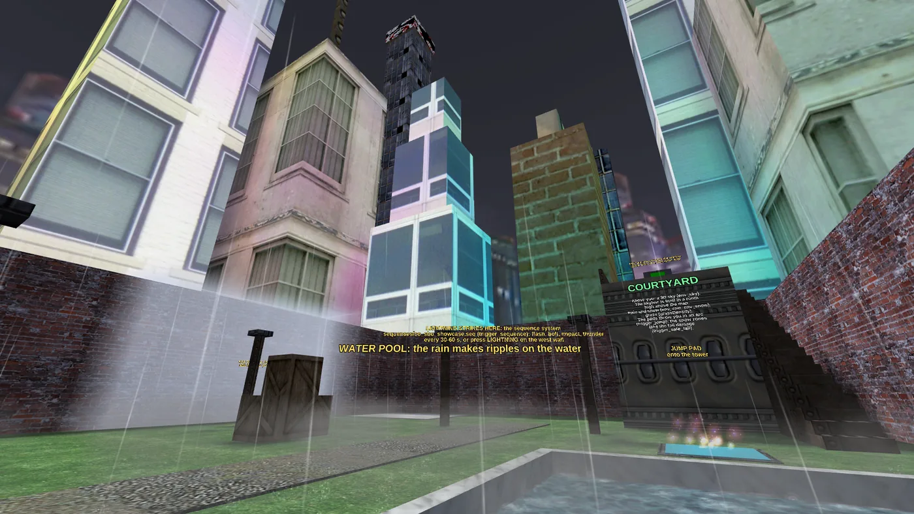

# Welcome

Syndicate Black Ops (SBO) is a multiplayer mod for Half-Life, and these pages cover how to play it, how to run a
server for it and how to make your own maps for it. SBO 2.0.0 rebuilt large parts of the game, with completely
revamped menus, a chat reimplemented in VGUI2, native Linux support, an in-game updater, a long list of bug fixes,
and many new entities and features for level designers.

## What is Syndicate Black Ops?

SBO was made by [Streumon Studio](https://streumon-studio.com/) in 2004. [MrCalvin](https://sbotnas.io) decompiled the
original mod and continues to add bug fixes, new features, and improve documentation for players, level designers, and
content creators. See [Downloading & Installing](playing/installing.md) to get started.

The [Syndicate Black Ops fan site](https://syndicateblackops.neocities.org/) has community news, screenshots, media and the servers.

<SboVersion />

*A courtyard in the rain, with the 3D skyline behind it*

## Sections

| Section | What you find there |
|---|---|
| [Playing](playing/installing.md) | How to install the game, the controls, your loadout, the weapons and items, the HUD, chat, spectating, the menus and the options |
| [Game modes](game-modes/index.md) | How Co-op, Battle Royale and Bounty Killer work, with their rounds, scores, XP and levels |
| [Server setup](server/index.md) | The game's server settings, its files and the lines it writes to the log |
| [Mapping](mapping/getting-started/editor-setup.md) | How to set up J.A.C.K. and compile a map, the map basics, the entity guide, the map features and a page for every entity |
| [Guides](guides/locus.md) | Short tutorials with small setups you can build, for the locus system, the calc_ entities, masters and the value triggers |
| [Changelog](changelog/index.md) | What each SBO release changes for players, server operators and mappers, newest release first |
| [What's New](/posts) | News about releases and the docs |
| [Credits](credits.md) | The projects SBO takes code and features from |

## Ported features

When a page or a key comes from another project, it shows that project's icon, for example [[ported:featureful]].
Hover over the icon to see the project's name, or click it to open the project's page.
