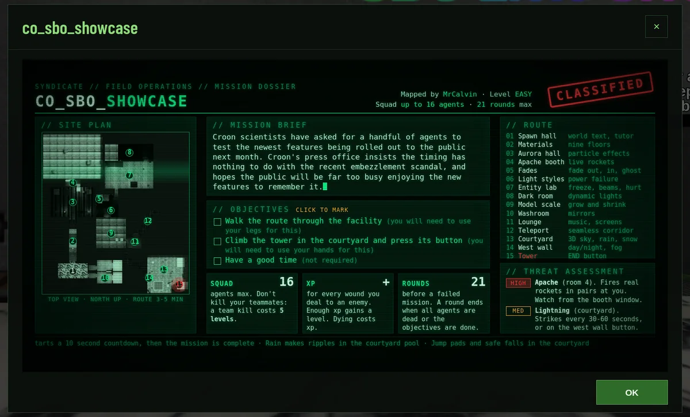

# Briefing

A map's briefing is the text or web page players read in the map briefing window when they join, before they choose
their loadout. It is a text file in `maps/` with the same name as the map, or a web page with its own pictures and
styles.

## The file

| Map | Briefing |
|---|---|
| `maps/co_mymap.bsp` | `maps/co_mymap.txt`, the plain text |
| | `maps/co_mymap.htm`, a web page, if you want one |

The game reads the text file as UTF-8 if it is valid UTF-8, and as Latin-1 if it isn't. A map without a `.txt` file
shows **No description for this map**. The briefing doesn't download automatically, players only get it if you list
it in the map's `.res` file. See [Custom content](custom-content.md) for more details.

The game doesn't read any settings from the briefing, so the round count, the difficulty and the player count in it
are only text for the players. The round count of a Co-op map comes from its [`max_round`](../entities/max_round.md)
entity. See [Co-op](../../game-modes/coop.md#number-of-rounds) for more details.

## Where players see it

Players see the briefing in these places:

- The map briefing window, which opens after the message of the day (its **Go!** button opens the loadout menu).
  Players can open it again at any time with the map briefing key (Default: <kbd>B</kbd>)
- The **Map Briefing** window in the spectator menu
- The **About this map** panel of the [joining screen](../../playing/menus.md#joining-screen), which shows the `.txt` file when the
  player already has it

## Web page briefing

If you put a file `maps/<map>.htm` next to the `.txt` file, players see the web page instead of the text. The
extension must be the three-letter `.htm`, because players only download files with a three-letter extension, so a
`.html` file never reaches them.



*A web page briefing in the Map Briefing window*

The page loads its pictures and style sheets from `maps/`, next to the page, so `` loads
`maps/co_mymap_1.png`. The page and each of its pictures only download if you list them in the map's `.res` file.

Players who show web pages as text with [`cl_disablehtmlmotd`](../../playing/options.md#player-cvars), and players
who play without Steam running, see the `.txt` file instead, so keep a `.txt` file next to the page. A map with a
`.htm` file and no `.txt` file shows **No description for this map** to those players.

## The stock briefings

Most stock SBO briefings have the same layout: the author, the difficulty (such as EASY, MEDIUM, HARD or VERY HARD),
a short story, the mission objectives, the rules of the game mode, the number of rounds, and the maximum number of
players. This is part of the showcase map's briefing:

```text
Mapped by MrCalvin

Level of the map : EASY

Croon scientists have asked for a handful of agents to test the newest features ...

Mission:

- Walk the route through the facility (you will need to use your legs for this)

- Climb the tower in the courtyard and press its button (you will need to use your hands for this)

- Have a good time (not required)

You are in operation, don't kill your teammates.
...
The round will be finished when all the players are dead or when the objectives of the
mission are accomplished.

Maximum number of rounds before a failed mission : 21

Experience System :
-You gain xp points each time you wound an enemy.
-When you have a sufficient number of xp points, you gain a level.
-When you die, you lose xp points.
-If you kill a fellow-member, you lose 5 levels.

Max players : 16
```

## Changes since 1.38

- A map can have an HTML briefing, `maps/<map>.htm`

## See also

- [Map briefing window](../../playing/menus.md#map-briefing) - what players see
- [Custom content](custom-content.md) - how players download the briefing and its pictures
- [Map names and spawns](map-names-and-spawns.md) - how the map name sets the game mode
- [Co-op](../../game-modes/coop.md) - rounds and missions
