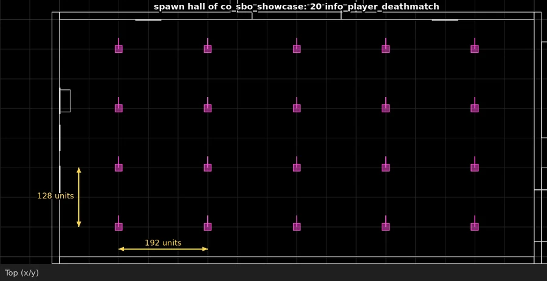

# Map names and spawns

The start of a map's file name sets its game mode, and its spawn points decide where players spawn. As players make
progress, a Co-op map can move the spawn forward through up to five spawn zones, or switch between named spawn sets
in any order.

## Map name prefixes

The game reads the map name when the map loads, no key sets the mode.

| Prefix | Game mode |
|---|---|
| `co_` | [Co-op](../../game-modes/coop.md), where all players form one team against the monsters and play in rounds until the mission succeeds or fails |
| `br_` | [Battle Royale](../../game-modes/battle-royale.md), where every player fights every other player in rounds and the last player alive wins the round |
| `bk_` | [Bounty Killer](../../game-modes/bounty-killer.md), where one player is the Hunted and every other player hunts them |

The prefix must be in lower case, and most other names, such as `mymap` or `CO_mymap`, also play as Bounty Killer.

## Spawn points

In every game mode, players spawn at [`info_player_deathmatch`](../entities/info_player_deathmatch.md) entities.
The game starts at a random spawn point of the active zone and takes the first free one from there, a spot with no
other player within 128 units of it. If no spawn point is free, the player spawns at one anyway.

A few more rules decide which spawn points the game uses:

- It skips a spawn point that is at the center of the map, `0 0 0`
- It uses a spawn point with a **Master** only while that [master](../guide/masters-and-states.md) is on
- If the active zone has no spawn point at all, players spawn at an
  [`info_player_start`](../entities/info_player_start.md)

When a player spawns at a spawn point, the spawn point triggers its **Target** with that player as the
[activator](../guide/entity-triggering.md), so you can show a message or start an event each time a player spawns.

## Spawn zones

A Co-op map can have up to five spawn zones, and each zone has its own class of spawn point:

| Zone | Spawn point class |
|---|---|
| 1 | [`info_player_deathmatch`](../entities/info_player_deathmatch.md) |
| 2 | [`info_player_go2`](../entities/info_player_go2.md) |
| 3 | [`info_player_go3`](../entities/info_player_go3.md) |
| 4 | [`info_player_go4`](../entities/info_player_go4.md) |
| 5 | [`info_player_go5`](../entities/info_player_go5.md) |

Zone 1 is active when the map loads. Each time you trigger a [`multispawn`](../entities/multispawn.md), the next
zone becomes active, up to zone 5, which then stays active (a `multispawn` with a **Master** only works while its
master is on). Players spawn in the new zone from the next round, and players already in the round stay where they
are. A new round doesn't reset the zone, so once a zone is active, it stays active for the rest of the map.

In Battle Royale and Bounty Killer, `multispawn` does nothing and players always spawn in zone 1.

*Spawn points in a grid, seen from above*

## Spawn sets

If five zones in a fixed order aren't enough, you can give spawn points a **Name** to put them in a spawn set. You
can make as many sets as you want, and a set can have points of all five spawn point classes. Give a
[`multispawn`](../entities/multispawn.md) that name as its **Spawn set**, and when you trigger it, that set becomes
the active set and players only spawn at its points from the next round. With one `multispawn` for each set, you can
switch between the sets in any order, for example back to an earlier checkpoint when the players lose an area.

A few rules decide how sets and zones work together:

- A `multispawn` with a **Spawn set** doesn't move the zone. A `multispawn` without a **Spawn set** moves the zone
  forward and ends the named set, so players spawn in the zone again
- While no set is active, players don't spawn at an `info_player_deathmatch` with a name, because it only belongs to
  its set, unless every `info_player_deathmatch` on the map has a name. A named `info_player_go2` to
  `info_player_go5` is still used in its zone
- If no spawn point has the name in **Spawn set**, players spawn in the active zone, and with `developer 1` set in
  the console, a message says so
- A new round keeps the active set, and every map starts with no set active
- [`trigger_changevalue`](../entities/trigger_changevalue.md) can change the **Spawn set** of a `multispawn` while
  the map runs, so one `multispawn` can send the players to different sets

## See also

- [Co-op](../../game-modes/coop.md) - rounds, missions and the other Co-op rules
- [`info_player_deathmatch`](../entities/info_player_deathmatch.md) - the spawn point of zone 1
- [`multispawn`](../entities/multispawn.md) - moves the spawn on to the next zone or to a named spawn set
- [`info_player_start`](../entities/info_player_start.md) - where players spawn when a zone has no spawn point
- [Briefing](briefing.md) - the text that players read before they spawn
