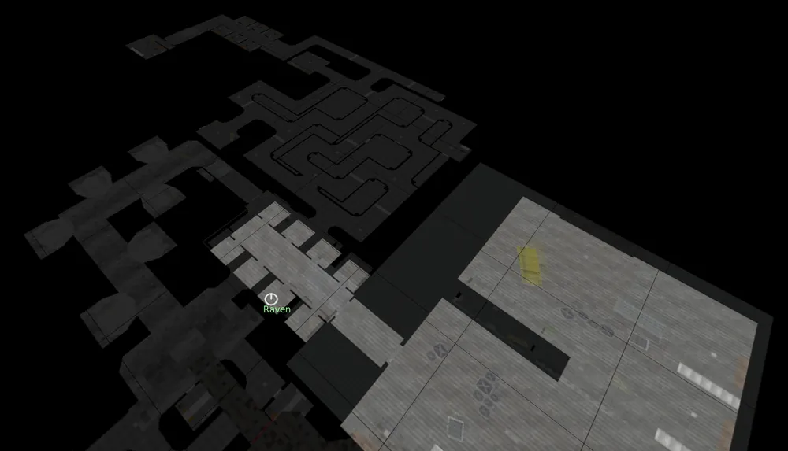

# Overviews

An overview is a top-down picture of your map that spectators see in the map overview modes and the
picture-in-picture inset, with up to 8 layers so each floor of a building can have its own picture. It is made of a
text file in `overviews/`, which says where the picture is in the map, and one image for each layer.

## The files

| File | What it is |
|---|---|
| `overviews/<map>.txt` | The overview file, which says where the picture is in the map and lists its layers |
| The images the overview file names | One image for each layer, as an 8-bit `.bmp` or a 24-bit or 32-bit `.tga` |

If a map has no overview file, the game uses default values, and with `developer 1` set in the console, the console
shows `Couldn't open file overviews/<map>.txt. Using default values for overiew mode.` The overview files and images
don't download automatically, so list them in the map's `.res` file. See [Custom content](custom-content.md) for more
details.

## The overview file

The file has one `global` block and one `layer` block for each image. Key names can be in upper or lower case, and
`//` starts a comment. This is the overview file of a map with two floors:

```text
global
{
	ZOOM	1.1548
	ORIGIN	174.00	-868.00	-720.00
	ROTATED	0
}

layer
{
	IMAGE	"overviews/bk_city.tga"
	HEIGHT	72.00
}

layer
{
	IMAGE	"overviews/bk_city_f1.tga"
	HEIGHT	-720.00
}
```

The `global` block places the picture in the map:

| Key | Value |
|---|---|
| `ZOOM` | The scale of the picture. The default is 1 |
| `ORIGIN` | The point in the map, as `x y z`, where the center of the picture is. The default is `0 0 0` |
| `ROTATED` | If you set 1, the picture is turned by 90 degrees. The default is 0 |
| `INSET` | The position and size of the picture-in-picture inset, as `x y width height` in units of a 640 by 480 screen, which the game scales to the real screen. The default is `4 4 240 180` |

Each `layer` block names one image and the height it belongs to:

| Key | Value |
|---|---|
| `IMAGE` | The path of the image, in quotes |
| `HEIGHT` | The height in the map the layer belongs to |

If the file has a key the game doesn't know, the game stops reading the file at that key and only uses what it read
before it. With `developer 1` set in the console, the console shows
`Error parsing overview file <file>. (<key> unkown)`.

## Layers [[ported:xdm]]

A map with several floors has one layer for each floor, up to 8 layers. If the file has more, the game uses the
first 8, and with `developer 1` set in the console, the console says so. The game draws the layers from the lowest
`HEIGHT` to the highest, no matter in which order you write them in the file.

Layers below the watched player's height are solid, and layers at or above that height show on top of them at a
quarter of their opacity, so the spectator always sees the floor the player is on. In the picture-in-picture inset,
the main view's height decides this. A file with only one layer always shows it solid.



*A two-floor overview with the watched player on the lower floor*

If a layer's image doesn't load, the game leaves the layer out and moves the layers after it up, and with
`developer 1` set in the console, the console reports it.

## Changes since 1.38

- An overview file can have up to 8 layers. SBO 1.38 used only one

## See also

- [Spectating](../../playing/spectating.md) - the overview modes and the picture-in-picture inset
- [Custom content](custom-content.md) - how players download the overview files
