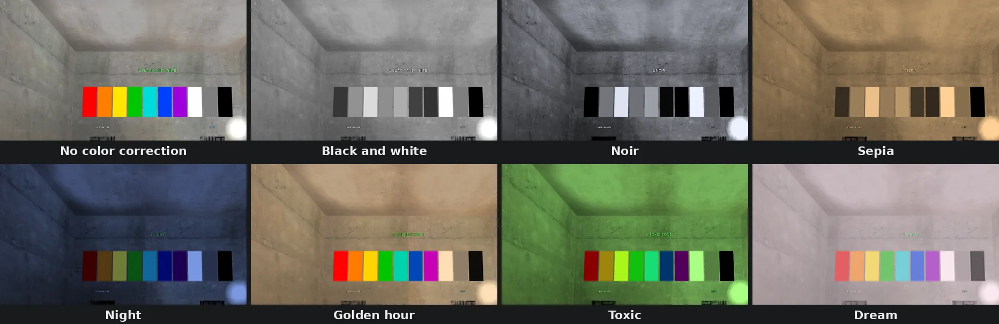
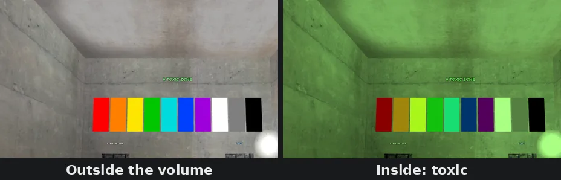
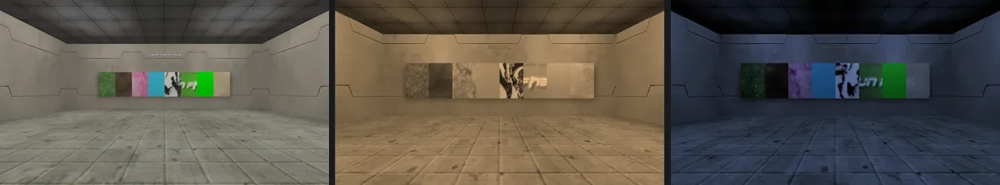
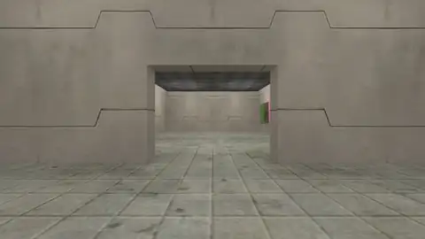
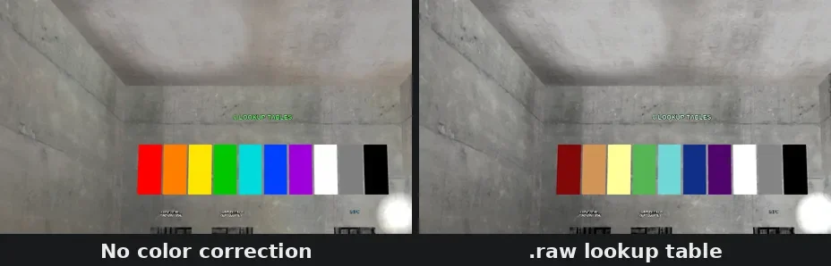
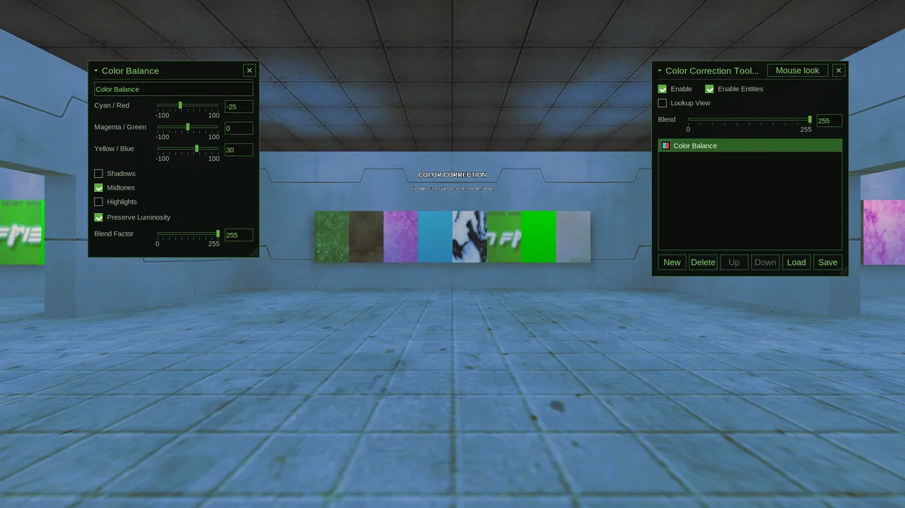

# Color correction

Color correction gives your map its own color grade, such as black and white, sepia, a night look or a toxic green,
for the whole map or inside an area. You set the look with a few simple keys or a lookup table file, as with the
Source entities of the same names, and you can make your own look in-game with the
[color correction editor](#making-a-look-in-the-game). Only the 3D view changes: the HUD, the crosshair, messages,
screen fades, the pictures of an [`env_overlay`](../entities/env_overlay.md) and the menus keep their colors.



*One room without color correction and with seven looks*

| Entity | Where the look applies |
|---|---|
| [`color_correction`](../entities/color_correction.md) | A point entity that changes the whole map, or that gets stronger the nearer the view is to it |
| [`color_correction_volume`](../entities/color_correction_volume.md) | A brush entity that fades in as the view enters the brush and fades out as it leaves |

Each player's game works out the look from where that player's view is, so spectators, the picture-in-picture view
and demos all follow their own camera.

## Simple keys

Both entities have the same look keys: **Saturation**, **Contrast**, **Brightness**, **Gamma**, **Tint Color** and
**Tint Amount**. The game applies them in that order. The looks in the picture above use the values in the table on
the [`color_correction`](../entities/color_correction.md#looks) page. Without a file, and with every look key at its
default, the entity changes nothing.

## Several at once

Every color correction that has some weight at the position of the view counts. Its weight is its **Maximum
Weight**, times its fade, times its distance falloff (a point entity) or its fade in and out (a volume). The game
mixes the four with the most weight. If their weights add up to more than 1, the game scales them down to 1. If they
add up to less than 1, the rest of the weight shows the normal picture. An **Exclusive** color correction with a
weight of W leaves the others only 1 − W of their weight, so it can replace a map-wide look inside its area. A map
can have up to 64 color correction entities, and the game ignores any more than that.



*A color correction volume seen from outside and from inside*



*A hall, a sepia room and a night room, each with the same color wall*



*The look of a volume fading in and out as you walk through it*

The example map <SdkFile path="sdk/examples/maps/co_example_colorcorrection/" /> has a black and white look for the whole map on a
button, and two rooms with a `color_correction_volume` each.

## Lookup table files

A lookup table gives, for each color, the color that it changes into, so it can hold any color grade that an image
editor can make, and you can also make one in the game with the [editor](#making-a-look-in-the-game). You name a file
in `gfx/colorcorrection/` with **Lookup Table File**. The game applies the simple keys after the grade of the table,
and players download the file with the map.

The file must be a `.raw` file in Source's format, which holds 32 x 32 x 32 colors of 3 bytes each for red, green and
blue, with red changing fastest, then green, then blue, so the file is exactly 98,304 bytes. Files from Source games
work as they are. The game reads no other format, because players can only download files whose extension has three
letters.



*One room without color correction and with a .raw lookup table*

If the game can't read a file, the entity uses only its simple keys. With `developer 1` set in the console, the
console says so once.

The SBO source has a small tool, `scripts/colorlut.py`, which makes `.raw` tables. It needs only Python 3:

- `strip` writes a neutral strip image
- `fromstrip` changes a graded copy of that strip into a `.raw` table

Put the strip on a screenshot and grade the screenshot in an image editor. The strip changes in the same way, so when
you cut the strip out again, it holds your grade:

```sh
python3 scripts/colorlut.py strip neutral.png
python3 scripts/colorlut.py fromstrip graded.png gfx/colorcorrection/mylook.raw
```

## Making a look in the game

The game has a version of the Source
[Color Correction Tools](https://developer.valvesoftware.com/wiki/Color_Correction). With it, you can make a look
while you watch your map change, and then save it as a `.raw` file. Type `colorcorrectionui` in the console to open
it. It works in single player, in a game that you host, and on a server that has `sv_cheats 2` set in its console.
`sv_cheats 1`, which turns on the usual [cheats](../getting-started/cheat-commands.md), doesn't open it. Type the
command again to close all of its windows.



*The color correction editor with one operation open*

While a window of the editor is open, the mouse moves a cursor and not your view. Your keyboard still moves you, so
you can walk around while you work. To look around with the mouse and keep the editor open, press **Mouse look** at
the top of the main window, or type `tool_mouselook` in the console. You can bind `tool_mouselook` to a key. While
mouse look is on, a note at the bottom of the screen tells you that <kbd>Esc</kbd> stops it. <kbd>Esc</kbd> then
gives you the cursor back where it was, and the game menu doesn't open.

When you click in a text or number box, your keys go to that box until you press <kbd>Enter</kbd> or <kbd>Esc</kbd>
or click somewhere else. You can drag a slider or type its value into the box next to it. A right click on a slider
sets it back to its default. You can change the size of each window, except the color wheel, with its edges. To fold
a window to its title bar, click the arrow next to the title or double-click the title. The windows remember their
position and size, and they always open unfolded.

The look stays on the view when you close the windows, so you can close them to look around and open them again to
continue. When the map changes, the look goes away until you open the editor again.

The main window has these parts:

- **Enable** - shows your look on the view
- **Enable Entities** - also shows the `color_correction` and `color_correction_volume` entities of the map, mixed
  with your look by weight as [Several at once](#several-at-once) describes. Turn it off to see only your look
- **Lookup View** - shows the lookup table that your look makes, as 32 squares. In each square, red increases to the
  right and green increases downward, and blue increases from one square to the next
- **Blend** - how strongly the view shows your look, from 0 for not at all up to 255 for fully
- **The list of operations** - the steps your look is made of, applied from the top of the list to the bottom

**New** adds an operation after the selected one and opens its window. **Delete** removes the selected operation,
and **Up** and **Down** move it. A double click on an operation opens its window, and a click on its icon turns it
off or on. Each operation has a name that you can change. It also has a **Blend Factor** from 0 to 255, which sets
how much of its result replaces its input. You can choose from these operations:

| Operation | What it does |
|---|---|
| Curves | Changes the brightness curve of all three colors (RGB), or of only red, green or blue. Click on the line to add a point, and drag a point to move it. To remove a point, right-click it or drag it out of the box. **Reset** makes the line straight again |
| Levels | Sets the input black and white points, the gamma of the mid tones and the output black and white points, for all three colors or for one of them, like the Levels tool of an image editor |
| Selected HSV | Changes the hue, saturation and value of the colors near one color. To pick that color, press **Select** and click on the screen, or click on the picture of your view in the window. You can also click the color box and choose the color on a color wheel. **Select Nearby RGB** picks colors that are close to it, and **Select Nearby Hue** picks colors of a similar hue. Each color up to **Tolerance** away changes fully, and after that, the change fades out over **Fuzziness**. **Colorize** gives the selected colors one hue, and **Invert Selection** changes every color except the selected ones. The picture shows the selected colors at full brightness and the other colors darker |
| Color Balance | Moves the colors toward cyan or red, magenta or green, and yellow or blue, separately for the **Shadows**, **Midtones** and **Highlights**. **Preserve Luminosity** keeps how light each color is |
| Lookup | Uses a `.raw` file from `gfx/colorcorrection/` as a step, for example a look you saved earlier that you want to build on. **Reload** reads the list of files again |

**Save** asks for a name of up to 39 characters: the letters a to z, digits, `_` and `-`. It saves the name in
lower case. It writes your look to `gfx/colorcorrection/<name>.raw` in the SBO folder, together with
`<name>.ccops`, a small text file with your list of operations and Blend. If a file with that name exists, press
Save a second time to replace it. To use the look in your map, put `<name>.raw` in the **Lookup Table File** of a
[`color_correction`](../entities/color_correction.md) or
[`color_correction_volume`](../entities/color_correction_volume.md), and ship the `.raw` with your map. The game
reads only the `.raw`, so you don't ship the `.ccops` file.

**Load** lists the looks in `gfx/colorcorrection/`. A double click or <kbd>Enter</kbd> loads a look and closes the
list. If you pick a look that you saved with the editor, it loads the full list of operations, with every value and
Blend as you saved them. This replaces your list, so if you have changes that you haven't saved, the editor first
asks if you want to save them. The title shows unsaved changes with a `*`. With `developer 1` set in the console, the
console also says if the loaded operations still make exactly the saved `.raw`. If you pick a `.raw` file that you
didn't save with the editor, the editor adds it to your list as a Lookup operation.

The file always holds your look at full strength, because Blend changes only how strongly you see it while you
work. If you want the look at a Blend of 128, set the **Maximum Weight** of the entity to 0.5.

## Players

Players can turn color correction off with the setting
[`mat_colorcorrection`](../../playing/options.md#player-cvars). Only the OpenGL renderer draws it.

## Changes since 1.38

- `color_correction` and `color_correction_volume`: change the colors of the player's view (color grading), for the whole map or inside an area, with simple keys or `.raw` lookup files
- The in-game editor `colorcorrectionui` makes color correction looks and saves them as `.raw` files

## See also

- [`color_correction`](../entities/color_correction.md) - the point entity and the looks table
- [`color_correction_volume`](../entities/color_correction_volume.md) - the brush entity
- [Weather and fog](weather.md) - rain, snow and fog
