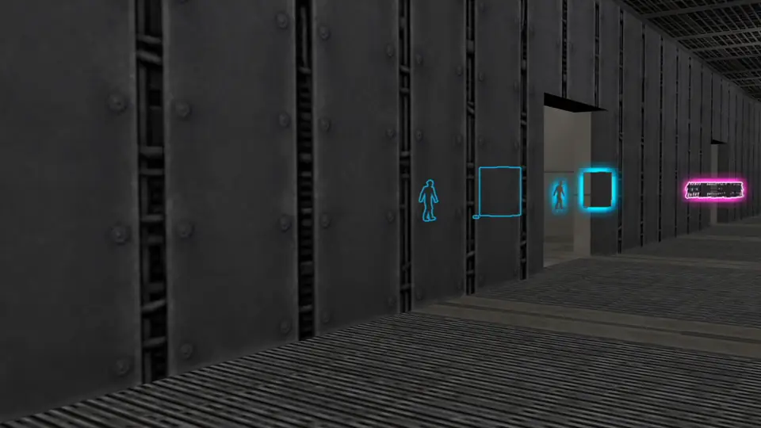
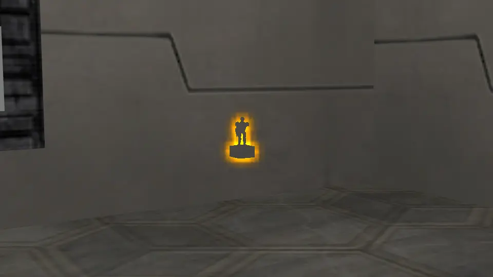

# Entity glow

Entity glow draws an outline or a soft halo around a monster, an item, a player or a brush entity. Players can find
it at a glance, even through walls and floors. You place an [`env_entity_glow`](../entities/env_entity_glow.md),
put the name of what should glow in its **Target Entity**, and every player sees the glow in the color you choose.

*Outlines and halos seen through a wall, with one glow switched on and off*

## Marking an objective

*An objective's halo, seen through the walls and the floor between*

Give the objective a name, such as `objective`, and put that name in the **Target Entity** of an
`env_entity_glow` with **Glow Visibility Mode** set to Always (0) and **Glow Style** set to Halo (1). With **Start
Disabled** set to Yes (1), the glow stays off until you trigger it. A glow set to Always or Only when occluded shows
through walls and floors, so players see it from another floor or from the other side of the map.

## A glow for one player

With the flag **Only the activator sees it**, only the player who triggers the glow sees it, and the other
players see nothing. **Target Entity** set to `!all` makes every alive monster and every other player glow, up to the
nearest 64, and a name glows up to 32 entities with that name. **Duration** turns the glow off by itself after that
many seconds, and 0 keeps it on until you turn it off. Sprites never glow.

## Styles and modes

| | Outline (0) | Halo (1) |
|---|---|---|
| Always (0) | A sharp line around the whole shape, through walls too | A soft glow around the whole shape, through walls too |
| Only when occluded (1) | A sharp line around the hidden parts only | A soft glow around the hidden parts only |
| Only when visible (2) | A sharp line around the parts players can see | A soft glow around the parts players can see |

A [`trigger_changevalue`](../entities/trigger_changevalue.md) can change the color, the mode and the style of a glow
while the map runs, for example to turn a white outline red.

## Changes since 1.38

- `env_entity_glow` draws an outline or a soft halo around models and brush entities, also through walls and floors, to mark an objective or anything else players should find

## See also

- [`env_entity_glow`](../entities/env_entity_glow.md) - the entity page
