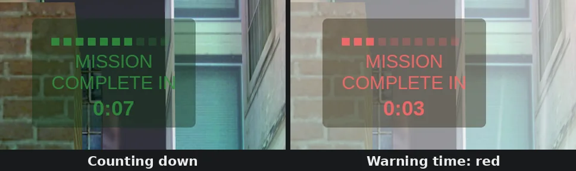

# HUD timer

A [`game_timer`](../entities/game_timer.md) shows a countdown on every player's HUD. It triggers its targets when the
warning time comes and when the time is up. It has the same keys,
defaults and look as the `game_timer` of the Source version of SBO. GoldSrc has no inputs and outputs, so you control
the timer with triggers and target keys instead.

On `co_sbo_showcase`, the tower has a 10-second countdown to the end of the mission. By default, the timer sits at the
top center of the HUD with its caption above the time and the bar under it, and it turns red in its warning time.

*A countdown, and the same countdown in red in its warning time*

## Turning it on and off

A timer with **Start Disabled** set to Yes, which is the default, stays hidden until you trigger it. With No, it runs
from the start of the map. The [use type](../guide/trigger-modes.md) of the trigger decides what happens:

| Trigger | What happens |
|---|---|
| On | The timer shows and runs. A timer with no time left starts again from **Timer Length**. A timer that you turned off before the end continues from where it stopped |
| Off | The timer stops and hides, and it keeps its time left |
| Toggle | Works like On when the timer is off, and like Off when it is on |
| Set, from a [`game_counter_set`](../entities/game_counter_set.md) | The time left becomes the value, in seconds |

With **Start Paused** set to Yes, an On shows the timer but doesn't start it, and the time flashes while the timer
is paused. When **Warn Time** seconds are left, the timer triggers **Target when warned**, turns red and flashes. When the time is up, it triggers **Target when
finished**. Then, with **Disable On Finish** set to Yes, the timer hides, and with No, it stays on the HUD at `0:00`.

## Keys

| Key | Description | Default |
|---|---|---|
| **Timer Length** `timer_length` | How many seconds the timer runs | `0` |
| **Max Length** `max_length` | The highest time left, in seconds, that a change can set or add. With 0, there is no limit, and the bar, the time gone by and the default warning use **Timer Length** | `0` |
| **Warn Time** `warn_time` | How many seconds are left when the warning comes, where -1 means a quarter of the length | `-1` |
| **Start Disabled** `StartDisabled` | With Yes, the timer stays hidden until you trigger it. With No, it runs from the start of the map | Yes (1) |
| **Start Paused** `start_paused` | With Yes, an On shows the timer but doesn't start it | No (0) |
| **Show Time Remaining** `show_time_remaining` | With "Show remaining time" (1), the timer shows the time left. With "Show elapsed time" (0), it shows the time gone by | Show remaining time (1) |
| **Disable On Finish** `disable_on_finish` | With Yes, the timer hides when the time is up, and with No, it stays on the HUD at `0:00` | Yes (1) |
| **Show In HUD** `show_in_hud` | With No, the timer runs and triggers its targets, but it doesn't show | Yes (1) |
| **Progress Bar Max Segments** `progress_bar_max` | How many segments the bar under the time has. -1 gives one segment for each second of the length, up to 15, and 0 shows no bar | `-1` |
| **Progress Bar Override** `progress_bar_override` | How many segments the bar shows. -1 follows the progress of the timer | `-1` |
| **HUD X Override**, **HUD Y Override** `x`, `y` | The position from 0 to 1, from left to right and from top to bottom, where -1 centers the timer at the top | `-1` |
| **Timer Caption** `timer_caption` | The text above the time. `\n` starts a new line, and a `#Token` shows translated text | |
| **Caption Width** `caption_width` | How many pixels wide the caption can be on a 1080p screen before it wraps, where 0 means it never wraps | `260` |
| **Caption Lines** `caption_lines` | How many lines the caption can have, from 1 to 4 | `2` |
| **Target when finished** `target` | The timer triggers it when the time is up | |
| **Target when warned** `warntarget` | The timer triggers it once, when the time left gets to **Warn Time** | |
| **Target when paused** `pausetarget` | The timer triggers it when the timer pauses, and also when a running timer finishes or you turn it off | |
| **Target when resumed** `resumetarget` | The timer triggers it when the timer starts to run | |

## Changing a running timer

A [`trigger_changevalue`](../entities/trigger_changevalue.md) or a
[`trigger_copyvalue`](../entities/trigger_copyvalue.md) can set every key above on a running timer, and the HUD
changes immediately for every player. Four more keys are only for this:

| Key | What it does |
|---|---|
| `time_remaining` | Sets the time left, in seconds |
| `add_time` | Adds seconds, but not on a timer that is off |
| `remove_time` | Takes seconds away, but not on a timer that is off |
| `paused` | 1 pauses the timer, and 0 lets it run again |

**Max Length** limits every change. A `trigger_copyvalue` that reads `time_remaining` copies the time left into a
key of another entity.

## Notes

- Only one timer shows at a time: the first timer that is on in the entity list of the map
- A player who joins sees the current time
- A timer keeps running through a new round, because nothing resets it between rounds
- The timer triggers its targets after it has changed its state. So a target that triggers the timer again finds it
  in that new state, for example finished and hidden

## Changes since 1.38

- `game_timer` is new

## See also

- [`game_timer`](../entities/game_timer.md) - the entity page
- [`game_counter_set`](../entities/game_counter_set.md) - sets the time left with Set
- [Changing keys](../guide/changing-keys.md) - how to change the keys of a running timer
- [Round hooks](../guide/round-hooks.md) - what happens at each round start
