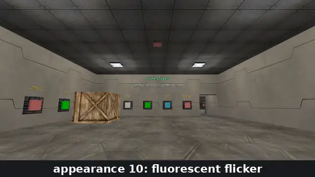
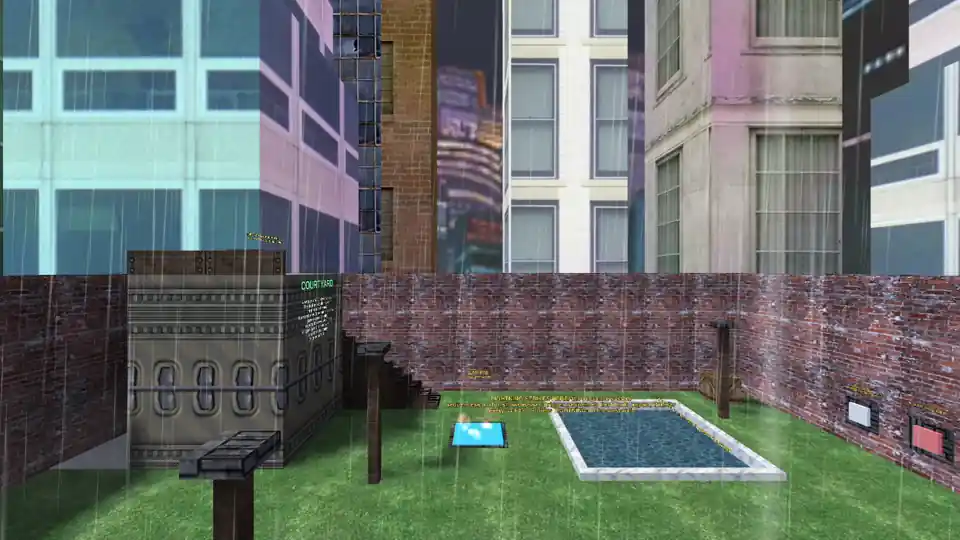

# Light styles

Light styles make your lights flicker, pulse, fade or go out while the map runs. They can also switch the whole map
between day and night without a new compile. A light style is a pattern of brightness that the engine plays on a group
of lights. A [`trigger_lightstyle`](../entities/trigger_lightstyle.md) changes the style of named lights, and a
[`global_light_control`](../entities/global_light_control.md) changes many lights at once.

The light styles room of `co_sbo_showcase` shows flicker, candle, pulse and a power failure with a red alarm light,
and the west wall of its courtyard switches between day and night.

*Light styles: flicker, candle, pulse and a power failure with a red alarm*

## Styles and patterns

A pattern is a string of letters from `a` for dark to `z` for bright, where `m` is normal brightness. The engine plays
the pattern at 10 letters a second and starts again at the end, so `mmamammmmammamamaaamammma` is a flicker. Each
light belongs to one style, and the styles have these numbers:

| Style | Which lights |
|---|---|
| 0 | Every light without a name and with the normal appearance |
| 1 to 12 | The preset styles of Half-Life, set with the **Appearance** of a light |
| 32 to 63 | Named lights, where the compiler gives each name its own style |

Lights with the same name have the same style, so you can change lights separately only if they have a name. Before
the game uses a pattern from the map, it cleans it: capital letters become small letters, the game removes other
characters, and it keeps only the first 63 letters. An empty pattern counts as `m`.

## `trigger_lightstyle`

When you trigger a `trigger_lightstyle`, it gives a new appearance to its target lights.

| Key | Description | Default |
|---|---|---|
| **Light(s) to affect** `target` | The name of the lights. [`!activator`](../guide/entity-triggering.md#target-selectors) also works | |
| **New appearance** `appearance` | One of the presets in the table below | Normal (steady) (0) |
| **Custom appearance** `pattern` | A pattern of letters. If you set one, the entity ignores **New appearance** | |
| **Fade time** `m_iFade` | How many whole seconds the lights take to fade to the new appearance | `0` |
| **Hold time** `m_iWait` | How many seconds the new appearance stays before the lights go back to their own style. Decimals such as 0.6 work, and -1 keeps the new appearance permanently | `-1` |
| **Reset light styles at round start** `round_reset` | See [Round reset](#round-reset) | No (0) |

| Value | Appearance | Value | Appearance |
|---|---|---|---|
| 0 | Normal (steady) | 10 | Fluorescent flicker |
| 1 | Flicker A | 11 | Slow pulse, noblack |
| 2 | Slow, strong pulse | 12 | Underwater |
| 3 | Candle A | 13 | Off |
| 4 | Fast strobe | 14 | Slow fade in |
| 5 | Gentle pulse | 15 | Medium fade in |
| 6 | Flicker B | 16 | Fast fade in |
| 7 | Candle B | 17 | Slow fade out |
| 8 | Candle C | 18 | Medium fade out |
| 9 | Slow strobe | 19 | Fast fade out |

During a fade, the brightness changes evenly over the **Fade time**, from the first letter of the current pattern to
the first letter of the new pattern, in steps every 0.1 seconds, and then the new pattern plays. A light's own style
is its pattern while it is on, and `a` while it is off. If you turn a light on or off by its name, this ends a fade or a hold on it. The entity skips a target that
isn't a named [`light`](../entities/light.md), [`light_spot`](../entities/light_spot.md) or
[`light_environment`](../entities/light_environment.md). With `developer 1` set in the console, the console reports
it.

## `global_light_control`

When you trigger a `global_light_control`, it sets one pattern on many styles. Without flags, that is style 0, which
is the style of every light that has no name.

| Key | Description | Default |
|---|---|---|
| **Pattern** `pattern` | The pattern to set | `m` |
| **Only these named lights** `target_entity` | If you give a name, only the styles of the lights with this name change, and the entity ignores its flags | |
| **Reset light styles at round start** `round_reset` | See [Round reset](#round-reset) | No (0) |

It has these flags:

- **Also styles 1-63** (65536) - The styles 1 to 63, which are the presets and the named lights, also change
- **Not the default style** (131072) - Style 0, the style of lights without a name, doesn't change

With no flags, only style 0 changes. A `global_light_control` without a name sets its pattern when the map starts.
This gives the whole map a different base light without a new compile.

*The whole map switched between day and night*

## Round reset

If a `trigger_lightstyle` or `global_light_control` has **Reset light styles at round start** set to Yes, the light
styles go back to their patterns from the map start at each round start, so a power failure in one round doesn't
continue into the next round. The reset includes:

- The styles of the world
- Each named light's own style, and the light stays on or off as it is at that moment
- The pattern of each `global_light_control` without a name

Fades and holds of a `trigger_lightstyle` end with the reset.

The reset happens once at each round start, also if many entities have the key.

## Players who join

The engine sends the current pattern of every style to a player who connects. So players who join late, and
spectators, see the lights in their current state.

## Notes

- The engine has 64 styles, from 0 to 63, and the compiler gives named lights the styles 32 to 63
- A pattern can have up to 63 letters
- A face of the map holds the light of up to four styles, and when more styles reach one face, the compiler leaves
  some of them out, so those lights don't light that face at all. See
  [Compiler notes](../basics/compiler-notes.md#four-light-styles-on-a-face) for more details

:::note

ZHLT, VHLT, SDHLT, ReSDHLT and hltools give the style of its name to every named entity with a `style` key other
than 0, not only to lights. For this reason, `trigger_lightstyle` uses the key `appearance`. See
[Compiler notes](../basics/compiler-notes.md) for more details.

:::

## Changes since 1.38

- Light styles can change while the map runs, with `trigger_lightstyle` and `global_light_control`

## See also

- [`trigger_lightstyle`](../entities/trigger_lightstyle.md) - changes the style of named lights
- [`global_light_control`](../entities/global_light_control.md) - changes many styles at once
- [`light`](../entities/light.md) and [`light_spot`](../entities/light_spot.md) - the lights themselves
- [Round hooks](../guide/round-hooks.md) - what happens at each round start
- [Compiler notes](../basics/compiler-notes.md) - why the compile tools change `style` keys
