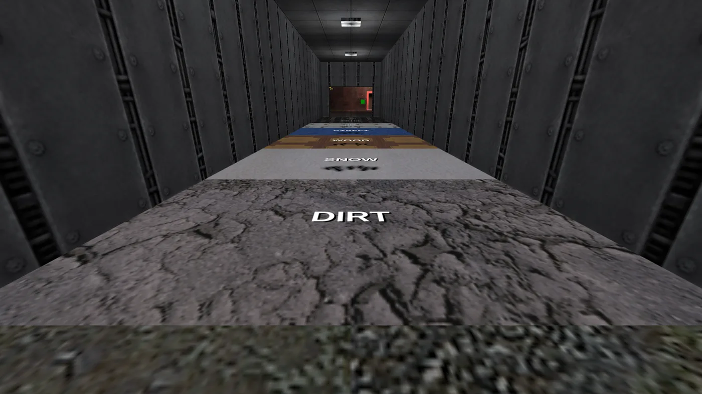
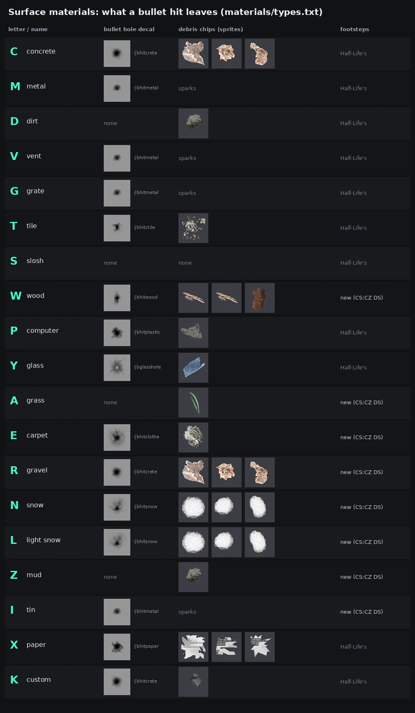
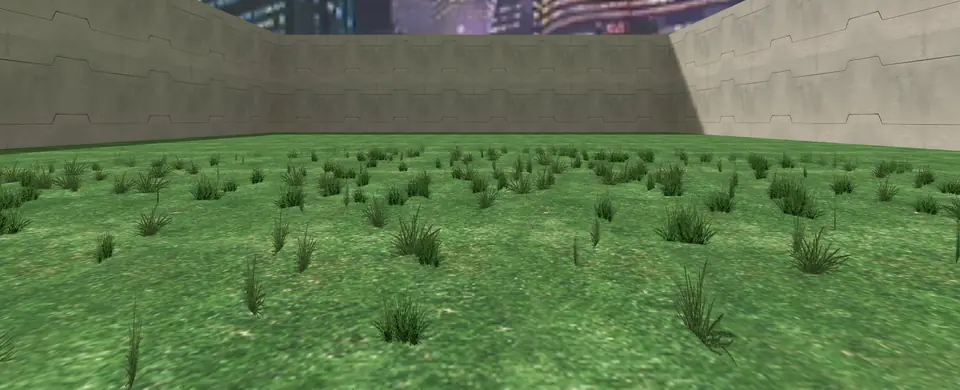

# Materials

Every texture has a material, which sets its footstep sounds, its bullet hit sounds and its bullet impact effects,
such as decals, debris chips, dust puffs and sparks. The SBO textures already have materials. A small text file gives
materials to the textures of your map, so players hear gravel under their feet and see wood chips where a bullet
hits wood.

The materials room of `co_sbo_showcase` has nine floors: grass, gravel, dirt, snow, wood, carpet, tile, metal and
grate.



*Material floors with bullet impact decals*

## Material letters

A material is a letter from A to Z, and a texture without a material counts as concrete:

| Letter | Material | Letter | Material |
|---|---|---|---|
| C | Concrete, the default | W | Wood |
| M | Metal | P | Computer |
| D | Dirt | Y | Glass |
| V | Vent | A | Grass |
| G | Grate | E | Carpet |
| T | Tile | R | Gravel |
| S | Slosh, which is shallow liquid | N | Snow |
| L | Light snow | Z | Mud |
| I | Tin | X | Paper |
| F | Flesh | K | Custom |




*The decal, debris and footsteps of each material*

## The files

The letters and effects come from four kinds of file:

| File | What it holds | Where it applies |
|---|---|---|
| `sound/materials.txt` | Half-Life's textures and their letters | Every map |
| `materials/textures.txt` | The letters of the SBO textures, which are the textures in the anzymut, roux and co_escape WADs | Every map |
| `materials/types.txt` | The sounds and impact effects of each letter | Every map |
| The materials file of the map | The textures, letters and effects of the map | That map |

The materials file of the map is the file that the [`worldspawn`](../entities/worldspawn.md) key **Materials file**
(`materials_file`) names. If that key is empty, it is `materials/maps/<map>.txt`, if that file exists.

## Lookup order

A texture gets its letter from the last of these files that lists it:

1. `sound/materials.txt`
2. `materials/textures.txt`
3. The materials file of the map

In the file of the map, its own lines win over the files that it includes. Inside one file, the first line for a
texture wins. The sounds and effects of a letter start with the built-in Half-Life values. Then
`materials/types.txt` changes them, and then the file of the map changes them. A block changes only the keys that it
names, and every other key keeps its value.

The game compares the full texture name first. If no line has the full name, a line that matches the first 12
characters counts. The prefixes `-0`, `+0`, `{`, `!` and `~` aren't part of the name.

## Texture lines

A texture line gives a letter to one texture: the letter, a space and then the texture name. This map file makes
four textures of the map metal, grass, carpet and concrete:

```text
// materials/maps/co_mymap.txt
M MYMETALFLOOR
A MYGRASS
E MYCARPET_RED
C 666PARQUET
```

You can write the letter in upper or lower case. Write the name without its `{`, `!`, `+0` or `~` prefix. `//`
starts a comment, `/* */` comments include whole lines, and the game skips a line that doesn't start with a letter.
The file of the map can also have these lines:

| Line | What it does |
|---|---|
| `#include <file>` | Reads another materials file, with its texture lines and its blocks |
| `#types <file>` | Reads a file of `material`, `texture`, `ladder` and `wade` blocks |
| `material <letter> { }` | A material block, as below |
| `texture "<name>" { }` | The impact effects of one texture |

## Material blocks

A `material` block changes a letter, or gives a material to a letter that has none. A new letter starts with the
volumes and step times of concrete. This block makes K an alien floor with its own steps, hit sounds, green chips and
dust:

```text
material K
{
	name "alien floor"
	step_right { "mymap/alien_step1.wav" "mymap/alien_step3.wav" }
	step_left { "mymap/alien_step2.wav" "mymap/alien_step4.wav" }
	hit { "mymap/alien_hit1.wav" "mymap/alien_hit2.wav" }
	fx_debris { "sprites/mymap/alien_chip.spr" }
	fx_smoke 1  fx_smoke_color 60 140 60
	fx_decal "{bhitcrete"
}
```

A block takes these sound and step keys:

| Key | What it sets |
|---|---|
| `name` | The name of the material |
| `step_right`, `step_left` | Up to 6 sounds each, and each step plays one of them at random |
| `walk_volume`, `run_volume` | How loud the steps are, from 0 to 1 |
| `walk_time`, `run_time` | How many milliseconds until the next step, from 50 to 5000 |
| `step_skip` | If you set 1, every fourth step is silent |
| `hit` | Up to 6 hit sounds |
| `hit_volume` | How loud the hit sounds are, from 0 to 1 |
| `hit_volume_bar` | How loud a melee hit on it is, from 0 to 1 |
| `hit_attenuation` | How fast the hit sound fades with distance, from 0 to 4, where 0.8 is normal |
| `hit_sparks` | If you set 1, about half of the bullet and melee hits on it make sparks and a spark sound, as on computers |

A letter without steps sounds like concrete when you walk on it. A letter without hit sounds sounds like concrete
when you hit it. Steps need both lists, `step_right` and `step_left`. A `ladder` block and a `wade` block also take
the step keys, and they set the sounds of ladders and of walking through water.

These keys set the impact effects:

| Key | What it sets |
|---|---|
| `fx_debris` | Up to 4 sprites, and each chip uses one of them at random |
| `fx_debris_count` | How many chips a hit makes, from 0 for none to 8, and each hit adds 0 to 2 more |
| `fx_debris_size` | The size of the chips, from 0.5 to 32 |
| `fx_debris_life` | How many seconds a chip lasts, from 0.1 to 30 |
| `fx_debris_speed` | A factor for the speed of the chips, from 0 to 4 |
| `fx_debris_brightness` | How bright the chips are, from 0 to 255 |
| `fx_debris_additive` | If you set 1, the game draws the chips additive, so they glow |
| `fx_debris_color` | The color of the chips, as `R G B` |
| `fx_debris_gravity` | A factor for the gravity on the chips, from -4 to 4 |
| `fx_debris_damp_time` | How many seconds until the chips slow down, from 0 to 10 |
| `fx_debris_damp_speed` | A factor for the speed after that time, from 0 to 4 |
| `fx_debris_afterdamp_gravity` | A factor for the gravity after that time, from -4 to 4 |
| `fx_smoke` | If you set 1, hits make dust puffs |
| `fx_smoke_color` | The color of the puffs, as `R G B` |
| `fx_sparks` | If you set 1, hits make sparks and a flash of light |
| `fx_decal` | A decal name from `decals.wad`, up to 15 characters, or `none` for no decal |
| `fx_ricochet` | Up to 6 ricochet sounds |

An `fx_` key gives the letter its own impact effect. A letter without `fx_` keys shows the bullet impact of
Half-Life, and flesh (F) has no impact effect.

## Texture blocks

A `texture` block gives one texture its own impact effects, separate from its letter, and it takes the `fx_` keys.
This block makes sparks on a glass texture, without a decal:

```text
texture "{MYGLASS" { fx_sparks 1 fx_decal none }
```

## Values and errors

Numbers are plain decimals, and the game changes a number that is out of range to the nearest limit. Sound paths
start from `sound/` and end in `.wav`. File paths start from the game folder and end in `.txt`. The game skips a key
that it doesn't know, and it doesn't use a file that has an error. With `developer 1` set in the console, the console
shows a line about each problem, with the file and the line of an error.

## Grass

Grass grows on textures with the material A, such as the SBO texture `666GRASS2`. It is off by default. These
`worldspawn` keys turn it on and set its look:

| Key | Editor name | Range | Default |
|---|---|---|---|
| `grassDensity` | Grass: density | 1 to 1000, where 0 means no grass | `0` |
| `grassSprite` | Grass: sprite | | `sprites/grass_01.spr` and `sprites/grass_03.spr` |
| `grassFadeDist` | Grass: fade distance | 128 to 4096 | `800` |
| `grassMinHeight` | Grass: minimum height | 4 to 256 | `16` |
| `grassMaxHeight` | Grass: maximum height | 4 to 256 | `32` |

Each player's game grows the grass around that player, with up to 3000 pieces at a time. The grass fades out
toward the fade distance.



*Grass pieces thinning out with distance*

## Downloads

When the map starts, the server adds these files to the download list:

- The materials file of the map, and the files that it reads with `#include` and `#types`
- The step and hit sounds of the letters that the textures of the map use
- The debris sprites and ricochet sounds that the files of the map name for its textures
- A custom grass sprite

The files for every map come with the game, so the server doesn't send them.

## Player option

Players can turn off debris chips and dust puffs with the setting
[`cl_effectsdetail`](../../playing/options.md#player-cvars), while sparks, decals and sounds stay. The same setting can
be found in **Options > Multiplayer > Bullet impact and gun effects**. The same setting also turns off the water splashes of bullets and the smoke from the barrel of the
player's gun.

## Notes

| Limit | Value |
|---|---|
| Texture lines in all files | 1024 |
| `#include` depth | 2 |
| Files that the file of a map reads, itself included | 8 |
| File size | 256 KiB |
| `texture` blocks | 32 |
| Files the materials add to the download list | 64 |

## Changes since 1.38

- The SBO textures have their materials from `materials/textures.txt` on every map. SBO 1.38 read only the
  `sound/materials.txt` of Half-Life, so all SBO textures were concrete. The material system gives every surface its
  own sounds, so it applies to every map, also custom maps
- Wood (W) has its own footsteps. In SBO 1.38, wood sounded like concrete. Wood uses the wood footsteps of
  Counter-Strike: Condition Zero Deleted Scenes on every map
- The materials A, E, R, N, L, Z, I, X and K, the map's materials file, bullet impact effects and grass are new

## See also

- [`worldspawn`](../entities/worldspawn.md) - the **Materials file** key and the grass keys
- [Custom content](../basics/custom-content.md) - how players download the materials files and sounds
- [Old maps](../basics/old-maps.md) - what the materials change on maps made for SBO 1.38
