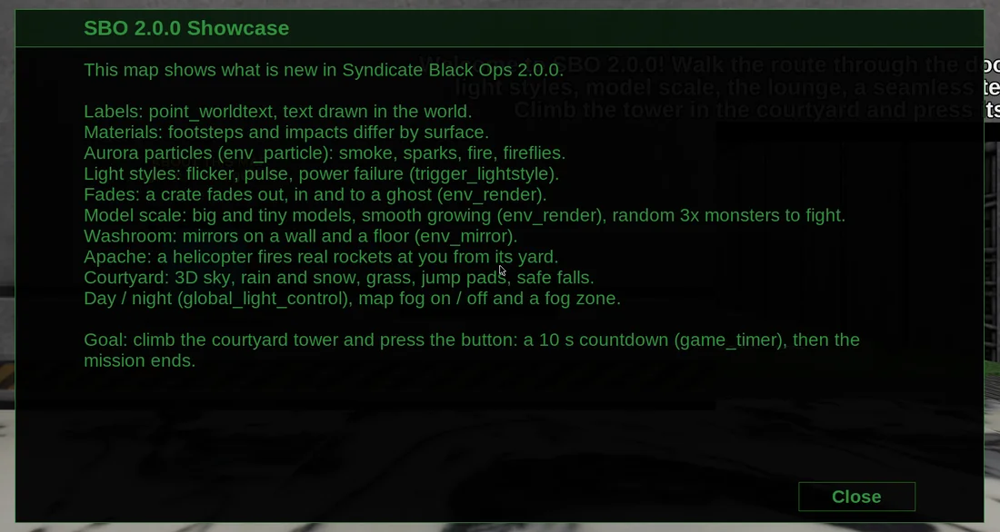

# Message boxes [[ported:featureful]]

Message boxes open a window in the middle of a player's screen with your text, a Close button and, if you give it
one, a title. A [`game_messagebox`](../entities/game_messagebox.md) opens the box when you trigger it. The box stays
open until the player closes it, or with an **Autoclose distance** set, until they walk away from it.

The spawn hall of `co_sbo_showcase` has an "about" box like this one.

*A message box in-game*

## Keys

| Key | Description | Default |
|---|---|---|
| **Title** `title` | One line of text in the title bar of the box. If you leave it empty, the box has no title bar. Write a `#Token` to show the text of an entry in `titles.txt` or in a language file of the game | |
| **Text** `message` | The text in the box, up to 1023 bytes. Write `\n` to start a new line, or write a `#Token` to show the text of an entry in `titles.txt` or in a language file of the game. If you leave it empty, the box never opens | |
| **Autoclose distance** `distance` | How far, in units, a player can be from **Autoclose position** before the box closes. If you leave it at 0, the box closes only when the player closes it | 0 |
| **Autoclose position** `position` | The point that **Autoclose distance** is measured from, as `x y z` map coordinates or as the name of an entity. If you leave it empty, it is the `game_messagebox` itself | |

## Flags

- **All Players** (1) - The box opens for every alive player, not only for the activator

## Who sees the box

When you trigger the entity, the box opens for the [activator](../guide/entity-triggering.md), which is the player
who started the chain of triggers. If you set **All Players**, it opens for every alive player. A box that is already
open for a player doesn't open a second time for that player, and bots never get boxes.

If you set an **Autoclose distance**, the box belongs to a place. It doesn't open for a player who is farther than
that distance from the position, and it closes when the player walks farther away. With `developer 1` set in the
console, the console tells you when a box didn't open because the player was too far away.

## While a box is open

The player closes the box and scrolls its text with these keys:

| Key | What it does |
|---|---|
| The Close button, <kbd>Enter</kbd> or primary attack | Closes the newest box |
| Mouse wheel | Scrolls the text by one line |
| <kbd>Page Up</kbd> or <kbd>Page Down</kbd> | Scrolls the text by one page |

While a box is open, it takes the mouse cursor. The player can still walk, but can't aim, change weapons or use
secondary attack. A text that doesn't fit in the box gets a scroll bar. The open boxes of a player stay open when the
player respawns and when a new round starts.

## Notes

- A player can have up to 8 boxes open at the same time, and a ninth box closes the oldest
- Boxes stack with the newest box on top, and the newest box closes first

## Changes since 1.38

- `game_messagebox` is new in SBO 2.0.0

## See also

- [`game_messagebox`](../entities/game_messagebox.md) - the entity page
- [Tutor messages](tutor.md) - short hints in a corner of the screen
- [`game_text`](../entities/game_text.md) - text on the HUD that fades out automatically
