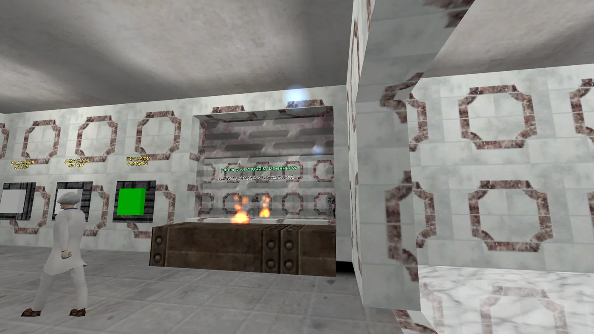
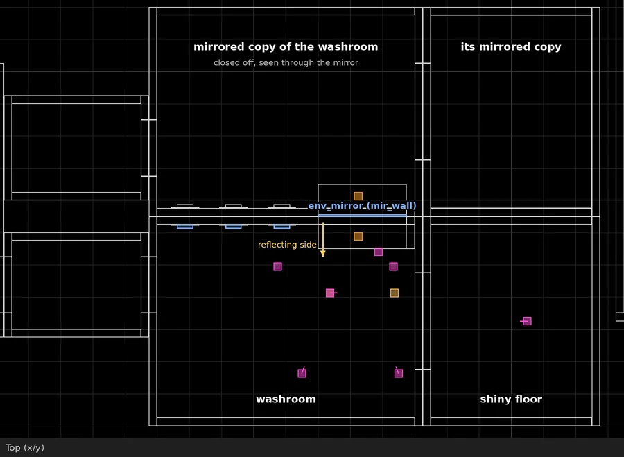

# Mirrors [[ported:spirit]]

An [`env_mirror`](../entities/env_mirror.md) turns a brush into a mirror, on a wall or as a shiny floor. It reflects
the models in front of it, such as monsters, items and props, and with **Draw Player** set, the players too. The world
in the reflection is a mirrored copy of the room that you build behind the mirror.

The washroom of `co_sbo_showcase` has a wall mirror and a reflecting floor.

*A wall mirror reflecting scientists and a fire*

## How it works

Each player's game draws every model within **Radius** of the center of the brush a second time, flipped across the
plane of the mirror. This includes monsters, items and props. With **Draw Player**, it also includes
players, who then see their own model in the mirror while they play in first person.
[Sprites](../entities/env_sprite.md), [world text](world-text.md) and the rain and snow of the
[weather](weather.md) also show in the mirror.

The mirror doesn't reflect the world. You build the room behind the mirror as a mirrored copy of the real room, and
you close it off. The mirror brush is see-through, so the copy shows through it. A player sees a reflection only
while they are on the reflecting side, and only of models on that same side. The reflection ends at the glass, so if
a part of a model goes through the glass, that part isn't in the reflection.

*Two mirror rooms and their mirrored copies, seen from above*

## Keys

| Key | Description | Default |
|---|---|---|
| **Radius** `radius` | The mirror reflects models within this distance of the center of the brush | 330 |
| **Mirror axis** `frags` | The direction that the mirror faces:  &bull;&nbsp;X or automatic (0) - the thinnest side of the brush, such as a wall facing east or west &bull;&nbsp;Y (1) - a wall facing north or south &bull;&nbsp;Z (2) - a shiny floor, with the mirrored room below it | X (0) |
| **Reflecting side** `side` | Which side of the brush reflects:  &bull;&nbsp;Both (0) - both sides, with the plane in the middle of the brush, but a floor mirror on the Z axis only reflects on its top face &bull;&nbsp;Positive (1) - only the east, north or top face &bull;&nbsp;Negative (2) - only the west, south or bottom face | Both (0) |
| **Render Mode** `rendermode` | How the game draws the mirror brush. Normal (0) makes the mirror opaque and hides the mirrored room | Texture (2) |
| **FX Amount** `renderamt` | The opacity of the mirror, from 1 for almost clear up to 255 for solid | 100 |

## Flags

- **Draw Player** (1) - The mirror reflects players too
- **Start Off** (2) - The mirror starts off

## On and off

A trigger switches the mirror on or off, and the [use types](../guide/trigger-modes.md) On and Off set that state.
While a mirror is off, the game draws its brush with the Render Mode Normal, so it is opaque and reflects nothing.
Players who join later see the current state of each mirror.

## Notes

- A map can have up to 32 active mirrors, and the game ignores the others. With `developer 1` set in the console,
  the console reports this
- Mirrors line up with the X, Y or Z axis
- Each mirror draws each model in its radius one more time, so a large radius costs more performance
- All mirrors together show up to 16 sprite entities and 16 sprite effects in each frame
- Mirrors don't show the particles of an [`env_particle`](particles.md)

## Changes since 1.38

- `env_mirror` is new

## See also

- [`env_mirror`](../entities/env_mirror.md) - the entity page
- [World text](world-text.md) - text in the world, which mirrors show
- [Entity keyvalues](../guide/entity-keyvalues.md) - the render keys
