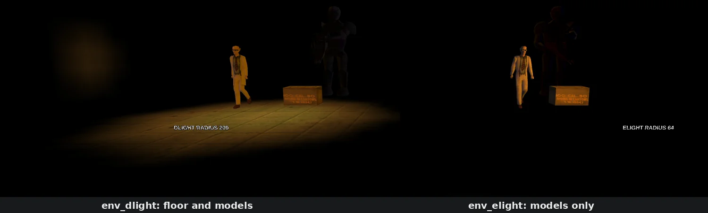
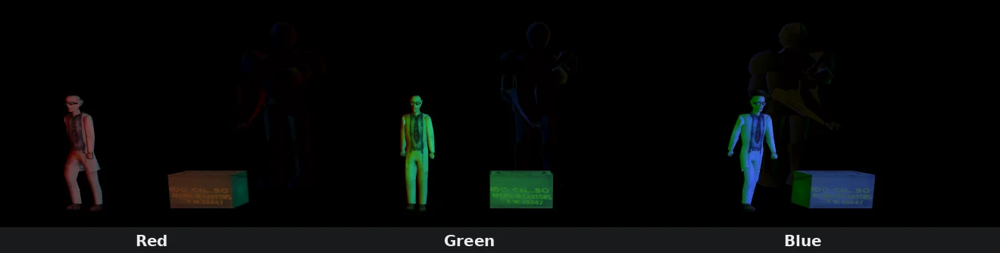
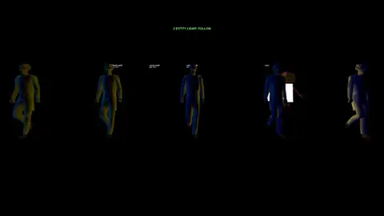
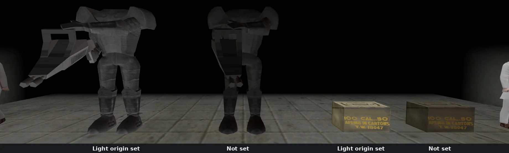

# Lights on models

Three entities change how models are lit while the map runs: a dynamic light, a light for models only, and a marker
that a model takes its lighting from. Without them, a model such as a monster, a player or a prop takes its light from
the compiled lightmap of the floor under it.

| Entity | What it lights |
|---|---|
| [`env_dlight`](../entities/env_dlight.md) | A dynamic light, which lights the walls, the floor and the models around it |
| [`env_elight`](../entities/env_elight.md) [[ported:spirit]] | An entity light, which lights only the models around it |
| [`info_light_origin`](../entities/info_light_origin.md) | A marker, not a light: a model can take its lighting from this marker instead of the floor under it |

## env_dlight or env_elight?

| | `env_dlight` | `env_elight` |
|---|---|---|
| What it lights | The walls, the floor and the models, so you see a glow around it | Only models, so the walls and the floor stay as they are |
| Cost | Higher, because in every frame the engine calculates the lighting of the walls and floor that it reaches again | Lower, because it lights only the models near it, point by point |
| Reach | Its radius | Full strength up to its radius, and in the dark still visible at 6 to 7 times the radius. Walls don't block it |

*An env_dlight on the left and an env_elight on the right*

You switch both lights on and off with triggers. They can stay on for a set time, and they can move with a moving
entity. An `env_elight` lights a model from the direction of the light, so the side that faces the light gets its
color. It can follow an entity and one of the attachments of its model, for example the hand of a monster. The
attachments of a model come from its QC file. See
[the QC guide on the303.org](https://the303.org/tutorials/gold_qc.htm) for more details.

If you leave **Radius** empty, it is 80 units for an `env_dlight` and 64 units for an `env_elight`. If you leave
**Light color** empty, it is white for both.

Each player's game has 32 dynamic lights and 64 entity lights, and it shares them with muzzle flashes, rockets and
other effects.

*Scientists lit red, green and blue by three env_elight*

*A yellow `env_elight` follows a moving [`func_train`](../entities/func_train.md) and lights the scientists it passes*

## Light origins

A model that stands under a ledge, half inside a wall, or on a dark spot of a bright room looks dark. This is because
the engine lights it from the floor directly under its origin. To correct this, put an `info_light_origin` where the
light is correct. Then give the model the key **Light origin** with the name of the marker, and the model is lit as
if it stood there.

*Models lit from a light origin in another room, next to unlit copies*

The editor shows the key on [`env_model`](../entities/env_model.md), [`env_static`](../entities/env_static.md),
[`monster_furniture`](../entities/monster_furniture.md) and [`cycler`](../entities/cycler.md), and other entities
with a model also accept it. Up to 512 entities in a map can have the key. Brush entities get their light when the map
is compiled, so for them, use the key **Light Origin Target** of the compile tools.

## Changes since 1.38

- `env_dlight` is new in SBO 2.0.0
- `env_elight`: a dynamic light that lights models only
- `info_light_origin`: a model takes its lighting from this marker instead of beneath its origin

## See also

- [Light styles](light-styles.md) - flickering and switchable lights
- [Props, models and fades](props-and-fades.md) - models as scenery
