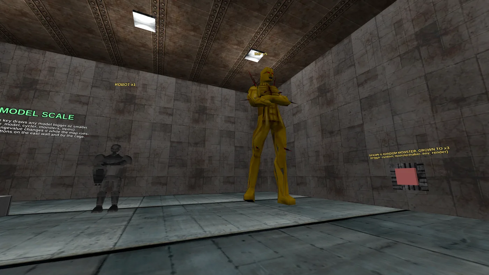
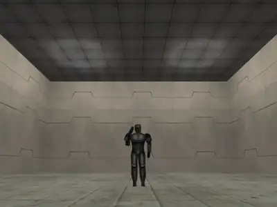

# Model scale [[ported:spirit]]

Model scale draws a model bigger or smaller with the `scale` key, from a giant monster to a tiny prop. The model
grows or shrinks around its origin: `0.5` is half size and `2` is twice the size, and an empty value, `0` or `1` is the
normal size. On monsters and props, the collision box and the hitboxes grow or shrink with the model, so a giant
monster is also a bigger target.

`co_sbo_showcase` has a room with a 5x imp, robots at 1x and 0.2x, a 0.3x zombie, a Fed with grow and
shrink buttons, and a button that spawns a random monster and grows it to 3x.

*An imp at five times its size next to a normal robot*

## Where it works

The editor shows the key **Model scale** on these entities:

- Monsters and dead monsters, including [`monster_furniture`](../entities/monster_furniture.md) and
  [`monster_generic`](../entities/monster_generic.md)
- The pick-up items [`item_battery`](../entities/item_battery.md), [`item_airtank`](../entities/item_airtank.md) and
  [`item_pickup`](../entities/item_pickup.md), and [`ammo_reserve`](../entities/ammo_reserve.md)

[`env_model`](../entities/env_model.md), [`env_static`](../entities/env_static.md),
[`env_modeltrain`](../entities/env_modeltrain.md) and an [`env_sprite`](../entities/env_sprite.md) that shows a `.mdl`
have their own **Scale** key, and a [`monstermaker`](../entities/monstermaker.md) has **Children's scale**, which
gives every monster it makes that scale. The key also draws each other entity with a `.mdl` model at its scale, for
example a [`func_rotating`](../entities/func_rotating.md) with a model. It does nothing on brush models and on
players.

## What scales

On monsters, dead monsters, items and `ammo_reserve`, the scale changes most of what the model does. It doesn't
change how a monster moves through the map:

| What scales | What doesn't scale |
|---|---|
| The model that you see and its animation | How a monster moves through the map: its hull, where it fits, its node paths and the steps it climbs |
| The collision box that players and monsters hit and that triggers touch | The eye height of a monster |
| The hitboxes that bullets hit | The free-space check of a [`monstermaker`](../entities/monstermaker.md) |
| The attack distances and melee reach of a monster | |
| The attachments, which are where the bullets, muzzle flash and grenades of a monster start | |

The hitboxes and attachments come from the QC file of the model. See
[the QC guide on the303.org](https://the303.org/tutorials/gold_qc.htm) for more details, and
[Useful tools](../getting-started/useful-tools.md) for model viewers that show them.

The engine moves monsters with one of the four hull sizes compiled into the map. So a 3x Fed still fits through the
doors that a normal Fed fits through, with its model and its box partly in the walls. A 0.5x Fed doesn't fit through
gaps that are too small for a normal Fed. Attack distances start at the edge of the scaled box, so a 4x zombie claws
a player who stands at its box. A scaled model is lit like the same model at scale 1. At very small scales, the box
keeps at least 1 unit on each side.

On every other entity, only the model that you see scales, and the box and the hitboxes stay the same.

## `env_sprite` with a model

An `env_sprite` with a `.mdl` plays one animation sequence of the model in a loop. You pick the sequence with the
key **Sequence**, which is 0 by default, and **Framerate** is then the speed of the sequence: 1 is the normal speed of
the sequence, 0.5 is half and 2 is twice that speed, and 0 holds the first frame. The editor default of 10 is meant for the
frames per second of a sprite, so set **Framerate** to 1 for a model, or it plays 10 times too fast.

When you trigger the `env_sprite`, it shows or hides the model. Each time the model shows, the sequence starts from
its beginning. With **Play Once**, the entity hides the model after the sequence has played one time.

## Changing the scale while the map runs

A [`trigger_changevalue`](../entities/trigger_changevalue.md) with the key `scale` changes the size and the box
immediately. An [`env_render`](../entities/env_render.md) with **Scale** does the same if it has no **Fade Time**.
With a fade time, the model grows or shrinks smoothly, and its box and hitboxes follow it step by step. See
[Props, models and fades](props-and-fades.md) for more details.

*Two `env_render` entities with **Fade Time** 2: one with **Scale** 2.5, one with **Scale** 1*

## Notes

- A model with a scale above 1 can reach out of the part of the map it stands in. So that it doesn't vanish while
  you can still see part of it, every player's game gets it all the time, wherever the player is in the map. Each
  such model adds a little network traffic for every player, all over the map
- The scale works in steps of 1/256, so 0.125, 0.25 and 0.5 are exact, and it goes up to about 255

## Changes since 1.38

- The `scale` key draws models at that scale. SBO 1.38 always drew them at their normal size
- The animation of a `.mdl` on an `env_sprite` is smooth and starts when the entity spawns or shows
- Maps made for SBO 1.38 with a `scale` key on a model show the model at that size. See
  [Old maps](../basics/old-maps.md) for more details

## See also

- [`env_render`](../entities/env_render.md) - changes the scale, with or without a fade
- [`trigger_changevalue`](../entities/trigger_changevalue.md) - changes the `scale` key at once
- [`env_sprite`](../entities/env_sprite.md) - shows a sprite or a model
- [Props, models and fades](props-and-fades.md) - models as scenery and fades
- [Entity keyvalues](../guide/entity-keyvalues.md) - the keys many entities share
