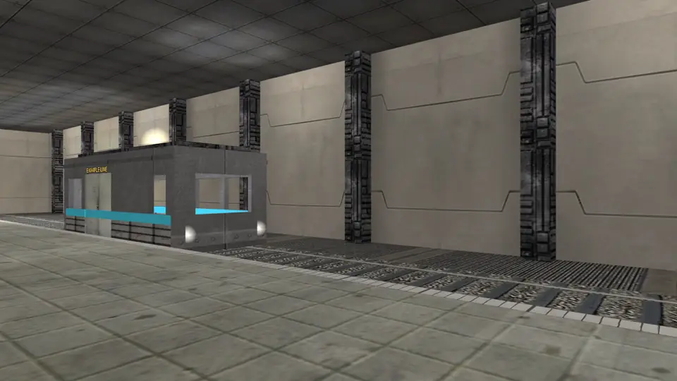
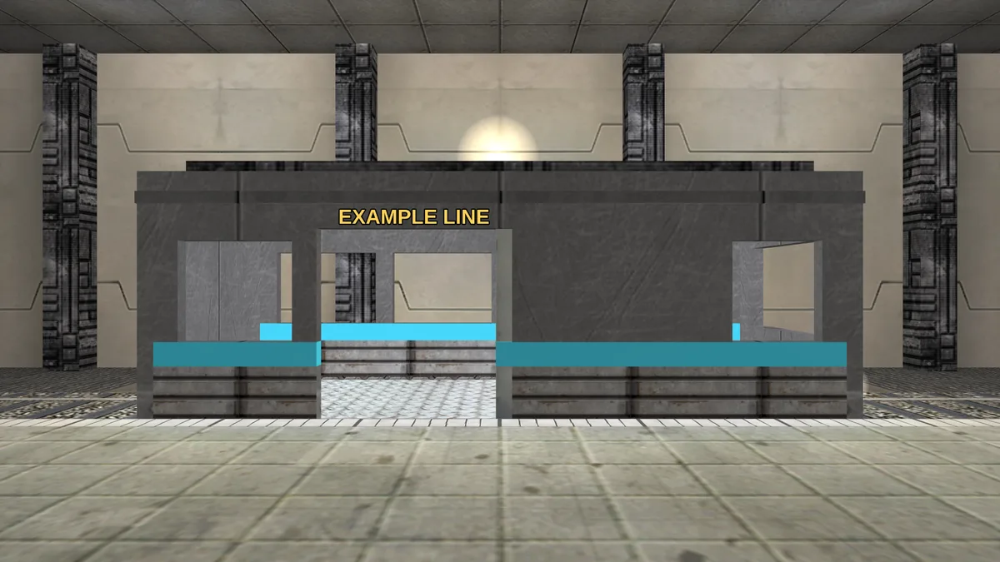
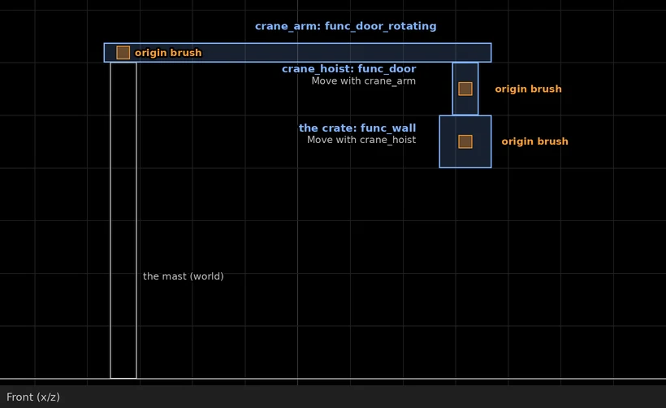
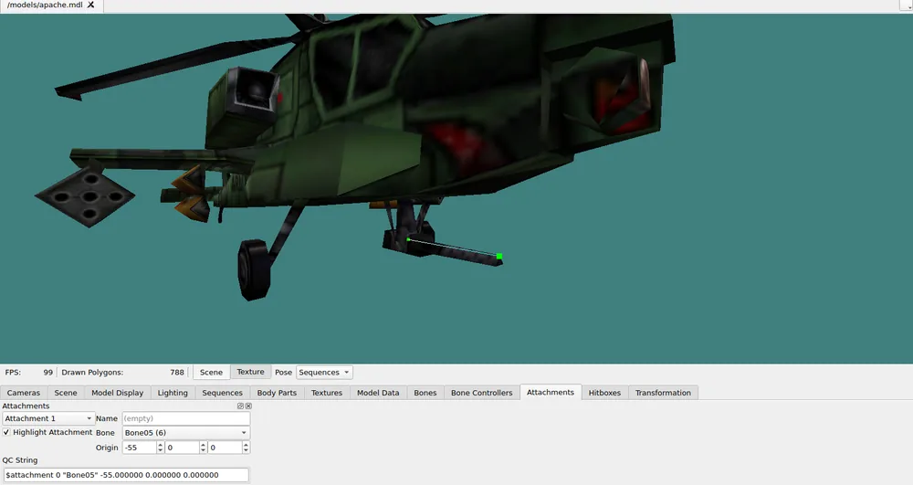
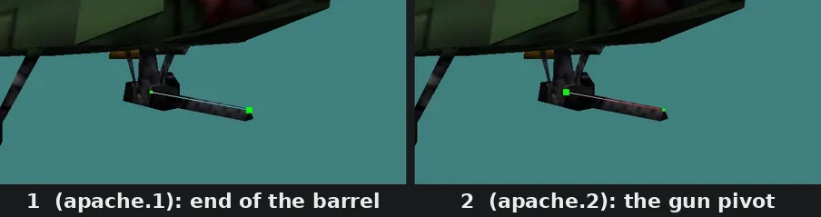
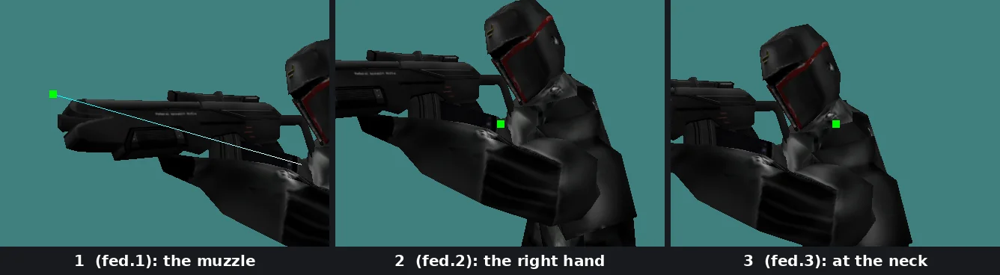
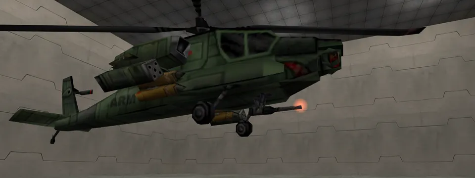
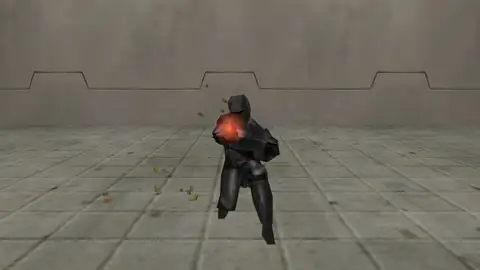

# Moving objects [[ported:spirit]]

:::warning[Experimental]

Move With is experimental. Great care has been taken to get it into a working state, but due to the nature of the
engine it may never work perfectly.

:::

Move With lets you put one entity on another, such as a door on a train or a lamp on a lift. The **Move with** key
comes from Spirit of Half-Life, a kit for making Half-Life mods developed way back in 2000.

SBO 2.0.0 adds many improvements that the original never had, such as children that follow their parent as it turns.
Even so, Move With will always be imperfect, because of the engine it runs on. Half-Life's engine comes from Quake,
and like Quake it stores every angle as three numbers: pitch, yaw and roll. These three numbers can't describe a turn
on top of another turn exactly, such as a door on a turning train, so small errors can show. Laurie Cheers, the author
of Spirit of Half-Life, describes the same limit:

> I spent a bunch of time trying to get compound rotations to work (e.g. a door moving with a rotating train), but it
> never quite looked right. (There's a reason why modern engines no longer use Quake's pitch/yaw/roll angle system.)
>
> Laurie Cheers, [PHQ interview](https://phq.muddasheep.com/phq_articles.cgi?show=96) (2015)

## The idea

Any entity can **move with** another entity, which is then its **parent**. The entity that moves with it is a
**child**. Put the name of the parent in the **Move with** key (`movewith`) of the child. The child then moves and
turns with the parent, and it keeps the position and the angles that it has on the parent in the editor. A child can
have its own children, so a hook can hang from a hoist that rides on a crane.

*A train pulls into a stop with its door, roof lamp, headlights and sign riding along, then its door slides open*

Build each child where it belongs on the parent, as you see it in the editor. This is also correct when the parent
moves away immediately at map start, such as a door that starts open or a [`func_train`](../entities/func_train.md)
that jumps to its first [`path_corner`](../entities/path_corner.md). The game measures each child against the parent
as you placed it.

Any entity can be a parent: trains, track trains, doors, rotating doors, lifts, [`func_rotating`](../entities/func_rotating.md),
[`func_pendulum`](../entities/func_pendulum.md), monsters, models and other children. Maps made for XashXT can use
the key `parent` in place of `movewith`, and SBO also reads that key.

## Keys

Every entity that can move with a parent has these keys in the editor.

| Key | Description | Default |
|---|---|---|
| **Move with** `movewith` [[ported:spirit]] | The name of the parent. If several entities have that name, the first one counts. A name that ends in `.1` to `.4` puts the child on that attachment point of the model of the parent. See [Attachments](#attachments) for more details | |
| **Axis locks** `parentflags` | Keeps some of the position or angles of the child, so they don't follow the parent. Add up the axes that you want to keep: 2 for X, 4 for Y and 8 for Z, and 16 for pitch, 32 for yaw and 64 for roll. 112 keeps all three angles, so the child stays level | `0` |

## A train with a door

A common setup is a train that carries a door, which opens at each station.

1. A [`func_train`](../entities/func_train.md) named `train_main`, with its first stop at a
   [`path_corner`](../entities/path_corner.md) named `station_a`
2. A [`func_door`](../entities/func_door.md) in the doorway of the train, named `train_door`, with **Move with**
   `train_main`
3. On `station_a`, **Fire On Pass** set to `train_door`, and **Wait here** set long enough for players to get on

The door opens and closes relative to the train, so it slides along the side of the train at all positions and
angles of the train. Players who stand in the train ride with it, as on any train.

*The example train at its first stop with its door open*

Example map: <SdkFile path="sdk/examples/maps/co_example_movewith/" /> builds this train, with a lamp, two headlights and a sign that ride along too.

The full Move With map, <SdkFile path="sdk/examples/maps/co_example_movewith/_full/" />, is a small city with a train, a lift, a crane, a drawbridge, a boat, a carousel and more, and a test wing whose rooms each show one tricky case. Every place has an Info button that opens a box with the entities and keys it uses.

A wheel ([`momentary_rot_button`](../entities/momentary_rot_button.md)) with **Move with** `train_main` turns on the
train while a player holds it. It can drive a [`momentary_door`](../entities/momentary_door.md) that also moves with
the train, such as a window that goes up and down while the train drives.

:::tip

You can add a [world screen](world-screens.md), a [world text](world-text.md) sign, a lamp
([`env_sprite`](../entities/env_sprite.md)), a [`trigger_camera`](../entities/trigger_camera.md) and an engine sound
([`ambient_generic`](../entities/ambient_generic.md)) to the train in the same way: give each of them **Move with**
`train_main`. The sound then plays from the train as it drives past.

:::

## A lift with a gate

1. A [`func_door`](../entities/func_door.md) that moves up, named `lift_cab`
2. A gate, also a `func_door`, with **Move with** `lift_cab`, and a [`func_button`](../entities/func_button.md)
   inside the cab with **Move with** `lift_cab` and **Target** `lift_cab`
3. On `lift_cab`, **Fire On Stop** set to the gate, so the cab opens the gate when it arrives at the top or the
   bottom

The gate and the button ride with the cab, and the gate opens and closes on the cab at all positions of the cab.

## A crane

With a chain of children, one part can hang from another part:

1. The arm, a [`func_door_rotating`](../entities/func_door_rotating.md) named `crane_arm`
2. The hoist, a [`func_door`](../entities/func_door.md) that moves down, named `crane_hoist`, with **Move with**
   `crane_arm`
3. The crate, a [`func_wall`](../entities/func_wall.md) with **Move with** `crane_hoist`

The hoist turns with the arm and comes down at the end of the arm, and the crate stays on the hoist all the time.
The hoist and the crate each need their own origin brush. See the next section for more details.

## A turning platform

Give a [`func_rotating`](../entities/func_rotating.md) a few crates ([`func_wall`](../entities/func_wall.md)) and a
lamp, all with **Move with** set to the name of the platform. They turn with the platform and stay in their
positions, and players who stand on the platform also ride around with it.

A solid brush child on a parent that turns needs its own **origin brush**, for example a small one in its middle.
Without an origin brush, the origin of the child is the origin point of the map, far away, and the game turns the
child around that point. So the child pushes things that it hits along a wide arc, but not the things that stand on
it. Players and monsters who stand on it still ride correctly. With `developer 1` set in the console, the console
warns about each such child when the map starts.

*A crane whose parts each move with the part above*

## Attachments

An attachment point is a point on a model that moves with one of its bones, such as the muzzle of a gun or the tip of
a tail. The author of the model places it with the `$attachment` command in the QC file, and the game uses the first
four points of a model. See [the303's QC guide](https://the303.org/tutorials/gold_qc.htm) for more details.

A child that moves with a model can sit on one of these points. The child then follows the point when the model moves
and when it plays an animation. The parent can also be a monster, so you can add sprites, glows and models to a
monster, such as a light on a Fed's gun.

### Find the attachment points of a model

You can see the attachment points of a model in
[Half-Life Asset Manager](https://github.com/SamVanheer/HalfLifeAssetManager) (see
[Useful tools](../getting-started/useful-tools.md)):

1. Open the model (`.mdl`) in Half-Life Asset Manager
2. On the **Model Display** tab, turn on **Show Attachments**. Each attachment point shows as a green dot in the 3D
   view
3. Open the **Attachments** tab. The list shows "Attachment 1", "Attachment 2" and so on, with the bone and the
   position of each point

Half-Life Asset Manager counts the points from 1, as **Move with** does, so "Attachment 1" is `.1`.

*A model's attachments in Half-Life Asset Manager*

*The Apache: **1** (`apache.1`) is the end of the gun barrel and **2** (`apache.2`) is the gun's pivot, both on the bone `Bone05`*

*A Fed: **1** (`fed.1`) is the muzzle of the gun and **2** (`fed.2`) is the right hand, both on `Bip01 R Hand`, and **3** (`fed.3`) is at the neck, on `Bip01 Head`*

### Put a child on an attachment point

This example puts a glow sprite on the gun of a helicopter:

1. Give the helicopter a name, for example `heli`
2. Place an [`env_sprite`](../entities/env_sprite.md) near the helicopter
3. Set its **Move with** to `heli.1`. The dot and the number after the name select the attachment point, from `.1` to
   `.4`
4. Run the map. The sprite sits on the first attachment point of `heli` and follows it

*An `env_sprite` with **Move with** `apache.1` sits at the end of the Apache's chin gun*

*A sprite that stays on a Fed's gun while the Fed moves*

*A Fed named `fed` is the parent, and an `env_sprite` with **Move with** `fed.1` is the child. The sprite sits at the
muzzle of the Fed's gun, and stays there when the Fed turns and aims*

Only a child that isn't solid can sit on an attachment point, such as a sprite, a model that isn't solid, an
[`info_target`](../entities/info_target.md) or a [`trigger_camera`](../entities/trigger_camera.md). A solid child
follows the origin of the parent instead.

These rules also apply:

- A name that matches an entity exactly always wins, so a parent named `door.1` still works as a plain name
- If the model has no such attachment point, the child follows the origin of the parent. If the parent changes to a
  model without that point, the child follows the origin until the point is back
- With `developer 1` set in the console, the console tells you when a child follows the origin instead of the point

### The same point in other entities

Other entities also use attachment points, but some count from 0 and some count from 1:

| Point | Move with | `env_sprite`, `env_elight`, `locus_beam` | `env_particle` | `calc_position` |
|---|---|---|---|---|
| The first | `.1` | 1 | 0 | Attachment point 0 (5) |
| The second | `.2` | 2 | 1 | Attachment point 1 (6) |
| The third | `.3` | 3 | 2 | Attachment point 2 (7) |
| The fourth | `.4` | 4 | 3 | Attachment point 3 (8) |

## Axis locks

With **Axis locks** (`parentflags`), a child keeps some of its position or angles from the moment that it was linked.
It follows the parent only on the other axes:

| Value | The child keeps |
|---|---|
| 2 | Its X position |
| 4 | Its Y position |
| 8 | Its Z position, so it keeps its height |
| 16 | Its pitch |
| 32 | Its yaw |
| 64 | Its roll |

Add up the values, so 112 keeps all three angles. A lantern that hangs from a drawbridge, or a gondola on a big
wheel, needs this: it moves with the parent but always hangs straight down.

## Changing the parent

A [`trigger_changeparent`](../entities/trigger_changeparent.md) gives entities a new parent while the map runs, or
removes their parent. Set **Entity to re-parent** to the entities that you want to change, and **New parent** to the
name of the new parent. When you trigger it, every entity with that name changes. An entity keeps its position at
the moment of the change, and then moves with its new parent from that position. If you leave **New parent** empty,
the entities stop where they are and don't move with anything.

A [`trigger_changevalue`](../entities/trigger_changevalue.md) on the keys `movewith`, `parent` or `parentflags` of a
child does the same as a `trigger_changeparent`, so you can move a crate from one train to another with either
entity. See [Changing keys](../guide/changing-keys.md) for more details.

## Names: aliases, groups and wildcards

**Move with** and the names of a `trigger_changeparent` work like the names in every other target key. So they also
take an alias (`*name`), a member of an [`info_group`](../entities/info_group.md), and a name that ends in `*`. In
**Move with**, a name that ends in `*` means the first entity whose name starts with the rest (see
[What * means in a name](../guide/entity-triggering.md#what-star-means)). A `trigger_changeparent` also takes
`!activator`, the entity that started the chain, and `!caller`, as the entity to re-parent or as the new parent. As
in the **Target** of any entity, `!caller` is the `trigger_changeparent` itself. A name that matches an entity
exactly always comes first.

The game finds the parent when it links the child, which is at map start or when a `trigger_changeparent` fires. If
you later point the alias at another entity, the child stays on the first entity. To make the child follow the
alias again, trigger a `trigger_changeparent` with **New parent** set to the same `*name`.

## Cameras, world text and screens

- A [`trigger_camera`](../entities/trigger_camera.md) that moves with a parent rides with it and keeps its own aim
  and turning, so it still turns to look at its target. It ignores its own path while it has a parent. If you give it
  both, the console says `trigger_camera <name> has a parent, so it ignores its path and rides with the parent` when
  `developer 1` is set in the console. With **Start At Player**, it takes only the view angles of the player and
  stays on its parent. It can also be on an attachment point
- A [world text](world-text.md) (`point_worldtext`) and a [world screen](world-screens.md) (`vgui_screen`) without
  **Surface** ride and turn with their parent. Each player's game draws them on the parent, so they never stay
  behind it. Players aim at and click a moving screen as usual. The parent must be something that the players' games
  draw, such as a brush or a model. While the parent is out of the view of a player or hidden, the text or
  screen stays where it was last drawn. **Axis locks** don't apply to them
- A world screen on a brush (a `vgui_screen` with **Surface**) already moves with that brush, so give **Move with** to
  the brush, not to the screen
- A spawn point, such as an [`info_player_go2`](../entities/info_player_go2.md), with **Move with** set to a moving
  platform makes players spawn on the platform at its current position
- A [`trigger_motion`](../entities/trigger_motion.md), a [`motion_manager`](../entities/motion_manager.md) or a
  [`trigger_changevalue`](../entities/trigger_changevalue.md) on `origin` or `angles` can also move a child. A new
  position or new angles move the child there, and the child then keeps that position on its parent. A velocity is
  the movement of the child on top of the movement of its parent. So a crate pushed along a cart continues to ride on
  the cart from its new position
- On a solid child, the position modes of these entities, such as **Set new position** and **Offset position, units
  per second**, move it in jumps, so players who stand on it don't ride with it. With the velocity modes, they ride
  with it

## Guns on moving objects

A gun ([`func_tank`](../entities/func_tank.md) and the other tanks) with **Move with** turns with its parent. Its
aim, its ranges and its center angles stay relative to its mount, so it aims where its user looks while the boat or
train under it turns. Give its [`func_tankcontrols`](../entities/func_tankcontrols.md) the same **Move with**, so the
controls also ride with it. Do the same for the tanks in its **Extra barrels name**, which then aim with it on the
parent. If its yaw range is less than 180, it always turns through that range to reach a target, and never through
the arc behind it. So the barrel doesn't turn through the player who stands behind the gun.

## What can't move with a parent

The game refuses **Move with** on these entities, and the entity then stays where it is. With `developer 1` set in
the console, the console says why when the map starts.

- **Monsters, players and pushable crates** ([`func_pushable`](../entities/func_pushable.md)), and things that fall
  or fly, because they move by themselves. They can stand on a moving object and ride with it. See
  [Standing on moving objects](#standing-on-moving-objects) for more details
- **Things that your game gets one time and then draws from its own copy**: [`env_mirror`](../entities/env_mirror.md),
  [`env_static`](../entities/env_static.md), [`func_rainvolume`](../entities/func_rainvolume.md),
  [`func_snowvolume`](../entities/func_snowvolume.md),
  [`color_correction_volume`](../entities/color_correction_volume.md) and [`env_fogzone`](../entities/env_fogzone.md)
- **Trains and other things that move on their own path or axis**: [`func_train`](../entities/func_train.md),
  [`func_tracktrain`](../entities/func_tracktrain.md), [`func_rotating`](../entities/func_rotating.md),
  [`func_pendulum`](../entities/func_pendulum.md), [`func_vehicle`](../entities/func_vehicle.md),
  [`env_modeltrain`](../entities/env_modeltrain.md) and [`env_spritetrain`](../entities/env_spritetrain.md). Any of
  them can be a parent

Some things can't move at all:

- **Lights** (`light`, `light_spot`) are part of the lightmaps that the compile tools make. For a lamp on a moving
  object, use a glowing sprite, a light texture on the brush, or a model or sprite with a dynamic light in its
  **Effects**
- **Beams** that end on an [`info_target`](../entities/info_target.md) can't follow it, because an `info_target`
  exists only on the server and the players' games don't know where it is

## Standing on moving objects

All things that stand on a solid child ride with it, as on a train or a lift: players, monsters, pushable crates and
dropped weapons. So a scientist can ride a carousel and a crate can ride a turning platform, but neither can have
**Move with** itself. A monster or a crate also keeps its position on a parent that turns while it moves, such as a
[`func_tracktrain`](../entities/func_tracktrain.md) with children in a curve. On a train without children, it rides
as in Half-Life.

When a player blocks the parent or a solid child, the full chain waits: the parent and all its children. A stock
train also waits for a player who blocks it. Everything stays in its position while it waits, and everything moves
on together when the player steps away. The rules of the parent decide what happens: a door goes back or crushes,
and a train waits and causes the damage of its **Damage on crush**. If a trigger stops or starts the parent while it
waits, the parent keeps that state when the player steps away. A new speed starts where the parent usually reads
it, which for a [`func_train`](../entities/func_train.md) is its next stop.

## Limits

- A chain can be at most 16 parents deep, and the game doesn't link a chain that loops back on itself
- A child of a parent that isn't a brush mover, such as a monster or a model, follows one frame behind it
- Brush triggers ([`trigger_hurt`](../entities/trigger_hurt.md), [`trigger_multiple`](../entities/trigger_multiple.md)
  and similar entities) follow the position of the parent, but their volume doesn't turn
- A looping [`ambient_generic`](../entities/ambient_generic.md) plays on the parent, or on the nearest part of it that
  the players' games draw, not at its own position. Two of them that play the same sound file need two such parts,
  or if you turn one off, both turn off. With `developer 1` set in the
  console, the console says so
- When a parent is removed, for example a broken [`func_breakable`](../entities/func_breakable.md) or by a
  **KillTarget**, its children stop where they are and don't move with anything, also after a new round. A looping
  sound that played on the parent stops
- If you hide a parent, its children don't hide
- When a part turns and moves at the same time, such as a seesaw, a carousel seat or a train with children in a
  curve, a door that closes on a monster or a pushable crate that rides it can go into it for a moment
- Two riders that are closer than about 45 units to each other, such as a player and a monster in a train car, can
  hit each other in a curve. One of them then stays a little behind, as on any train in Half-Life

## Playing online

Moving objects work well in online matches. Near a carousel, a sign of 200 parts or a train with doors, windows and
lamps, each player gets about 4 kB/s more data than near the doors and trains of a stock map. This is well below the
default rates, and the number of players in the game doesn't change it.

A lamp, a sign or a solid part that rides on a parent uses no network data while the parent moves. Each player's
game learns the position of the child on the parent one time and draws it there, so only the parent uses network data
as it moves.

In these cases, a child uses a few bytes of network data each time it moves, like any moving object:

- The child has **Axis locks**
- The player's game doesn't draw the parent, for example when the parent is far behind walls or hidden
- The child is a door, button or other mover that moves on its parent, such as a train door while it opens

Children without a model, such as an `info_target`, a brush trigger or an `ambient_generic`, use no network data.

## Riding with a high ping

Each player's game works out where doors, lifts, trains and their children will be when the server moves that
player. So a player with a high ping stands still on a moving floor, lands on a rising lift and
walks through a train car, and doesn't bounce or sink in. This works on every map, with or without Move With.

The game knows the stops of doors, lifts, buttons and a [`func_train`](../entities/func_train.md) before they
happen, so they stop exactly. A [`func_tracktrain`](../entities/func_tracktrain.md), a
[`func_rotating`](../entities/func_rotating.md) or a [`func_pendulum`](../entities/func_pendulum.md) has no stop that
the player's game knows. When such a train brakes for a station, for example on a
[`train_setspeed`](../entities/train_setspeed.md), a player with a high ping sees the view jump back one time. The
jump is about the distance that the train moves in the time of their ping: about 60 units at a ping of 300 ms on a
train at 200 units a second. After that, the player rides normally. A `func_train` stops at its
[`path_corner`](../entities/path_corner.md) without that jump.

On a lift that rises fast, a player with a high ping sees the view a little lower while the lift rises. The view
settles smoothly when the lift stops.

## Changes compared with Spirit of Half-Life

Move With in SBO doesn't use the code of Spirit of Half-Life, but it reads the same `movewith` key. A mapper notices
these differences:

- Children go around every turning parent, such as a `func_rotating`, a `func_pendulum` or a track train in a curve.
  In Spirit, only children of a rotating door, an `info_target` or a walking monster did this, and children of all
  other entities turned in place
- Solid children on a turning parent push and carry players. Spirit moved them into position in each frame, which
  didn't carry players and could leave players stuck inside
- When a player blocks a parent or a child, the full chain waits in place, so the parts don't drift apart. The
  documentation of Spirit warned about this problem
- Children follow their parent exactly every frame, so they don't drift away and then jump back into place
- Lamps, signs, doors and other children are drawn on their parent by each player's game, so they don't lag behind
  or jitter, even with a high ping
- Players with a high ping ride moving objects smoothly, because each player's game works out where they will be,
  while in Spirit they bounced on them as in Half-Life
- A looping sound on a moving object plays from the object as it moves, while in Spirit it stayed where it started
- Entities that don't move with anything work exactly as in Half-Life, while Spirit also changed how every monster
  thinks, even on maps without Move With
- Moving objects work on an empty server and with any number of players. Spirit did part of the work in the updates
  of the players
- A sprite can sit on an attachment point of its parent's model, while Spirit only attached monsters and
  `info_target` entities
- A parent name with a dot in it works, while Spirit read any name with a dot as an attachment and cut off its end
- A chain that loops back on itself, or an entity that can't move with a parent, gets a console line that names it

## Changes since 1.38

- Any entity can be attached to another entity and moves and turns with it, as in Spirit of Half-Life. Put the parent's name in the new Move with key (`movewith`)
- [`trigger_changeparent`](../entities/trigger_changeparent.md) gives an entity a new parent while the map runs
- Movewith is experimental, test thoroughly when using it

## See also

- [`trigger_changeparent`](../entities/trigger_changeparent.md) - gives entities a new parent
- [Changing keys](../guide/changing-keys.md) - `trigger_changevalue` on the Move With keys
- [World screens](world-screens.md) and [World text](world-text.md) - screens and signs that can ride along
- [Particles](particles.md) - an `env_particle` follows an entity with its own **Move with entity** key
