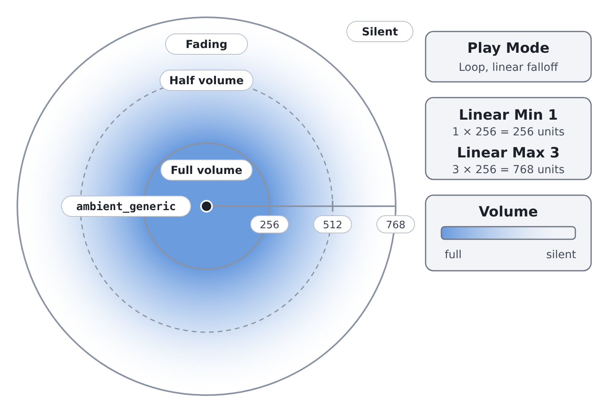

# Music and sound [[ported:sevenkewp svencoop]]

An [`ambient_music`](../entities/ambient_music.md) plays MP3 music that every player hears anywhere on the map. An
[`ambient_generic`](../entities/ambient_generic.md) has play modes that make a sound play once or loop, even against
the loop points of its WAV file. Two of these modes add a linear falloff, so the sound gets quieter the farther each
player is from it.

## `ambient_music`

| Key | Description | Default |
|---|---|---|
| **MP3 file** `message` | The file, as a path from `sound/`, for example `mymap/theme.mp3` | |

It has these flags:

- **Start Silent** (1) - The music doesn't start when the map loads
- **Loop** (2) - The music starts again when it ends

The game of each player plays the file with the MP3 player of the engine, at the MP3 volume that the player set in
their options. Without **Start Silent**, the music starts when the map loads. A trigger starts the music when it is
off, and stops it when it is on. Only one track plays at a time, so a second `ambient_music` that starts replaces
the track. An `ambient_music` that stops ends the music only if its own track is playing. A player who joins hears
the current track from its start. The file goes on the download list automatically.

An `ambient_generic` with an `.mp3` file plays it in the same way, as music for every player. If you set its **Play
Mode** to "Loop", it loops.

The path must obey these rules. If it doesn't, the game removes the entity when the map loads, and with
`developer 1` set in the console, the console shows an error:

- It is a path inside `sound/`, and it ends in `.mp3`
- It has only letters, digits and `/ _ - .`, and no `..`
- It has up to 57 characters

## `ambient_generic` play modes

These keys of `ambient_generic` choose how a sound plays:

| Key | Description | Default |
|---|---|---|
| **Play Mode** `playmode` | How the sound plays, which the table below lists | Default (0) |
| **Linear Min** `linearmin` | Up to this distance, the sound plays at full volume. The distance is in steps of 256 units, so 1 is 256 units | `0` |
| **Linear Max** `linearmax` | From this distance, the sound is silent. The distance is in steps of 256 units, and 0 makes the sound silent at all positions | `0` |

| Value | Mode | What it does |
|---|---|---|
| 0 | Default | The flag **Not Toggled** and the loop points of the WAV file decide |
| 1 | Play once | The sound plays once for each trigger, even a WAV file that has loop points |
| 2 | Loop | The sound loops, even a WAV file that has no loop points |
| 5 | Play once, linear falloff | Like "Play once", with a linear falloff |
| 6 | Loop, linear falloff | Like "Loop", with a linear falloff |

A linear falloff sets the volume for each player by their distance to the entity. The sound is at full volume up to
**Linear Min** and silent from **Linear Max**, and the entity ignores its radius flags. With **Play Everywhere**, the
two falloff modes, "Play once, linear falloff" and "Loop, linear falloff", play like "Play once" and "Loop", without
a falloff. For example, the lounge of `co_sbo_showcase` plays music in the mode "Loop, linear falloff" with **Linear Min** 1
and **Linear Max** 3, so the music is at full volume within 256 units and silent at 768 units.

*How the music volume falls off with distance, seen from above*

In the modes 1 to 6, the server starts the sound for each player. A player who joins gets the sound one second after
joining. If you make a WAV file without loop points loop, it starts again when a player comes into range. With
`developer 1` set in the console, the console shows a line about such a file. If the game can't read the length of a
WAV file, the file plays in the mode "Default", and with `developer 1` set in the console, the console shows an
error. A WAV file loops smoothly only if it has loop points. See
[Looping a sound](https://developer.valvesoftware.com/wiki/Looping_a_sound) for more details.

## Changes since 1.38

- `ambient_music` and the `ambient_generic` keys **Play Mode**, **Linear Min** and **Linear Max** are new

## See also

- [`ambient_music`](../entities/ambient_music.md) - the music entity
- [`ambient_generic`](../entities/ambient_generic.md) - every key of the sound entity
- [Custom content](../basics/custom-content.md) - how players download your sounds
