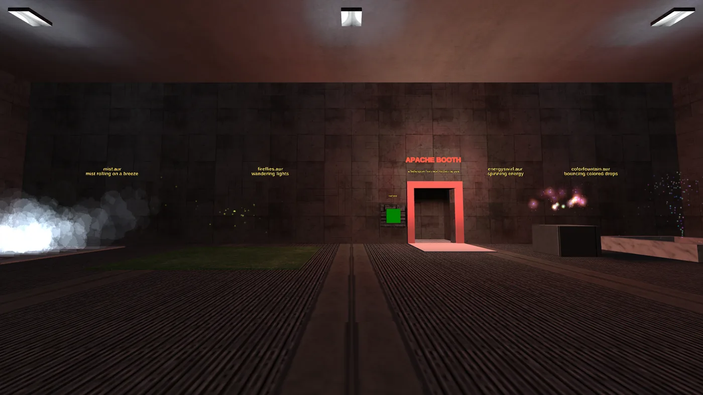
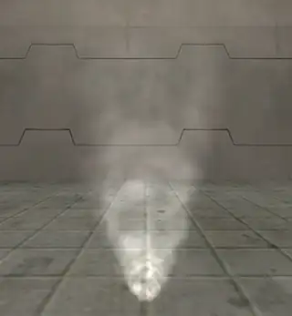
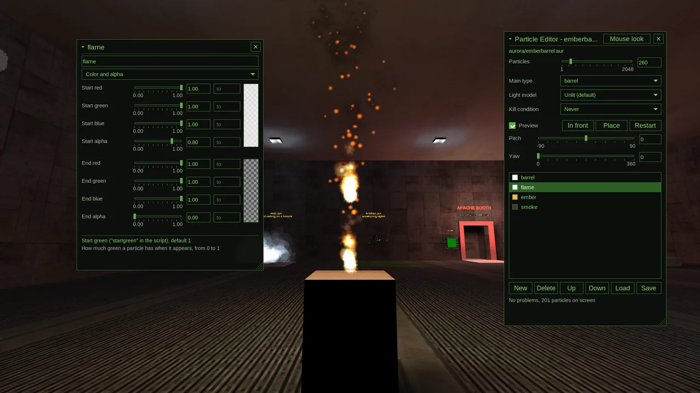

# Particles [[ported:spirit]]

Particles give your map steam, sparks, fire, smoke and other effects that move and change over time. An
[`env_particle`](../entities/env_particle.md) plays an Aurora particle script, a small text file in the `.aur` format
of Spirit of Half-Life, XashXT and PrimeXT. The scripts of those mods play in SBO next to the scripts that come with
the game, and you can make your own in-game with the [particle editor](#making-an-effect-in-the-game).

The Aurora hall of `co_sbo_showcase` has eight effects side by side.



*Particle effects in a hall*

## The entity

| Key | Description | Default |
|---|---|---|
| **Particle script**<br />`message` | The `.aur` file, as a path from the game folder, with up to 63 characters and without `..` | `aurora/steamvent.aur` |
| **Angles**<br />`angles` | The game adds the pitch and the yaw to the `spraypitch` and `sprayyaw` of the script, so a pitch of 90 turns the spray 90 degrees down. The entity ignores the roll, and the wind doesn't turn with the entity | `0 0 0` |
| **Move with entity**<br />`target` | The effect moves and turns with this entity, and it keeps the distance to the entity that it has in the editor. While a player can't see that entity, the player can't see the effect | |
| **Attachment point**<br />`attachment` | If **Move with entity** names an entity with a `.mdl`, the effect is on attachment 0 to 3 of the model. "None" (-1) means no attachment | None (-1) |

It has these flags:

- **Start On** (1) - A named `env_particle` starts on
- **Spawn Use** (2) - Each trigger shows a one-time copy of the effect at the position and angles of the activator

An effect without a name is always on. With a name, a trigger switches it on or off, and the
[use types](../guide/trigger-modes.md) On and Off set that state. Players who join later, and spectators, see each
effect in its current state. A **Spawn Use** copy emits particles for the top-level `lifetime` of its script, or
for the `lifetime` of its main type if the script has none. It's 5 seconds if neither is set, and 120 seconds at
most. Then its particles die out, and the game removes any that are left 30 seconds later. Players download the
script and the sprites that it names automatically.

## Scripts that ship with the game

| Script | What it shows |
|---|---|
| `steamvent.aur` | A jet of steam |
| `sparkshower.aur` | Welding flashes that spray bouncing sparks |
| `emberbarrel.aur` | A barrel fire with embers and smoke |
| `mist.aur` | Waterfall mist drifting on a breeze |
| `energyswirl.aur` | Spinning blue to violet energy orbs |
| `fireflies.aur` | Lights wandering over an area |
| `colorfountain.aur` | Colored drops bouncing on the floor |
| `traintrail.aur` | Exhaust that stays behind a moving entity, made for **Move with entity** |
| `muzzleburst.aur` | Bursts of muzzle flashes, made for **Attachment point** |
| `wrecksmoke.aur` | Smoke that is lit by the place it drifts through and goes out under water |
| `wrecksmoke_unlit.aur` | The same smoke without lighting |

The `aurora/` folder also has the scripts of Spirit of Half-Life: `smoke.aur`, `smoke2.aur`, `torch.aur`,
`fountain.aur`, `sparker.aur`, `signal.aur`, `galaxy.aur` and others.

## The `.aur` format

A script is a list of `"key" "value"` pairs. A few keys are alone at the top, and all the other keys belong to
particle types, with one `{ }` block for each type. `//` starts a comment, and keys can be in upper or lower case.
This script makes a column of rising smoke:

```text
"particles" "100"          // particles of this system at most
"maintype" "smokesource"   // the type the entity emits

{
  "name" "smokesource"     // the main type: one particle on the entity
  "spraytype" "smoke"      // sprays this type
  "sprayrate" "10"         // 10 a second
}

{
  "name" "smoke"
  "sprite" "sprites/ballsmoke.spr"
  "gravity" "40"           // rises
  "lifetime" "2"
  "startsize" "0"
  "endsize" "40"
  "startalpha" "0.3"
  "endalpha" "0"
  "startangle" "0..360"    // a random value for each particle
}
```

The **main type** is one particle that stays on the emitter while the effect is on. It draws nothing without a
`sprite`, so usually it only sprays. A particle with a `spraytype` sprays particles of that type, `sprayrate` times
a second, and a sprayed type can also spray another type. A sprayed particle starts with the speed of its parent plus
the spray. An `overlaytype` draws a second type on the same particle. The overlay has the same position, size and
spin, but its own sprite, colors, opacity and frame.



*`aurora/smoke.aur`: the main type `smokesource` draws nothing and sprays 10 `smoke` particles a second*

Any number can be a range `min..max`, and each particle gets its own random value in it. `0..360` and `360..0` mean
the same. You can also write the name of a type before its `{ }` block. If a script has a mistake, the rest of the
script still loads, and the game skips each key that it doesn't know. With `developer 1` set in the console, the
console shows one line about each mistake.

### Top-level keys

| Key | Description | Default |
|---|---|---|
| `particles` | How many particles this system can have, overlays included, from 1 to 2048. When all of them are in use, a spray waits for a free particle | `100` |
| `maintype` | The type on the emitter. Without it, the system shows nothing | |
| `lightmodel` | With 1 or 2, the game multiplies the color of each particle by the light of the world at its position, with its light styles. It measures the light every tenth of a second. With 0, the particles are unlit | `0` |
| `killcondition` | `empty`, `water` or `solid`. When the point of the emitter is in open space, in water or inside a solid, the effect stops permanently, and its living particles finish their life. The game also reads this key inside a type block, with the same effect on the whole system | |
| `attachment` | The attachment point the effect sits on when **Move with entity** names a `.mdl` and **Attachment point** is "None". This key counts from 1, as XashXT and PrimeXT do, so 1 is the entity's attachment 0, and 0 means no attachment. If you pick an **Attachment point** on the entity, that one counts instead | `0` |
| `lifetime` | How many seconds a **Spawn Use** copy emits particles. It replaces the `lifetime` of the main type for the copy, as in PrimeXT. An effect that the entity switches on and off keeps running | |

### Type keys

Each type block takes these keys. Values that change from a start to an end change evenly over the life of the
particle.

| Key | Description | Default |
|---|---|---|
| `name` | The name of the type, up to 29 characters | |
| `sprite` | The sprite, for example `sprites/glow01.spr`. Without a sprite, the game draws nothing | |
| `rendermode` | How the game draws the sprite: `additive`, where black is invisible, `solid` or `texture`, which blend by the alpha of the sprite, or `color` | `additive` |
| `lifetime` | How many seconds the particle lives, so a sprayed particle with 0 dies immediately. For the main type, it is the length of a **Spawn Use** copy | `0` |
| `startsize` | Half the width of the sprite square in units, and a particle with 0 or less isn't drawn | `0` |
| `endsize` | The size at the end of its life | |
| `sizedelta` | If there is no `endsize`, how many units per second the size changes | `0` |
| `startalpha`, `endalpha` | The opacity at the start and at the end of its life, from 0 for invisible up to 1 for solid | `1, 1` |
| `startred`, `startgreen`, `startblue` | The color at the start, each from 0 to 1 | `1` |
| `endred`, `endgreen`, `endblue` | The color at the end of its life | `1` |
| `startframe` | The sprite frame at the start, and the frames loop | `0` |
| `endframe` | The frame at the end of its life | |
| `framerate` | If there is no `endframe`, how many frames per second it plays | `0` |
| `startangle` | How far the sprite is turned at the start, in degrees | `45` |
| `angledelta` | How many degrees per second the sprite spins | `0` |
| `gravity` | The upward pull in units per second squared, so positive values rise and negative values fall | `0` |
| `drag` | How fast the speed of the particle changes to the speed of the wind, where 0 keeps the speed | `0` |
| `windyaw`, `windstrength` | The direction of the wind as a yaw, where 0 is east and 90 is north, and its speed | `0, 0` |
| `spraytype` | The type this particle sprays | |
| `sprayrate` | How many particles it sprays per second, up to 16 in each frame | `0` |
| `sprayforce` | The speed of the spray in units per second, which the game adds to the speed of the parent | `0` |
| `spraypitch` | The pitch of the spray, from -90 for up through 0 for level to 90 for down. The game adds the pitch of the entity | `0` |
| `sprayyaw` | The yaw of the spray, where 0 is east and 90 is north. The game adds the yaw of the entity | `0` |
| `overlaytype` | A type drawn on this particle, up to 4 layers deep, which doesn't move or spray by itself and dies with the particle | |
| `collision` | What happens when the particle hits the world or a brush entity, which is `none`, `die` or `bounce` | `none` |
| `bounce` | With `bounce`, how much of the speed the particle keeps away from the surface, from 0 to 1. A value other than 0 also turns bouncing on | `0` |
| `bouncefriction` | With `bounce`, how much of the speed it loses at each bounce, from 0 to 1 | `0` |
| `drawcondition` | The game draws the particle only where its point is in `empty` space, in `water` or inside something `solid` | |

XashXT and PrimeXT scripts load and run like SBO scripts. Their top-level `attachment` and `lifetime` keys are
defaults, and the keys you set on the entity always count first.

## Making an effect in the game

The game has a particle editor. With it, you can make an effect while you watch it run in your map, and then save it
as a `.aur` file. Type `particleeditorui` in the console to open it. It works in single player, in a game that you
host, and on a server that has `sv_cheats 2` set in its console. `sv_cheats 1`, which turns on the usual
[cheats](../getting-started/cheat-commands.md), doesn't open it. Type the command again to close all of its windows
and the effect.



*The particle editor with a fire effect open*

The editor runs your script as a real effect in front of you. The effect starts again with each change that you
make, so you see the change immediately. While a window of the editor is open, the mouse moves a cursor and not your
view, and your keyboard still moves you. To look around with the mouse and keep the editor open, press **Mouse
look** at the top of the main window, or type `tool_mouselook` in the console. <kbd>Esc</kbd> gives you the cursor
back. You can change the size of each window with its edges, except the Save window and the color wheel. To fold a
window to its title bar, click the arrow next to the title or double-click the title. If you hold the mouse on a
control, a tip tells you what it does. The windows remember their position and size, and they always open
unfolded.

The main window has these parts:

- **Particles**, **Main type**, **Light model** and **Kill condition** - the
  [top-level keys](#top-level-keys) of the script
- **Preview** - turns the effect on and off, like switching an `env_particle`
- **In front** - puts the effect in front of you
- **Place** - puts the effect on the wall or floor you click next
- **Restart** - starts the effect again
- **Pitch** and **Yaw** - turn the spray, like the angles of an [`env_particle`](../entities/env_particle.md)
- **The list of types** - the particle types of the script. The square shows the start color of a type, and the
  main type has a bright frame

**New** adds a type and opens its window. **Delete** removes the selected type, and **Up** and **Down** move it in
the file. A double click on a type opens its window. The window has the name of the type, a box where you choose a
group of keys, such as **Color and alpha**, and the keys of that group with plain names. If you point at a key, the
bottom of the window shows its name in the script, its unit and default, and what it does. You can drag a slider or
type into the box next to it. For a range, type the second number into the **to** box. A right click on a slider
removes the key from the script, so the game uses the default of the key. If you rename a type, the `maintype`,
`spraytype` and `overlaytype` keys that name it also change.

In the **Color and alpha** group, a box next to the numbers of the start color and of the end color shows that
color. A click on a box opens a color wheel. Drag in the wheel to choose the color, and drag on the bar next to it to
set the brightness. The slider under them sets the alpha, and the effect changes while you drag. <kbd>Esc</kbd>
closes the wheel and sets the color back to its value when you opened the wheel.

**Pick** next to the sprite opens a window with the sprites in the folders of the game. These are the SBO sprites,
the Half-Life sprites and the sprites that you downloaded with maps, as pictures with their names under them. A
larger window shows more of them at the same time. The list hides the sprites of the HUD, the kill feed and the map
editor icons, which particles don't use, and **Show filtered sprites** also shows them. If a name is too long to
fit, point at the picture to see its full path. If you type part of a name in the filter box, the list shows only the
sprites that match, while you type. A double click or <kbd>Enter</kbd> gives the sprite to the type and closes the
list. If the game can't load the sprite, the window tells you why. The game loads only the sprite that you pick, not
the pictures in the list.

A line at the bottom of the main window shows the problems that the game finds in your script, such as an unknown
key or a type that is used but not defined. It also shows how many particles are on the screen.

**Load** lists the scripts in `aurora/`, which are the scripts that come with the game and the scripts that you
downloaded, and a new script to start from. A double click or <kbd>Enter</kbd> opens a script. If your script has
changes that you haven't saved, the editor first asks if you want to save them. It asks the same when you close it.
The title shows unsaved changes with a `*`.

**Save** asks for a name of up to 39 characters: letters, digits, `_` and `-`. It writes `aurora/<name>.aur` in the
SBO folder. If a file with that name exists, press **Save** a second time to replace it. The editor changes only the
keys that you edit, so the comments and the order of a script that you loaded stay the same. To use the effect in
your map, set the **Particle script** of an [`env_particle`](../entities/env_particle.md) to `aurora/<name>.aur`.
The game reads each script one time for each map, so an `env_particle` in the current map keeps the old script until
the map loads again.

## Notes

| Limit | Value |
|---|---|
| Particles per system | 1 to 2048 |
| Particles alive in all systems together | 8192 |
| Types per script | 64 |
| Overlay depth | 4 |
| Particles sprayed by one particle in one frame | 16 |
| Spawn Use copies | 10 per second for each entity, and 32 at a time in the game of a player |
| Script name | 63 characters |

Each player's game runs the particles, with its own random values. It doesn't run or draw an effect that the
player can't see. Particles show only with the OpenGL renderer, because the software renderer draws none, and
[mirrors](mirrors.md) don't show them.

## Changes since 1.38

- `env_particle` and the Aurora scripts are new
- The in-game particle editor, which you open with `particleeditorui` in the console, makes particle effects and saves them as `.aur` files

## See also

- [`env_particle`](../entities/env_particle.md) - the entity page
- [Custom content](../basics/custom-content.md) - how players download scripts and sprites
- [Weather and fog](weather.md) - rain, snow and fog
