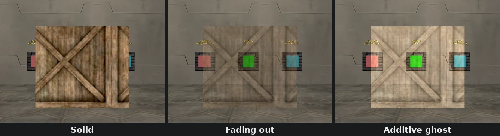

# Props, models and fades

Props, models and fades fill your map with scenery models and let you fade any entity in or out. An
[`env_static`](../entities/env_static.md) shows a model at almost no cost to the server, and an
[`env_model`](../entities/env_model.md) gives a model two animated states that a trigger switches between. An
[`env_render`](../entities/env_render.md) changes how the game draws other entities, immediately or with a smooth
fade.

| Entity | What it is |
|---|---|
| `env_static` | A model that each player's game draws, without an entity on the server |
| `env_model` | A model with an "on" animation and an "off" animation |
| `env_render` | Copies render settings to its targets, immediately or with a smooth fade |

## `env_static`

An `env_static` is a model that costs the server almost nothing. It doesn't count toward the engine's limit on
models in a map, because players download the model file as a plain file. It uses no network traffic while the map
runs, and a prop without a name doesn't count toward the engine's limit on entities in a map. An `env_static` isn't
solid, so players, monsters and bullets go through it.

When you trigger a named prop, it shows or hides for every player, and the [use types](../guide/trigger-modes.md) On
and Off set that state. The flag **Start invisible** (2) makes it start hidden, and players who join later see each
prop in its current state. With the flag **In the 3D sky** (4), the prop shows in the sky room of an `env_sky`. See
[3D sky](sky.md) for more details.

| Key | Description | Default |
|---|---|---|
| **Model** `model` | The model. The default is a placeholder box for the editor only. If you don't replace it, the game removes the entity when the map starts | `models/editor/env_static.mdl` |
| **Body**, **Skin** `body`, `skin` | The body group and the skin of the model | `0` |
| **Animation sequence** `sequence` | The animation the model plays | `0` |
| **Animation speed** `framerate` | How fast the animation plays, where 0 keeps the model still | `1.0` |
| **Scale** `scale` | The size of the model, where 0 or 1 is the normal size | `1.0` |

A map can have up to 1024 props and 256 different prop models, and the game leaves out the others. With
`developer 1` set in the console, the console reports this.

## `env_model`

An `env_model` is a model with two states. A trigger with On, Off or Toggle switches the model between its on state
and its off state. Each state has its own sequence, behavior and frame rate.

| Key | Description | Default |
|---|---|---|
| **Sequence when on**, **Sequence when off** `m_iszSequence_On`, `m_iszSequence_Off` | The name of the animation for each state | |
| **Behavior when on**, **Behavior when off** `m_iAction_On`, `m_iAction_Off` | What happens when the animation ends:  &bull;&nbsp;Freeze when sequence ends (0) - it stops on the last frame &bull;&nbsp;Loop (1) - it starts again &bull;&nbsp;Change state when sequence ends (2) - the model changes to the other state | Freeze when sequence ends (0) |
| **Framerate when on**, **Framerate when off** `m_flFramerate_On`, `m_flFramerate_Off` | How fast each animation plays, where 1 is its normal speed | `1` |
| **Starting frame** `frame` | The frame that the animation starts on, from 0 to 255, where -1 picks a random frame | `0` |
| **Material** `material` | With **Solid (model hitboxes)**, the hit sound and impact effects of bullets on the model, which the table below lists | Cinder Block (4) |
| **Reset at round start** `round_reset` | If you set Yes, the model goes back to the state it had when the map loaded at each round start. See [Round hooks](../guide/round-hooks.md) for more details | No (0) |

It has these flags:

- **Initially Off** (1) - The model starts in its off state
- **Drop to Floor** (2) - The game puts the model on the floor when the map starts
- **Solid (20 unit box)** (4) - The model is a solid box of 20 units
- **Solid (model hitboxes)** (8) - The model is solid in the shape of its hitboxes
- **Client-side animation** (16) - Each player's game runs the animation
- **Always send to clients** (32) - Every player's game gets the model all the time, also when the player can't see it

**Solid (model hitboxes)** works with a model that has 1 to 128 hitboxes and was compiled with the model flag 512.
You write this flag as `$flags 512` in the QC file of the model. See
[the QC guide on the303.org](https://the303.org/tutorials/gold_qc.htm) for more details, and
[Useful tools](../getting-started/useful-tools.md) for the tools that compile models. Players, monsters, bullets,
rockets and grenades then hit the hitboxes. Other models give the results in this table:

| The model | Result |
|---|---|
| `$flags 512` and 1 to 128 hitboxes | Collision with the hitboxes |
| No `$flags 512` | The 20-unit box of flag 4 |
| `$flags 512` and 0 or more than 128 hitboxes | Not solid |
| A `scale` other than 1 | Collision at the unscaled size |

While it is off, a model with this flag isn't solid. With `developer 1` set in the console, each of these cases
prints a line in the console. The key **Material** sets the sound and look of bullet hits on such a model:

| Material | Sounds and looks like |
|---|---|
| Glass (0), Unbreakable Glass (7) | Glass |
| Wood (1) | Wood |
| Metal (2) | Metal, with sparks |
| Flesh (3) | Flesh |
| Cinder Block (4) | Concrete |
| Ceiling Tile (5) | Tile |
| Computer (6) | Computer, with sparks |
| Rocks (8) | Gravel |

Bullet hits on a model leave no decal. See [Materials](materials.md) for the materials of the world.

## `env_render`

When you trigger an `env_render`, it copies its FX, FX Amount, Render Mode and FX Color to every entity named in
**Target**. **Target** also accepts [`!activator`](../guide/entity-triggering.md#target-selectors) and `*player`.
Each of the flags 1 to 8 leaves out one setting, and with a **Fade Time**, the change is smooth.

| Key | Description | Default |
|---|---|---|
| **FX Amount factor** `message` | The targets get the FX Amount of the entity times this factor. It can be a number, a range `a..b` or a [locus number](../guide/locus.md). If you leave it empty, it is 1 | |
| **Scale** `m_fScale` | The model or sprite scale that the targets get, where 0 doesn't change it | `0` |
| **Fade Time** `frags` | How many seconds the FX Amount, the color and the scale take to change, where 0 changes them immediately | `0` |
| **Trigger after fading** `netname` | The entity triggers it one time when the change is done, with the first target as the activator | |

It has these flags:

- **No Renderfx** (1) - It doesn't copy the FX
- **No Renderamt** (2) - It doesn't copy the FX Amount
- **No Rendermode** (4) - It doesn't copy the Render Mode
- **No Rendercolor** (8) - It doesn't copy the FX Color
- **Remove target** (32) - It removes the targets after the fade, but only with a **Fade Time**. It never removes
  players
- **Remove self** (64) - The `env_render` removes itself after it is used

The Render Mode and the FX change immediately, at the start of a fade. The FX Amount, the color and the scale change
smoothly. A fade starts from what the target shows at that moment, also in the middle of an earlier fade. A new
change replaces a fade that is still running. A target with the Render Mode Normal and an FX Amount of 0 counts as
255 when a fade starts. Each player's game draws the fade smoothly, and players who join during a fade see the
end state. A scale fade grows or shrinks the model smoothly, and its collision box and hitboxes follow it step by
step. See [Model scale](model-scale.md) for more details.

Up to 256 fades can run at the same time. If there are more, an entity gets its end values immediately. A fade lasts
one hour at most.

`co_sbo_showcase` has a crate that fades out, fades in and fades to an additive ghost over 3
seconds.

*A crate solid, half faded and as an additive ghost*

## Changes since 1.38

- `env_static` and `env_model` are new
- `env_render` has the keys **FX Amount factor**, **Scale**, **Fade Time** and **Trigger after fading**, and the
  flags **Remove target** and **Remove self**. In SBO 1.38, it could only copy the render settings immediately

## See also

- [`env_static`](../entities/env_static.md), [`env_model`](../entities/env_model.md) and
  [`env_render`](../entities/env_render.md) - the entity pages
- [Model scale](model-scale.md) - the `scale` key on models
- [Materials](materials.md) - the materials of the world's textures
- [Round hooks](../guide/round-hooks.md) - putting an `env_model` back at each round start
- [Entity keyvalues](../guide/entity-keyvalues.md) - the render keys
