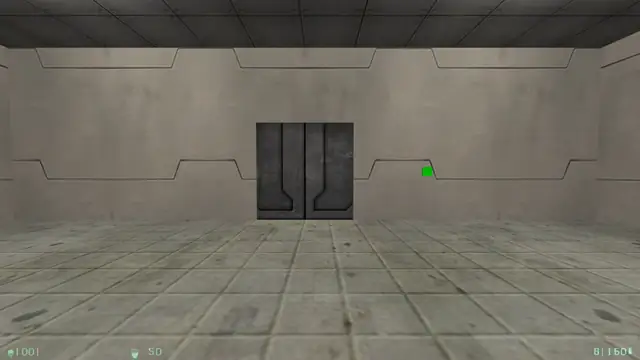
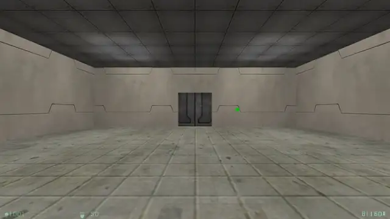

# Sequence files [[ported:czeror]]

A sequence file is a text file next to your map that runs timed scenes: it triggers entities, shows text on every
player's screen and plays sounds, one line after the other, with pauses in between. Each scene in the file is an
entry, and a [`trigger_sequence`](../entities/trigger_sequence.md) in the map runs one entry when you trigger it.

A scene with text, sounds and doors that open on cue can be one short entry instead of a chain of relays in the map,
and you can change its timing or its text without compiling the map again. Each line of an entry can trigger
entities, remove entities, show text or play a sound, and then wait a few seconds before the next line. The format is
the one of Counter-Strike: Condition Zero Deleted Scenes.

## Your first sequence

This setup shows a warning on every player's screen when a player presses a button, and opens a door 3 seconds
later.

### Step 1: the file

In the `sequences` folder of the game folder, next to `maps`, make a text file with the name of your map and the
extension `.seq`. For the map `maps/co_mymap.bsp` the file is `syndicate/sequences/co_mymap.seq`. Write this in it:

```text
%vault_open
{
    #text = "The vault opens in 3 seconds", position = -1 -1
    #pause = 3
    #firetargets = "vault_door"
}
```

- `%vault_open` starts an entry called `vault_open`, and its lines go between `{` and `}`
- `#text` shows text on every player's screen, and `position = -1 -1` puts it in the middle of the screen
- `#pause = 3` waits 3 seconds
- `#firetargets` triggers every entity named `vault_door`, like the **Target** key of a button does

### Step 2: the entities

1. Place a [`func_door`](../entities/func_door.md) and set its **Name** to `vault_door`.
2. Place a `trigger_sequence` and set its **Name** to `seq_vault`.
3. Set the **Sequence name** of `seq_vault` to `vault_open`, which is the entry's name without the `%`.
4. Place a [`func_button`](../entities/func_button.md) and set its **Target** to `seq_vault`.

### Step 3: in-game {#step-3-in-game}

When a player presses the button, every player on the server sees "The vault opens in 3 seconds" in white in the
middle of their screen for about 2 seconds, wherever they are, and 3 seconds after the press the door opens. If
somebody presses the button again while the entry runs, it starts again from its first line.



*Sequence text on the screen, then the door it announces opens*

You don't need to compile the map again when you change the file: the game reads it each time the map loads. If the
file has a mistake, the server console shows it with its line number when the map loads, and the game then uses
nothing of that file. [Testing a map](../getting-started/testing.md) shows where to find the console.

## Lines and pauses

The lines of an entry run from top to bottom. A line starts with `#` and holds one or more commands, separated by
commas. Everything on one line happens at the same moment, and the `pause` of a line is the wait after it. So these
two entries do the same thing:

```text
%version_a
{
    #text = "Get out!"
    #pause = 2
    #firetargets = "exit_door"
}

%version_b
{
    #text = "Get out!", pause = 2
    #firetargets = "exit_door"
}
```

A line can go on over several lines of the file, because it only ends where the next `#`, `$`, `@` or `}` starts.
This line shows text, plays a sound and triggers the lights all at once, and then waits 4 seconds:

```text
    #text = "Intruder alert!",
        sound = VAULT_ALARM,
        firetargets = "alarm_lights",
        pause = 4
```

These are the commands a line can have:

| Command | Value | What it does |
|---|---|---|
| `pause` | Seconds | Waits this long after the line before the next line runs |
| `firetargets` | A name in quotes | Triggers the entities with that name. See the next section for more details |
| `killtargets` | A name in quotes | Removes the entities with that name from the map |
| `text` | Text in quotes | Shows the text on the screen of every player, also dead players and spectators |
| `sound` | A sound name | Plays a sound. See [Sounds](#sounds) for more details |
| `repeat` | -1 or a number | Starts the entry again from its first line. See [Repeating an entry](#repeating-an-entry) for more details |

When one line has several of these, the game triggers the targets first, then removes the entities, then shows the
text and then plays the sound.

### Triggering and removing entities

`firetargets` triggers the entities the way the **Target** key of a button does. They get the same activator as the
`trigger_sequence`, so [`!activator`](../guide/entity-triggering.md#target-selectors) in the entities you trigger
is the player who pressed the button in the first example. They also get the same use type, so if the
`trigger_sequence` was triggered with On, its targets get On too.

`killtargets` removes every entity with that name, for example a [`monstermaker`](../entities/monstermaker.md)
that should stop making monsters:

```text
    #killtargets = "vault_guard_maker"
```

## Text on the screen

Text uses the same settings as a [`game_text`](../entities/game_text.md): a position, colors, an effect, fade
times, a hold time and a channel. Without any settings, text is white, starts at the middle of the screen and runs
to the right, fades in for 0.2 seconds, stays for 1.6 seconds and fades out for 0.2 seconds. Add `position = -1 -1` to
center it.

### Changing how text looks

You change these settings with modifiers. A modifier written after a comma on a `#` line changes that line only:

```text
    #text = "Get out!", color = 255 60 60, holdtime = 4
```

A modifier on a line of its own that starts with `$` changes every text after it, until you change it again or the
entry ends:

```text
%briefing
{
    $color = 150 220 255, position = -1 0.7     // light blue, low on the screen
    #text = "Control: the guards change shifts at midnight.", pause = 3
    #text = "Control: you have two minutes.", pause = 3
    #text = "Go!", color = 255 255 255           // this one is white
}
```

These are the modifiers. Their values work like the keys of a `game_text`:

| Modifier | Value | If you don't set it |
|---|---|---|
| `position` | Two numbers `x y` from 0 to 1, where `0 0` is the top left corner and `1 1` the bottom right one. -1 centers the text in that direction | 0.5 0.5 |
| `color` | The text color as `red green blue`, each from 0 to 255 | 255 255 255 |
| `color2` | The color of the highlight of the effect "scan out", as `red green blue` | 255 255 255 |
| `effect` | 0 fades the text in and out, 1 is the credits effect, and 2 writes the text out one letter at a time ("scan out") | 0 |
| `fadein` | Seconds. With the effect 2, it is the time for each letter | 0.2 |
| `fadeout` | Seconds | 0.2 |
| `holdtime` | Seconds the text stays. -1 sets it by the length of the text: 1 second plus 0.05 seconds for each character | 1.6 |
| `fxtime` | Seconds of the highlight of the effect 2 | 1 |
| `channel` | The text channel from 0 to 3. A new text replaces the text on the screen that has the same channel | 0 |
| `speaker` | The name of a monster that says the sounds, or `none`. See [Sounds](#sounds) for more details | none |
| `listener` | Who the speaker talks to. See [Sounds](#sounds) for more details | none |

Text in quotes can go over several lines of the file, and its line breaks show on the screen. The game shows the
text exactly as you wrote it, so `\n` doesn't make a new line.

### The ready-made styles

The game comes with five styles, which are sets of modifiers you can use with `@` and their name. A style changes
every text after it, like a `$` line does:

```text
%intro
{
    @TitleStyle
    #text = "THE VAULT", pause = 2
    @SubtitleStyle
    #text = "Sector 7, 02:14", pause = 4
    @ObjectiveStyle
    #text = "Find the vault"
}
```

| Style | Where on the screen | Color | Effect | How long it stays | Channel |
|---|---|---|---|---|---|
| `@TitleStyle` | Centered, 36 % down | White | Scan out | 4 s | 2 |
| `@SubtitleStyle` | Centered, 42 % down | Gray | Fade | 4 s | 3 |
| `@ObjectiveStyle` | Centered, 16 % down | Orange | Scan out | 5 s | 0 |
| `@RadioStyle` | Centered, 70 % down | Light blue | Fade | By the length of the text | 3 |
| `@SignStyle` | Centered, 56 % down | Pale yellow | Fade | By the length of the text | 0 |

Each style also sets `speaker = none`. No style uses channel 1, because the game uses it for other text, such as
**LEVEL UP**.



*The five ready-made text styles*

## Sounds

`#sound` plays a sound by a name. The name is either a sound group of your file or a sentence group of the game's
`sound/sentences.txt`, such as `BA_OK`, and the game looks in your file first.

You list your own sounds in a `!sentences` block in the file, outside the entries. Each line holds a name and a sound
file under `sound/`, with or without `.wav`:

```text
!sentences
{
    VAULT_ALARM0 mymap/alarm_a           // sound/mymap/alarm_a.wav
    VAULT_ALARM1 mymap/alarm_b.wav       // sound/mymap/alarm_b.wav
    VAULT_RADIO0 mymap/radio_call
}

%alarm
{
    #sound = VAULT_ALARM, pause = 2
    #sound = VAULT_RADIO
}
```

Names that differ only in the number at their end make a group, so `VAULT_ALARM0` and `VAULT_ALARM1` are the group
`VAULT_ALARM`, and `#sound = VAULT_ALARM` plays one of the two at random. A group can also have only one sound, like
`VAULT_RADIO`. A sound file without a folder is in `sound/vox/`, which holds the announcer's words.

If the name is neither in your file nor in `sentences.txt`, nothing plays, and the console says so when the map loads.

### Who hears a sound

Without a speaker, every player hears the sound at full volume, wherever they are. A sound of one file doesn't overlap the sound of one file before it from the same
`trigger_sequence`, because the new one stops the old one if it is still playing.

With `speaker` set to the name of a monster, that monster says the sound, so only the players near the monster hear
it. If no monster has that name, nothing plays. For a group of `sentences.txt`, `listener` names who the monster talks to:
the name of an entity, or a class name such as `player`, which picks the nearest one within 4096 units of the
`trigger_sequence`:

```text
    #sound = BA_OK, speaker = guard_boss, listener = player
```

### Sentences of several words

A line in the `!sentences` block can also hold several words, like the sentences in
[`sentences.txt`](https://twhl.info/wiki/page/Sentences.txt). The game plays the words one after the other, a comma
makes a short pause, and a setting in brackets right after a word, such as `(p105)` for a higher pitch, changes
that word:

```text
!sentences
{
    VAULT_WARNING0 warning, security breach(p105) detected
}
```

Without a speaker, every player's game plays the whole sentence. A sentence can have up to 120 characters, and only
its first word can name a folder, which then holds all its words. With a speaker, the monster only says the first
word of such a sentence, and the console says so when the map loads.

## Repeating an entry

`#repeat = -1` starts the entry again from its first line, again and again, until the `trigger_sequence` is turned
off. The entry needs a pause on or before the `repeat` line, or the game refuses the whole file:

```text
%siren
{
    #firetargets = "siren_light", sound = VAULT_ALARM, pause = 1.5
    #repeat = -1
}
```

`#repeat = 2` starts the entry again from its first line 2 times and then goes on with the line after it. So in this
entry the knock plays 3 times, and then the door opens:

```text
%knock
{
    #sound = KNOCK, pause = 0.5
    #repeat = 2
    #firetargets = "door"
}
```

A `repeat` always goes back to the first line of the entry, not to the line after an earlier `repeat`. An entry can
have up to 8 `repeat` lines with a number. `#repeat = 0` does nothing.

## Starting and stopping

How the `trigger_sequence` reacts depends on the [use type](../guide/trigger-modes.md) it gets:

| It gets | When the entry isn't running | When the entry is running |
|---|---|---|
| On, Toggle or Set | Starts the entry | Starts the entry again from its first line |
| Off | Does nothing | Stops the entry |

Buttons, `trigger_once`, `trigger_multiple` and [`multi_manager`](../entities/multi_manager.md) send Toggle, so
they start an entry. To stop one, target the `trigger_sequence` with a [`trigger_relay`](../entities/trigger_relay.md)
whose **Trigger State** is Off, and trigger the relay.

When an entry stops, no more of its lines run, but what it already did stays done: triggered entities stay
triggered, removed entities stay removed and text on the screen stays for its hold time. A sound it plays without
a speaker stops at once, but a sound a monster says and a sentence of several words play to their end.

:::note

A `trigger_relay`, [`trigger_auto`](../entities/trigger_auto.md) or
[`game_team_master`](../entities/game_team_master.md) sends Off when its **Trigger State** is Off, which is the
editor default, or when it has no **Trigger State** key. To start an entry through one of these, set its
**Trigger State** to On or Toggle.

:::

With the flag **Fire once**, the `trigger_sequence` runs its entry only the first time it is started, and it stays
used up even if an Off stopped the entry.

A few more rules apply while entries run:

- Each `trigger_sequence` runs its own entry, so two of them can run the same entry at the same time
- A player who joins sees and hears only the lines that run after they joined
- A new round doesn't stop a running entry or reset **Fire once**
- An entry that runs 4096 lines without a pause stops, and the console says so

## Your own styles and defaults

An entry that holds only `$` lines works as a style of your own, and you use it with `@` like the game's styles:

```text
%VaultStyle
{
    $position = 0.05 0.5, color = 120 255 120
    $holdtime = 3, channel = 2
}

%vault_log
{
    @VaultStyle
    #text = "Vault log: door opened", pause = 3
    #text = "Vault log: alarm off"
}
```

`@name` puts all the lines of the entry `name` at that place, including its `$` lines, so any entry works this way,
not only styles. The entry can be in your file or in the game's `global.seq`, and an entry can be used with `@` and
run by a `trigger_sequence` both. `#gosub = name` does the same as `@name`. An entry that uses itself, directly or
through other entries, is a mistake.

A `$` line outside the entries sets the defaults of every entry after it in the file:

```text
$fadein = 0.5, fadeout = 0.5
```

The game's styles are in `sequences/global.seq`, which comes with the game. The game reads it before the file of
your map, so if your file has an entry with the same name as one in `global.seq`, such as `%RadioStyle`, yours
replaces it on your map.

## Writing rules

- Text and target names go in quotes, while entry names, sound names and numbers don't
- `//` starts a comment that goes to the end of the line, and `/*` and `*/` enclose a comment over several lines. The
  game removes comments before anything else, also inside quotes, so text can't contain `//` or `/*`
- Entry names, command names, modifier names and sound names can be in upper or lower case
- Each entry name can be in a file only once
- Outside the entries, a line starts with `%` for an entry, `!sentences` for the sound block or `$` for the defaults
- Inside an entry, a line starts with `#` for commands, `$` for modifiers or `@` for a style or another entry
- `#sentence` does nothing, and the console says so when the map loads. Use `#sound` instead

The game also refuses a file that uses `setdefaults`, `modifier`, `postmodifier` or `noop`, which are commands of the
Condition Zero format that a file can't use.

## A full example

The courtyard lightning of `co_sbo_showcase` runs from `sequences/co_sbo_showcase.seq`. It triggers a light flash, a screen
flash, a laser beam that flickers, an explosion and the thunder, with short pauses between them:

```text
%lightning
{
    #firetargets = "lt_flash_ls"
    #firetargets = "lt_zone1"
    #firetargets = "lt_beam", pause = 0.12
    #firetargets = "lt_beam", pause = 0.08
    #firetargets = "lt_beam"
    #firetargets = "lt_zone2"
    #firetargets = "lt_boom", pause = 0.3
    #firetargets = "lt_beam", pause = 0.5
    #firetargets = "lt_thunder"
}
```

The SDK file <SdkFile path="sdk/examples/sequences/co_example.seq" /> uses every part of the format, with a comment on each line.

## Downloads and limits

When the map loads, the server adds `sequences/<map>.seq` and the sound files of its sentences to the files players
download with the map. `global.seq` comes with the game, so the server doesn't send it. See
[Custom content](../basics/custom-content.md) for how players get your files.

| Limit | Value |
|---|---|
| Sound files the sequences of a map can play | 128 |
| Sound files in sentences of several words | 128 |
| Characters in a sentence of several words | 120 |
| `repeat` lines with a number in one entry | 8 |
| Lines in a row without a pause | 4096 |

## Changes since 1.38

- Sequence files and `trigger_sequence` are new

## See also

- [`trigger_sequence`](../entities/trigger_sequence.md) - runs an entry of the file
- [`game_text`](../entities/game_text.md) - the HUD text whose settings the modifiers follow
- [`trigger_relay`](../entities/trigger_relay.md) - its **Trigger State** decides whether it starts or stops an entry
- [Trigger modes](../guide/trigger-modes.md) - the use types On, Off, Toggle and Set
- [Custom content](../basics/custom-content.md) - how players download your sounds
- [Testing a map](../getting-started/testing.md) - where the console shows mistakes in the file
