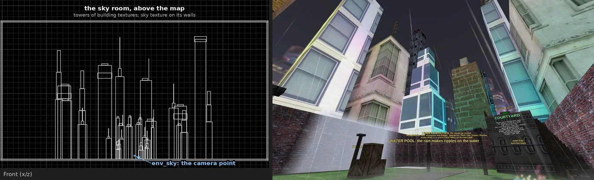
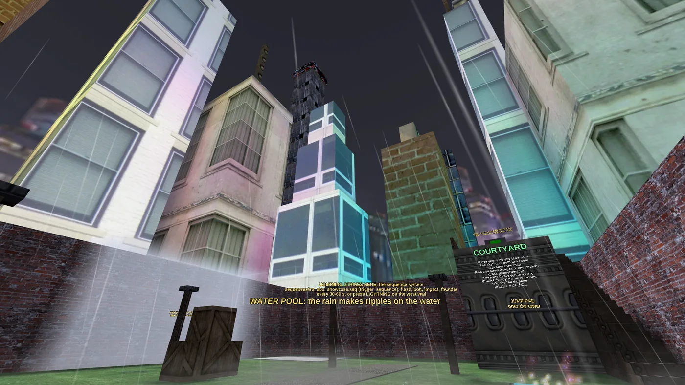
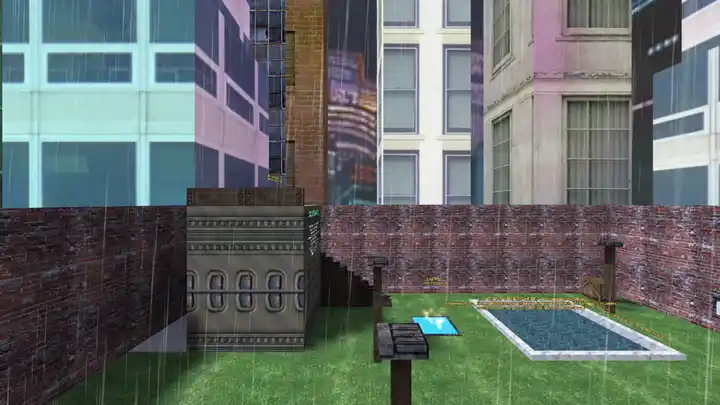

# 3D sky [[ported:spirit]]

:::warning[ReSDHLT]

ReSDHLT v0.22.2 lights the areas under a 3D sky black. If you compile with ReSDHLT, use my
[ReSDHLT v0.22.2-envsky.1](https://github.com/MisterCalvin/ReSDHLT/releases/tag/v0.22.2-envsky.1) until this note is
removed. ZHLT, VHLT and SDHLT are not affected. See
[ReSDHLT and env_sky areas](../basics/compiler-notes.md#resdhlt-and-env_sky-areas) for more details.

:::

A 3D sky gives your map a skyline with real depth instead of a flat picture, with towers, scenery models and moving
clouds behind the sky of the playable area. You build this scenery in a closed room of the map that players never
reach, called the sky room. An [`env_sky`](../entities/env_sky.md) in that room is the camera point that the game
shows it from.

The courtyard of `co_sbo_showcase` has a 3D sky. Its skyline is a room high above the map.

*A sky room in the editor, and its skyline in-game*

*A 3D skyline above a courtyard*

## How it works

Before each frame, each player's game draws the sky room as it looks from the `env_sky` point, with the angles
and field of view of the view. Then it draws the normal view on top. The sky room shows at all places where the view
has no face. You make these places with the `env_sky` texture, because the game doesn't draw a face with this
texture. `sbo_tools.wad` has an `env_sky` texture, and any other texture with this name works too, because only the
name counts. The `env_sky` texture also needs compile tools that know it. See
[Compiler notes](../basics/compiler-notes.md) for more details.

The `sky` faces of the sky room show the 2D skybox behind its scenery, and `sky` faces in other parts of the map show
the 2D skybox as usual. The weather treats an `env_sky` face as sky, so rain and snow fall under it.

## Parallax

Parallax makes the sky room move a little as the player moves, as scenery far away does:

| Key | Description | Default |
|---|---|---|
| **Parallax scale** `frags` | If you leave it at 0, the camera stays at the `env_sky` point, so the sky room acts like a skybox that is infinitely far away. With a value N from 1 to 255, the camera is at the `env_sky` point plus the eye position of the player divided by N | 0 |

With a scale of N, the center of the map at 0 0 0 matches the `env_sky` point. If the player moves 160 units in the
map, the camera moves 160 / N units in the sky room. The sky room is then a 1:N model of the map around its center.

*The walls slide past while the 3D skyline barely moves*

## Sky fog

The fog of the map, from [`env_fog`](../entities/env_fog.md) or an [`env_fogzone`](../entities/env_fogzone.md), never
reaches the sky room, because its distances would wash out a sky room built at a small scale. Instead, each `env_sky`
can give its sky room a fog of its own:

| Key | Description | Default |
|---|---|---|
| **Sky fog color** `rendercolor` | The color of the sky fog, as red, green and blue from 0 up to 255. It is only used when **Sky fog density** is above 0 | 128 128 128 |
| **Sky fog density** `density` | How thick the sky fog is, from 0 up to 0.01, as the density of `env_fog`. 0, or a value above 0.01, gives no sky fog | 0 |
| **Skybox fog** `fogskybox` | How much the sky fog covers the 2D skybox behind the sky room: None (0) leaves it clear, Partial (1) tints it so its picture still shows, and Full (2) fogs it as if it were 2048 units away | Partial |

The sky fog fogs the brushes, entities and props of the sky room by their distance from the `env_sky` point, in the
units of the sky room, so a near building stays almost clear while a far one right next to it on screen can be
solid fog. With **Skybox fog** on Partial or Full, the 2D skybox behind the sky room gets the fog too, so far scenery
fades into the sky instead of standing out as solid fog-colored shapes against a clear sky. A sky room built at 1/16
scale needs about 16 times the density that the map's fog would use for the same look. In a sky room 2048 units wide, 0.0012 gives a light
haze on scenery 500 units away and fades scenery 1000 units away into the fog color.

Since every `env_sky` has its own sky fog, switching to another `env_sky` also switches to its fog, and two `env_sky`
at the same point, one with sky fog and one without, let a map turn the haze on and off. The sky fog needs OpenGL,
like `env_fog`.

## Switching skies

The `env_sky` has one flag:

- **Start off** (1) - This `env_sky` isn't the sky when the map starts

A map can have several sky rooms, each with its own `env_sky`. Only one `env_sky` is the sky at a time, and every
player sees the same sky. When the map starts, the sky is the first `env_sky` without **Start off** in the entity list
of the map. If you trigger an `env_sky` with On or Toggle, it becomes the sky, and the `env_sky` that was on goes off.
If you trigger the `env_sky` that is already on, nothing changes. Players who join later, and spectators, see the
current sky.

If you trigger the `env_sky` that is on with Off, it goes off and the map has no 3D sky. An Off to another `env_sky`
changes nothing. If a **KillTarget** removes the active `env_sky`, the map also has no 3D sky. Without a 3D sky, the
`env_sky` faces show the 2D skybox of the map, as `sky` faces do.

## Notes

- The sky room shows its world brushes, its entities and the 2D skybox, so moving clouds made with a
  [`func_conveyor`](../entities/func_conveyor.md), sprites, a [`func_rotating`](../entities/func_rotating.md),
  trains, a [`func_wall`](../entities/func_wall.md) and models such as an [`env_model`](../entities/env_model.md) or
  monsters all show in the 3D sky, and never at their real position
- An [`env_static`](../entities/env_static.md) with the **In the 3D sky** flag shows in the 3D sky too, and adds no
  network traffic
- A monster that a monster maker puts into the sky room later shows in the sky within a second
- The sky doesn't show beams, lasers, [`point_worldtext`](../entities/point_worldtext.md) or particle effects that
  are in the sky room
- Every player's game gets every entity of the sky room all the time, wherever the player is, so each entity there
  adds a little network traffic for every player
- The sky shows no players, and no monsters, weapons, weather or particle effects from the playable map
- The engine draws the 2D skybox over every sky area of a view, also over `env_sky` areas in the same direction, so
  a view with both `sky` and `env_sky` faces shows the 2D skybox in both
- The sky room never has the fog of the map, only its own sky fog (see [Sky fog](#sky-fog))
- The `env_sky` point must be between -4096 and 4096 on each axis

## Changes since 1.38

- `env_sky` is new
- `env_sky` has new Sky fog color, Sky fog density and Skybox fog keys, which give the sky room of a 3D sky its own fog, while the map's fog stays out of it

## See also

- [`env_sky`](../entities/env_sky.md) - the entity page
- [Weather and fog](weather.md) - rain and snow under the `env_sky` texture
- [Compiler notes](../basics/compiler-notes.md) - which compile tools know the `env_sky` texture
- [Editor setup](../getting-started/editor-setup.md) - the WADs to load, with the `env_sky` texture
