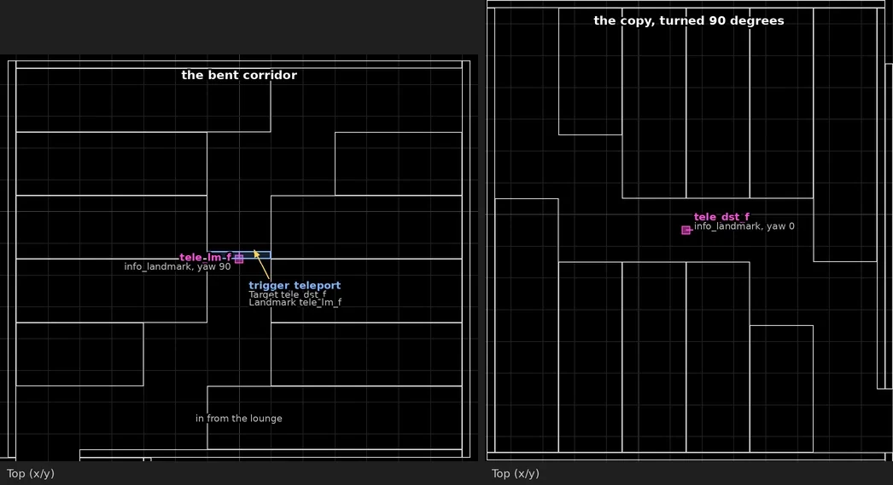
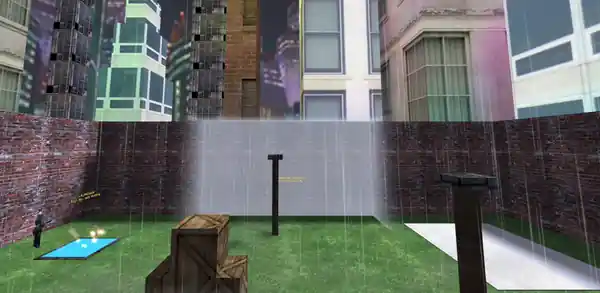

# Teleports and jump pads

Teleports and jump pads move players around your map without a cut. A
[`trigger_teleport`](../entities/trigger_teleport.md) with a landmark moves a player seamlessly to a copy of the place
where they stand. A [`trigger_jump`](../entities/trigger_jump.md) launches anything that touches it on an arc to a
point, and a [`trigger_safe_fall`](../entities/trigger_safe_fall.md) cancels fall damage.

## Seamless teleports

A `trigger_teleport` with a **Landmark** (`message`) is seamless. The entity that touches it arrives at the same
position relative to the destination, which is its **Target**, as it had relative to the landmark, so the view, the
speed and the weapon don't jump.

`co_sbo_showcase` has a bent corridor. Halfway along it, the player moves to a copy of the corridor in a different
part of the map, turned 90 degrees. A seamless teleport has three parts:

*A teleport with a landmark and a turned destination, seen from above*

| Part | What it is |
|---|---|
| Landmark | A named point entity in the first place, for example an [`info_landmark`](../entities/info_landmark.md) or an [`info_target`](../entities/info_target.md) |
| Destination | A named point entity at the matching point of the copy |
| Trigger | A brush across the passage, with **Target** set to the destination and **Landmark** set to the landmark |

The turn is the yaw of the destination minus the yaw of the landmark, rounded to whole degrees. Pitch and roll don't
count. The position, the speed and the view of the teleported entity all turn by that angle, so for a copy that is
turned 90 degrees to the left, give the landmark a yaw of 0 and the destination a yaw of 90.

The game of a player predicts their movement and doesn't know about the teleport, so for a short time, about as long
as their ping, the player continues to walk in the first place on the screen. Then the game moves them to the
matching position in the copy. The player doesn't notice this move only if the first place and the copy look the
same, so make the copy match past the trigger and behind the matching point. A player who runs with a ping of about
200 ms moves less than 128 units in that time.

The landmark and the flags decide who is teleported:

- Without a landmark, the trigger teleports players, and also monsters if you set the flag **Monsters** (1)
- With a landmark, it doesn't teleport dead players or spectators
- With a landmark and the flag **Grenades, items** (1024), it also teleports grenades, rockets, dropped weapons,
  items and gibs

A landmark teleport keeps a player on the ground, and the other players don't see the player slide from the old
position to the new one. If the landmark or the destination doesn't exist when a player touches the trigger, the
trigger stops working for the rest of the map. With `developer 1` set in the console, the console shows a line about
it.

## Plain teleports

Without a landmark, the teleported entity stands at the destination, faces the angles of the destination and
doesn't move. A trigger without a **Target** does nothing, with or without a landmark. These flags change what a
plain teleport does:

- **Random destination** (64) - The destination is one of the entities named in **Target**, picked at random
- **Relative** (128) - Without a landmark, the entity keeps its distance from the origin of the trigger, so the
  trigger needs an origin brush
- **Keep angles** (256) - Without a landmark, the entity keeps the direction it faces
- **Keep velocity** (512) - Without a landmark, the entity keeps its speed

## Jump pads

A `trigger_jump` launches anything that touches it on an arc to its **Target**, which can be an entity, a
[locus position](../guide/locus.md) or `x y z` coordinates. The arc follows the gravity of the server. **Height** sets
how far the top of the arc is above the entity that it launches. With 0, the top is the higher of the target and the
entity, plus the height of the entity, plus 16 units. By default, the trigger launches only alive players.
Its flags add living monsters, [`func_pushable`](../entities/func_pushable.md) entities and other entities.

The trigger plays no sound, but at each launch it triggers **Trigger on jump** with the launched entity as the
activator, so an [`ambient_generic`](../entities/ambient_generic.md) or an effect can mark the jump. The courtyard of
`co_sbo_showcase` has jump pads and safe fall zones.

*A jump pad sending a player over a courtyard to its target*

## Safe falls

A player in the air who touches a `trigger_safe_fall` takes no fall damage at the next landing, and the landing plays
no fall sound. It only affects alive players.

You can't switch a `trigger_jump` or a `trigger_safe_fall` on and off, but while their master is off, they do
nothing.

## Changes since 1.38

- Fixed a `trigger_teleport` without a Target sending players to a random spot. An empty Target matched any entity
  without a name
- `trigger_teleport` has the new key **Landmark** and the new flags **Random destination**, **Relative**,
  **Keep angles**, **Keep velocity** and **Grenades, items**
- `trigger_jump` and `trigger_safe_fall` are new

## See also

- [`trigger_teleport`](../entities/trigger_teleport.md) - every key and flag of the teleport
- [`info_teleport_destination`](../entities/info_teleport_destination.md) - a destination point
- [`info_landmark`](../entities/info_landmark.md) - a landmark point
- [`trigger_jump`](../entities/trigger_jump.md) - the jump pad
- [`trigger_safe_fall`](../entities/trigger_safe_fall.md) - cancels fall damage
- [Locus system](../guide/locus.md) - the positions that the **Target** of a jump pad accepts
