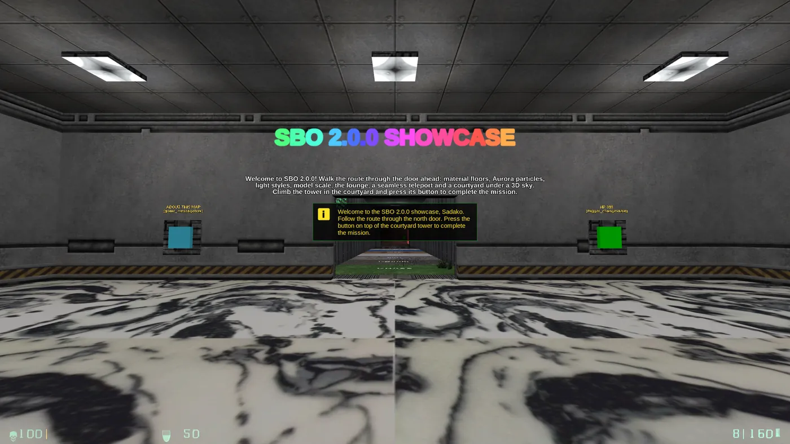

# Tutor messages [[ported:cs]]

Tutor messages are short hints in a small window on the player's screen, with an icon, text and a sound, like the
tutor of Counter-Strike: Condition Zero. An [`env_tutor`](../entities/env_tutor.md) shows them at the top right by
default, or at any other position you choose. Each player has one window and a queue of waiting messages, so two hints
never cover each other.

The spawn hall of `co_sbo_showcase` shows a centered tutor message each time you spawn.

*A centered tutor message*

## Showing and closing

| Trigger | What happens |
|---|---|
| On or Toggle | The message shows, or it waits in the queue |
| Off | The message closes, or it leaves the queue |

By default, the message is for every player. With the flag **Activator only** (1), it is only for the player who
triggered it. With **Show on player spawn** (4), it shows each time a player spawns. Only alive players see
tutor messages. With a **Master**, the message shows only while the master is on.

A player sees each message one time for each map. With the flag **Repeatable** (8), a player sees it again, up to
**Max shows per player** times. The entity triggers **Target** when the message shows to a player, and **Target when
closed** when the message closes for a player, each time with that player as the activator.

## Text

The text can have a few placeholders, which the game of each player fills in:

| You write | It shows |
|---|---|
| `\n` | A new line |
| `%n` | The name of the player |
| `%+reload%` | The key bound to a command, so "Press %+reload% to reload" shows "Press R to reload" |
| `#Token` | An entry from the translation files of the game |

The text can have up to 1023 bytes.

## Keys

| Key | Description | Default |
|---|---|---|
| **Text** `message` | The text of the message | |
| **Type** `type` | The colors, the icon and the sound, which the table below lists | Default (1) |
| **Icon** `icon` | The icon:  &bull;&nbsp;The type's (0) - the icon of the **Type** &bull;&nbsp;None (1) &bull;&nbsp;`i` (2) &bull;&nbsp;`!` (3) &bull;&nbsp;Skull (4) &bull;&nbsp;Big `i` (5) &bull;&nbsp;Big `!` (6) | The type's (0) |
| **Custom icon** `iconfile` | A `.tga` file, for example `gfx/mymap/hint.tga`. If you set one, the entity ignores **Icon** | |
| **Sound** `sound` | The sound:  &bull;&nbsp;The type's (0) - the sound of the **Type** &bull;&nbsp;None (1) &bull;&nbsp;`events/tutor_msg.wav` (2) &bull;&nbsp;`events/friend_died.wav` (3) &bull;&nbsp;`events/enemy_died.wav` (4) | The type's (0) |
| **Custom sound** `soundfile` | A sound file. If you set one, the entity ignores **Sound**. Only the player who sees the message hears it | |
| **Text color** `color` | The color of the text. If you leave it empty, the message uses the color of its **Type** | |
| **Icon color** `iconcolor` | The color of the icon, where `255 255 255` keeps the colors of the icon. If you leave it empty, the small icons take the color of the text, and the big and custom icons keep their own colors | |
| **Background** `bgcolor` | The background as `R G B A`. If you leave it empty, it is `0 0 0 200` | |
| **Border** `bordercolor` | The border as `R G B A`. If you leave it empty, it has the color of the menu scheme of the game | |
| **Alignment** `align` | The position of the window, which the table below lists | Top right (0) |
| **X**, **Y** `x`, `y` | The position from 0 to 1, from left to right and from top to bottom, where -1 uses the position of the **Alignment** | `-1` |
| **Hold Time** `holdtime` | How many seconds the message stays on the screen, where 0 keeps it until you trigger it off | `6` |
| **Priority** `priority` | A message with a higher priority shows first | `0` |
| **Interrupt** `interrupt` | With Yes (1), the message replaces a message on the screen that has the same or a lower priority. With No (0), it waits in the queue | No (0) |
| **Queue lifetime** `lifetime` | How many seconds the message waits in the queue, where 0 means no limit and -1 means it doesn't wait | `0` |
| **Max shows per player** `maxshows` | With **Repeatable**, how many times each player sees it, where 0 means no limit | `0` |
| **Target when closed** `closetarget` | The entity triggers it when the message closes for a player, with that player as the activator | |

| Type | Color and icon |
|---|---|
| Default (1) | Green |
| FriendDeath (2) | Red, with a skull |
| EnemyDeath (4) | Blue, with a skull |
| Scenario (8) | Yellow |
| Buy (16), Career (32), Hint (64), InGameHint (128) | Green |
| EndGame (256) | Yellow |

| Alignment | | |
|---|---|---|
| Top right (0) | Top left (1) | Top center (2) |
| Center left (3) | Center (4) | Center right (5) |
| Bottom left (6) | Bottom center (7) | Bottom right (8) |

## The queue

A message that can't show immediately waits in the queue of the player, which holds 16 messages. When the window
closes, the waiting message with the highest priority shows next. If several messages have the same priority, the
oldest shows first. A waiting message doesn't end a message on the screen early, unless it has **Interrupt** and at
least the same priority. A player who goes to spectator mode loses the window and the queue, and **Target when
closed** doesn't fire then.

## Downloads

A custom icon and a custom sound go on the download list automatically.

## Changes since 1.38

- `env_tutor` is new

## See also

- [`env_tutor`](../entities/env_tutor.md) - the entity page
- [`game_text`](../entities/game_text.md) - text on the HUD
- [Message boxes](message-boxes.md) - a box in the middle of the screen with a Close button
- [Masters and states](../guide/masters-and-states.md) - the **Master** key
- [Custom content](../basics/custom-content.md) - how players download your icons and sounds
