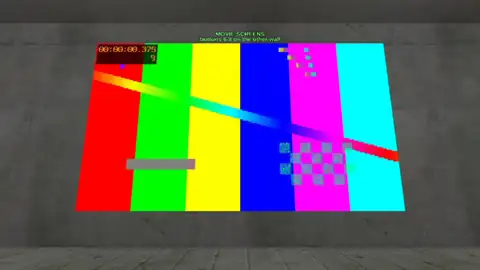

# Video [[ported:aura]]

Your map can play videos with sound, on the full screen or on movie screens in the world. A
[`game_playvideo`](../entities/game_playvideo.md) plays a video on the full screen, for the player who triggered it or
for every player. The same video files also play on a movie screen, a [`vgui_screen`](../entities/vgui_screen.md) in
the world that every player sees.



*A video playing on a movie screen*

## `game_playvideo`

| Key | Description | Default |
|---|---|---|
| **Video file**<br />`video` | The `.ogv` file in `video/`, without that folder, so for `video/mymap/intro.ogv` you write `mymap/intro.ogv` | |
| **Sound file**<br />`audio` | An `.ogg` file in `video/` that plays in place of the sound of the video. If you leave it empty, the video plays its own sound | |
| **Master**<br />`master` | While the master is off, a trigger does nothing | |

It has one flag:

- **All Players** (1) - The video plays for every player, also for spectators and dead players, not only for the
  activator

Without **All Players**, nobody sees the video if the activator isn't a player. The picture fills the screen and keeps
its proportions, and black bars fill the rest. The sound plays at the volume of the game. While the video plays, the
player can't move, fire or change weapons, but the game continues around them.

The video ends in these cases:

- It gets to its end
- The player presses <kbd>Esc</kbd>
- The player dies, if they were alive when it started
- Another video starts
- The map changes

A player who joins later doesn't see it, and a new trigger starts it again.

## Video files

| | |
|---|---|
| Video format | Ogg with a Theora picture and Vorbis sound, named `.ogv` |
| Separate sound | Ogg Vorbis, named `.ogg` |
| Folder | `video/` in the game folder, or a folder inside it |
| Picture size | Up to 2048 x 2048 |
| Frame rate | 1 to 240 frames per second |
| File size | Up to 128 MB |

A video without a sound track plays without sound, or with the **Sound file**. The SDK has a sample video,
<SdkFile path="sdk/examples/video/sbo_sample.ogv" />, and a test map that uses it, <SdkFile path="sdk/examples/maps/co_video_test/" />. See
[Making a video file](#making-a-video-file) to turn your own video into an `.ogv`.

## Making a video file

The easiest way is the [SBO video converter](https://syndicate-black-ops.github.io/video-converter/), which runs in
your browser: drop a video, click Convert, then Save. Your video is never uploaded. It is slow for long videos, so for
those use ffmpeg, a free program that you run from the command line, as the steps below show.

### 1. Get ffmpeg

On Windows, open the [ffmpeg download page](https://ffmpeg.org/download.html), click the Windows logo and take one
of these two builds:

- [gyan.dev](https://www.gyan.dev/ffmpeg/builds/) - `ffmpeg-release-essentials.zip`
- [BtbN](https://github.com/BtbN/FFmpeg-Builds/releases) - `ffmpeg-master-latest-win64-gpl.zip`

Unzip it anywhere, and you find `ffmpeg.exe` in its `bin` folder, for example
`ffmpeg-9.0.2-essentials_build\bin\ffmpeg.exe`. Both builds can write Theora and Vorbis. On Linux, install the
`ffmpeg` package of your distribution.

### 2. Convert the video

On Windows, copy your video, here `intro.mp4`, into the `bin` folder next to `ffmpeg.exe`. Then type `cmd` in the
address bar of that folder's window and press <kbd>Enter</kbd>, which opens a Command Prompt in the folder (the
command below doesn't work in PowerShell). Paste this line and press <kbd>Enter</kbd>:

```bat
ffmpeg.exe -y -i intro.mp4 -vf scale=960:-2 -c:v libtheora -b:v 1100k -pass 1 -an -f ogg NUL && ffmpeg.exe -y -i intro.mp4 -vf scale=960:-2 -c:v libtheora -b:v 1100k -pass 2 -c:a libvorbis -q:a 3 -ac 2 -ar 44100 intro.ogv
```

On Linux, run the same line in the folder of your video, with `ffmpeg` and `/dev/null`:

```sh
ffmpeg -y -i intro.mp4 -vf scale=960:-2 -c:v libtheora -b:v 1100k -pass 1 -an -f ogg /dev/null && ffmpeg -y -i intro.mp4 -vf scale=960:-2 -c:v libtheora -b:v 1100k -pass 2 -c:a libvorbis -q:a 3 -ac 2 -ar 44100 intro.ogv
```

ffmpeg reads your video twice. The first time it only measures the video and writes `ffmpeg2pass-0.log`, which you
can delete when it's done, and the second time it writes `intro.ogv`. The picture is 960 pixels wide, its height
follows the shape of your video, and the sound is stereo Vorbis at 44100 Hz. Because the bitrate is fixed, the file
size depends only on the length of the video, about 8.5 MB per minute.

These are the settings you might change:

| Setting | In the command | What it does |
|---|---|---|
| Width | `scale=960:-2` | Sets the picture width in pixels, and the height follows. It doesn't change the file size, because the bitrate sets that, but a smaller picture looks less sharp and has fewer blocky spots |
| Frame rate | `scale=960:-2,fps=30` | Add `,fps=30` to lower a 60 fps video to 30 fps. The file size stays the same, but every frame gets more of the bitrate, and players' computers have half the frames to decode |
| Bitrate | `-b:v 1100k` | Sets how much picture data each second gets, in kilobits, and so the file size. With the sound, `1100k` makes about 8.5 MB per minute and `600k` about 4.7 MB. Change it in both halves of the line |

The limits of the [Video files](#video-files) table still apply. If you have the SBO source code and Docker,
`scripts/convert_video.sh intro.mp4 intro.ogv` runs the same two steps for you.

### 3. Put the file in the game

Copy `intro.ogv` into the `video` folder of the game, in a folder named after your map, so for a map called `mymap` it
goes in `Half-Life/syndicate/video/mymap/intro.ogv`. Create the folders if they don't exist. In the
[`game_playvideo`](../entities/game_playvideo.md), you then write `mymap/intro.ogv` as the **Video file**. The name
must obey the rules in [File names](#file-names), so `My Intro.final.ogv` has to become something like
`my_intro.ogv`.

### 4. Make a separate sound file

If you want the video to play a different sound from its own, for example music, make an `.ogg` file from a `.wav`,
`.mp3` or a video:

```bat
ffmpeg.exe -y -i music.wav -vn -c:a libvorbis -q:a 3 -ac 2 -ar 44100 music.ogg
```

On Linux, write `ffmpeg` instead of `ffmpeg.exe`. `-vn` drops the picture, if the file has one. Put the `.ogg` in the
same folder as the video, and write `mymap/music.ogg` as the **Sound file**.

### 5. Downloads

You don't need to list the video or sound file in the `.res` file of the map, because the game puts them on the
download list itself. See [Downloads](#downloads) for more details.

## File names

A video or sound file name must obey these rules:

- It has only letters, digits and `/ _ - .`
- It has no `..`, and no `/` at the start, at the end or twice in a row
- It has exactly one dot, before the extension, because the engine doesn't send a file with more dots to players
- It has up to 57 characters, without `video/`

If a name doesn't obey a rule, the server console says so when the map loads, with the reason. The entity then plays
nothing.

:::note

Linux servers and web servers treat `Intro.ogv` and `intro.ogv` as two different files.

:::

## Downloads

The video and sound files go on the download list of the map, and players get them from the server or from its
download address. A player who doesn't have the file sees nothing from that entity. The engine sends only files with a
three-letter extension, which `.ogv` and `.ogg` have.

A server sends files of up to 10 MB itself, unless its operator changes `sv_filetransfermaxsize` in the server
console. A bigger video, which at the bitrate of [Making a video file](#making-a-video-file) is anything over about
70 seconds, reaches players only from the web server that the server names in `sv_downloadurl`.

## Movie screens

A `vgui_screen` with a movie file plays a video on a surface in the world for every player, and the sound comes from
the screen. The game plays only the two nearest screens in view at a time, and the other screens keep their last
picture. See [World screens](world-screens.md) for more details.

## Changes since 1.38

- `game_playvideo` and video files are new

## See also

- [`game_playvideo`](../entities/game_playvideo.md) - the entity page
- [`vgui_screen`](../entities/vgui_screen.md) - a screen in the world that can play a video
- [World screens](world-screens.md) - menus and videos on a surface
- [Custom content](../basics/custom-content.md) - how players download your files
