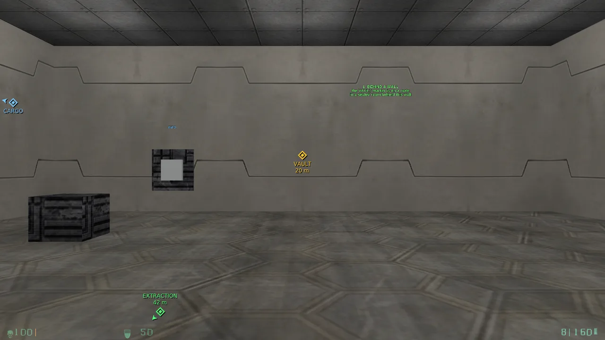
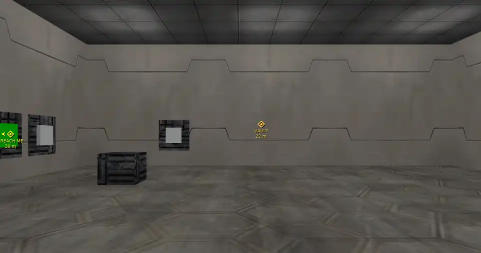
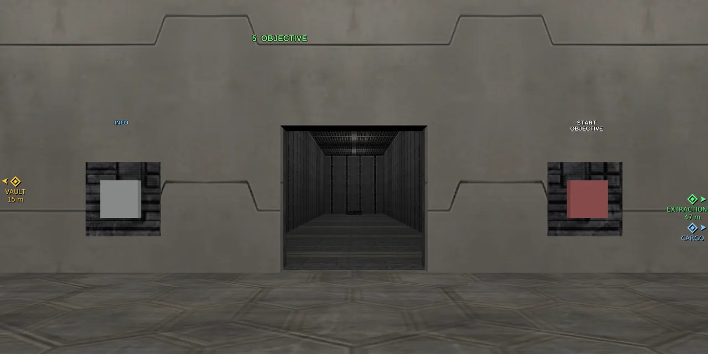

# Waypoints

An [`info_waypoint`](../entities/info_waypoint.md) puts a marker on the players' screens that leads them to a spot,
with an icon, a label and the distance in meters, and it shows through walls and floors.



*A marker seen through a wall, and two markers on the edges of the screen*



*A marker through a wall slides to the screen edge as the player turns, and another turns off when reached*

## Markers off the screen

When the spot is behind the player or beside the view, the marker sits on the edge of the screen with an arrow
pointing toward it, so the player knows which way to turn. As the player turns, the marker slides along the edge until
the spot comes into view.



*Markers on the edges of the screen, with arrows toward their spots*

## Marking an objective

A marker works well with a [`trigger_objective`](../entities/trigger_objective.md): the objective tells players what
to do, and the marker shows them where. To turn both on at the same time, give the objective and the marker their
own names and have a [`multi_manager`](../entities/multi_manager.md) trigger both, with a
[`trigger_relay`](../entities/trigger_relay.md) set to On in front of the marker, so a second trigger can't turn it
off. To take the marker away when the objective is completed, put the name of a `trigger_relay` set to Off in the
objective's **Target when completed**, with the marker as that relay's target.

## Turning off when a player gets there

Set **Reached Radius** and the marker turns off as soon as a living player comes that close to it, so you don't need
a trigger brush around the spot. Put a name in **Target When Reached** to start the next step, such as completing the
objective, with the player who got there as the activator.

## Showing a marker only near or far

**Hide Farther Than** keeps a marker off the screens of players who are farther away, so a marker for a door or a
switch appears only when players are in the same area. **Hide Closer Than** does the opposite and hides a marker once
players are close enough to see the spot for themselves. Each player sees the marker by their own distance. With the
flag **No edge arrow**, the marker shows only while its spot is in view, and never on the edge of the screen.

## A marker for one player

With the flag **Only the activator sees it**, only the player who triggers the marker sees it, so a button can show
that player where to go without showing the others.

## Following a moving entity

Put the name of a train, a monster or another entity in **Follow Entity**, and the marker moves with that entity. The
marker keeps the distance it has from the middle of the entity where you placed it, so place the marker above the
entity in the editor to have it float above it. To move the marker to the next objective, a
[`trigger_changevalue`](../entities/trigger_changevalue.md) can put the name of another entity in **Follow Entity**,
and the marker moves onto that entity at the same distance.

## Custom icon

The marker tints its icon with its **Color**, so an icon that should take the color is drawn in white on a black
background, with gray for its soft edges. It is saved as an indexalpha sprite, where each pixel's palette index is how
solid it is, from see-through at 0 to solid at 255, and the color comes from the marker's **Color**.

With SpriteMaker, which comes with [WadMaker](https://github.com/pwitvoet/wadmaker), name the picture with `.ia` before
its extension, for example `mymarker.ia.png`, and put a `spritemaker.config` file next to it with this line:

```
*.ia    transparency-input: grayscale    color: 255 255 255
```

Then drag the picture onto `SpriteMaker.exe` and it makes `mymarker.spr` next to it. The `grayscale` setting makes the
white parts solid and the black parts see-through, and the white `color` lets the marker's **Color** show as it is,
because SpriteMaker uses the picture's average color if you leave it out.

With [Half-Life Texture Tools](https://github.com/yuraj11/HL-Texture-Tools), save the picture as an 8-bit grayscale
image whose palette runs from black at index 0 to white at index 255, then open **Tools > Create new Sprite**, add the
picture under **1. Images**, choose **Indexalpha** under **Texture format** in **2. Settings** and leave **Quantize
palette with all frames** off so the sprite keeps the picture's palette, then **Save sprite** under **3. Save**.

The icon is always drawn 32 units of the HUD wide and high, which is 32 pixels on a 1080p screen and larger with HUD
scaling, so a 64 by 64 pixel picture stays sharp. The default diamond is 64 by 64 too.

An additive sprite is added to the picture behind it instead: black is see-through and the icon brightens what is
behind it, tinted with the **Color**, without the dark shadow the other icons get. A sprite with colors of its own is
multiplied with the **Color**, so set the **Color** to 255 255 255 to keep its own colors.

Put the sprite in your map's `sprites` folder and list it in the map's `.res` file, so players download it with the
map.

## Changes since 1.38

- `info_waypoint` marks a spot with an icon, a label and its distance in meters. It shows through walls and moves to the edge of the screen with an arrow when the spot is off the screen

## See also

- [`info_waypoint`](../entities/info_waypoint.md) - the entity page
- [Entity glow](entity-glow.md) - an outline or a halo around entities, also through walls
