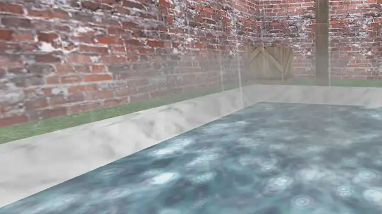
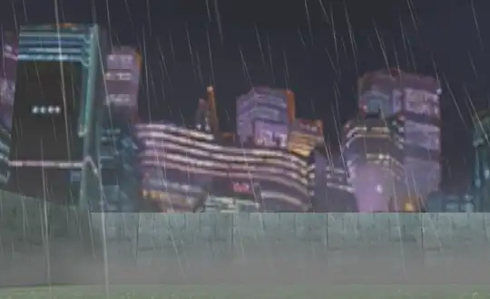
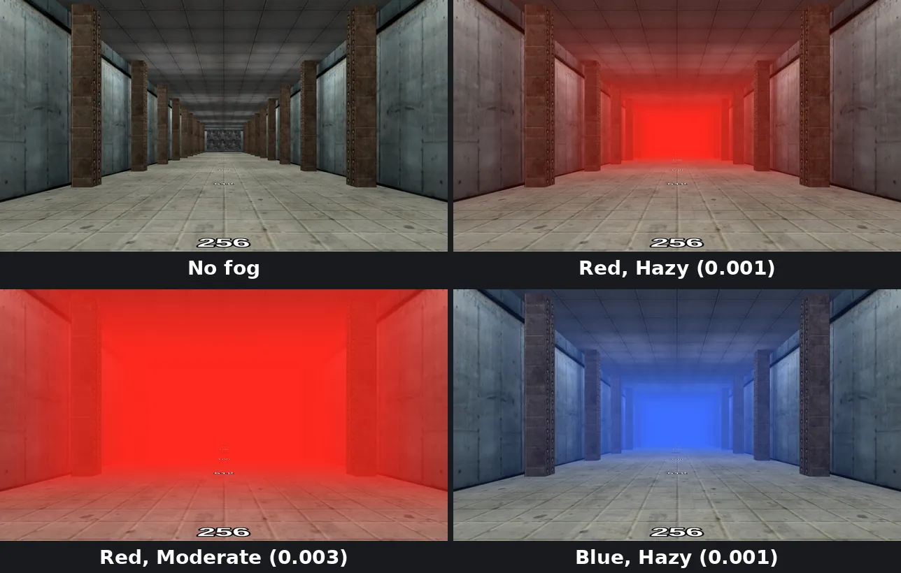
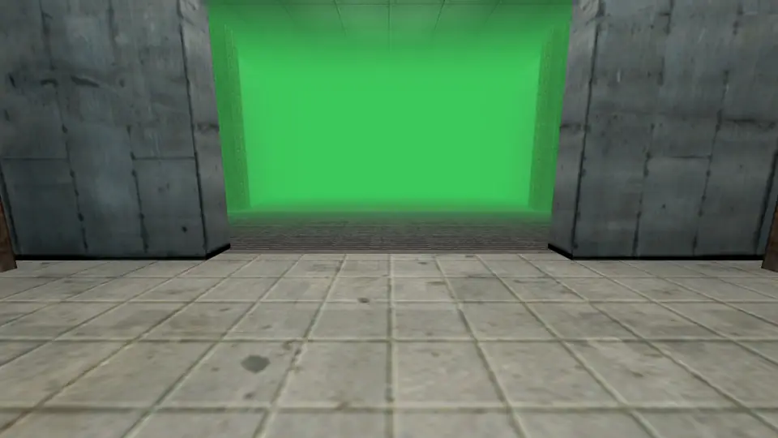
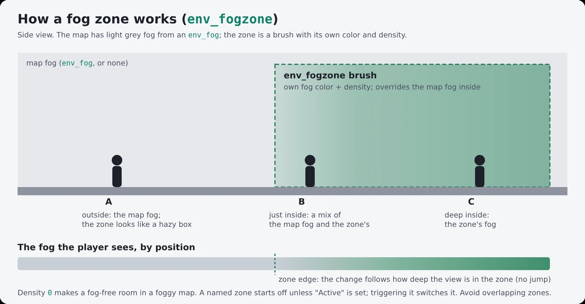

# Weather and fog

Weather and fog give your map rain, snow and fog. The rain and snow are the weather of Counter-Strike 1.6, with
splashes, ripples on water and wind. They fall only where the sky is above, and one entity turns them on for the whole
map, while a brush entity limits them to one area. Fog covers the whole map with an
[`env_fog`](../entities/env_fog.md), or it fills a brush volume with an [`env_fogzone`](../entities/env_fogzone.md).

The courtyard of `co_sbo_showcase` has rain and snow. Buttons on its west wall switch the map fog
and a fog zone on and off.

*Rain with ripples on a pool*

## Rain and snow

One [`env_rain`](../entities/env_rain.md) or [`env_snow`](../entities/env_snow.md) without a name, at any position
in the map, turns on the weather for the whole map. If you leave its keys empty, it is the weather of Counter-Strike
1.6. Its keys change how many drops or flakes fall, their size and speed, and how long they last. Each player's
game draws the weather around that player's view. Drops and flakes appear only where the sky is above: a face
with a texture whose name starts with `sky`, or a face with the [`env_sky`](sky.md) texture, so rooms, tunnels and
overhangs stay dry automatically, unless you set **Allow indoor**. Rain splashes on solid ground and makes ripples on
water. If a map has both rain and snow without names, it gets rain.

An `env_rain` or `env_snow` with a name is a separate weather, which the game draws on top of the weather without a
name. It starts off unless you set **Start Active**. A trigger switches it on or off for every player at the same
time, so you can start a storm or a snowfall during the map.

Players set how much weather they see in their options, with the setting
[`cl_weather`](../../playing/options.md#player-cvars). The weather makes no sound, but the game comes with the looping
sound `ambience/rain.wav`, which you can play with an [`ambient_generic`](../entities/ambient_generic.md).

### Wind

Without wind keys, the rain and snow blow with the random wind of Counter-Strike, which changes to a new direction
every 15 to 30 seconds. If you set **Wind X** or **Wind Y** [[ported:spirit]], that weather blows with a fixed wind.
The wind is a sideways speed in units per second along the X and Y axes of the map, so every drop slants in the same
direction and the puffs of dust blow with it. **Wind spread X** and **Wind spread Y** give each drop or flake a random
extra sideways speed, from minus the value up to the value, so the drops don't all slant the same. For example,
**Wind X** 100 and **Wind Y** 200 make the slanted rain of the Spirit of Half-Life examples. **Wind X** 0 and **Wind
Y** 0 with a spread of 150 make each drop slant in its own direction around straight down. The flag **Not affected
by wind** makes the drops or flakes fall straight down, also with wind keys.

*The rain of the example map `co_example_weather`, with **Wind X** 100 and **Wind Y** 200*

SBO also reads the Spirit of Half-Life names of these keys, `m_flWindX`, `m_flWindY`, `m_flRandX` and `m_flRandY`,
so a value from a Spirit map gives the same sideways speed. A fast raindrop slants less than a slow one, and SBO
raindrops fall at 500 to 1800 units per second by default, where Spirit raindrops fall at 900.

### Changing the weather while the map runs

A [`trigger_changevalue`](../entities/trigger_changevalue.md) or a
[`trigger_copyvalue`](../entities/trigger_copyvalue.md) can change any key or flag of `env_rain`, `env_snow` and the
volumes while the map runs, and every player sees the change immediately, for example a turning wind, heavier rain
or a weather switched on with its flag **Start Active**. A count, update time, size, speed or life set to 0 or less
goes back to its default, as at map start. The operations can also add to a key or multiply it, such as the wind. See
[Changing keys](../guide/changing-keys.md) for more details.

### Rain or snow in one area

[`func_rainvolume`](../entities/func_rainvolume.md) and [`func_snowvolume`](../entities/func_snowvolume.md) are
brush entities, and the rain or snow falls only inside their brush. **Raindrops per update**, or **Snowflakes per
update**, counts for the full brush, so a larger brush needs a higher number to look the same. With **Allow
indoor**, the weather also falls where there is no sky above, for example under a roof.

A volume without a name is always on. A volume with a name starts off unless you set **Start Active**, and a trigger
switches it on or off. The game draws the volumes and the map-wide weather of `env_rain` and `env_snow` together.

## Map fog: `env_fog`

An `env_fog` colors the distance in the view of every player.

*One hall without fog and with three env_fog settings*

| Key | Description | Default |
|---|---|---|
| **Fog color** `rendercolor` | The color of the fog | `128 128 128` |
| **Density** `density` | How thick the fog is, from 0 for no fog up to 0.01 for very thick fog. A value below 0 or above 0.01 means no fog. The editor gives these choices: Misty (0.0005), Thin (0.0007), Hazy (0.001), Moderate (0.003), Dense (0.005) and Thick (0.01). You can also type a different value | Misty (0.0005) |

It has one flag:

- **Start active** (1) - A named `env_fog` starts on

An `env_fog` without a name is always on. An `env_fog` with a name starts off unless you set **Start active**. A
trigger switches it on or off, and the [use types](../guide/trigger-modes.md) On and Off set that state. The first
`env_fog` that is on is the fog of the map. When the fog changes, it fades over about one second.

## Fog volumes: `env_fogzone`

An `env_fogzone` is a brush entity with the same keys as `env_fog`, and the game doesn't draw its brush. From outside,
the box of the volume looks like fog: the more of the volume the view goes through, the thicker it is. Where the volume
meets open air, the fog thins out over its last 64 units, so it has no hard edge; against a wall, floor or ceiling it
stays thick. Walls, floors and players inside the volume are fogged too. Inside, the fog blends from the fog of the
map to the fog of the zone. The deeper the view is inside the zone, the closer the fog is to the fog of the zone, which
replaces the fog of the map there. With a **Density** of "None" (`0`), you get a clear volume on a foggy map.

*Walking into a green fog zone*

A zone without a name is always on. A named zone starts on when its flag **Active** (1) is set, which is the editor
default. A trigger switches the zone on or off. The free camera of a spectator gets the fog of the zone that it is
in.

*A fog zone inside map fog, seen from the side*

## Notes

- Fog shows only with the OpenGL renderer
- Fog is off while the view is under water, where the engine draws its own water fog
- The 2D skybox and the room of the [3D sky](sky.md) are never fogged by the map's fog, but the sky room can have
  its own [sky fog](sky.md#sky-fog)
- Each player's game draws the fog, so monsters see through it

## Changes since 1.38

- `env_rain`, `env_snow`, `func_rainvolume`, `func_snowvolume`, `env_fog` and `env_fogzone` are new
- SBO 2.0.0 removed the rain and snow entity of SBO 1.38, because its rain and snow could crash the game.
  [Old maps](../basics/old-maps.md#sbo-138-entities) says what replaces it
- `env_rain` and `env_snow` get the keys of the rain and snow volumes (amount, drop size, speed and more), and all four get wind keys to blow the rain or snow in a set direction

## See also

- [`env_rain`](../entities/env_rain.md) and [`env_snow`](../entities/env_snow.md) - rain or snow on the whole map
- [`func_rainvolume`](../entities/func_rainvolume.md) and [`func_snowvolume`](../entities/func_snowvolume.md) - rain
  or snow in one area
- [`env_fog`](../entities/env_fog.md) and [`env_fogzone`](../entities/env_fogzone.md) - map fog and fog volumes
- [Changing keys](../guide/changing-keys.md) - `trigger_changevalue` and `trigger_copyvalue`
- [3D sky](sky.md) - the sky room and the `env_sky` texture
- [Old maps](../basics/old-maps.md) - what happens to the removed SBO 1.38 weather entity
