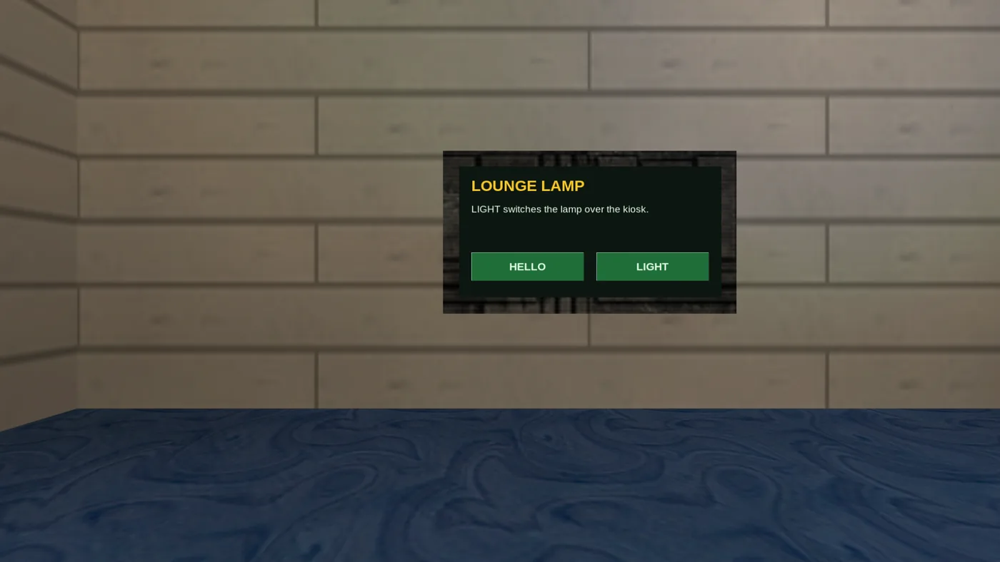
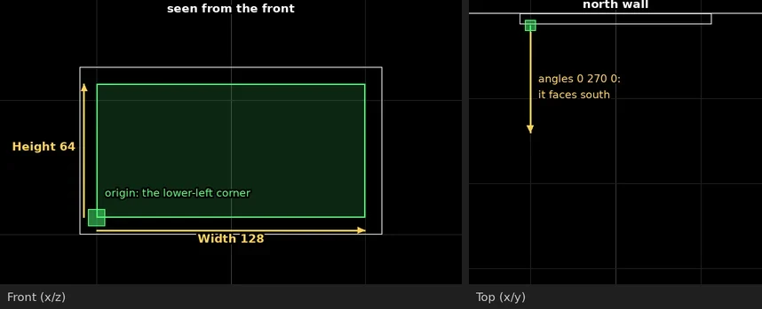
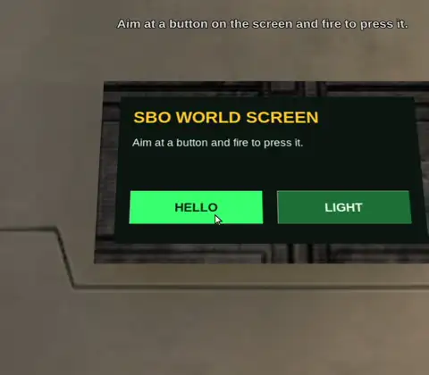
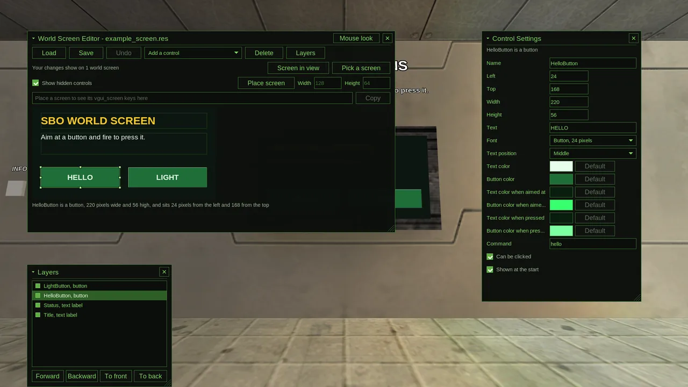
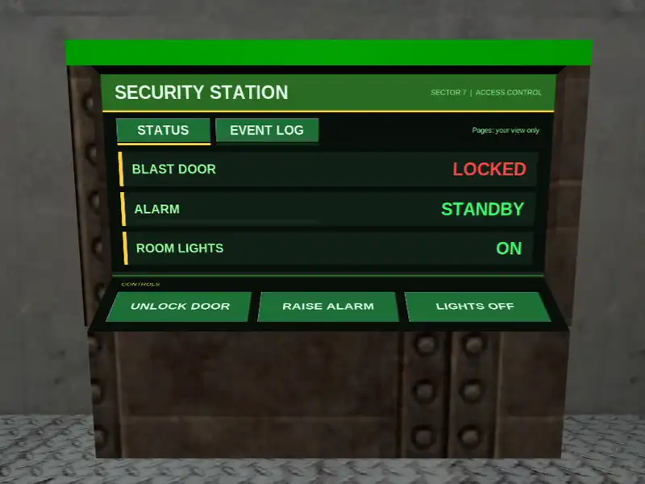

# World screens

World screens put working screens right into your map: touch screens, control panels and status monitors with labels,
buttons, images and bars, and movie screens that play videos. A [`vgui_screen`](../entities/vgui_screen.md) shows a
VGUI2 panel (a game menu window) on a flat screen or on the faces of a brush. Players aim at the screen and click its
buttons, and each button can trigger entities of the map.

The lounge of `co_sbo_showcase` has a wall screen and a kiosk screen. The prefab
<SdkFile path="sdk/prefabs/world_screens/security_station.map" /> is a security station with a bent touch screen, a status monitor,
a door, an alarm and lights.

*A wall screen with two buttons*

## A flat screen

The origin of the entity is the lower-left corner of the screen, as seen from the front. The screen faces along
**Angles**, so with a yaw of 90 it faces north and the player stands north of it. **Width** goes to the right of the
viewer and **Height** goes up, both in units. The game stretches the panel to fit the screen, so if the ratio of Width
to Height is different from the pixel ratio of the layout, the panel looks stretched. The layout `example_screen` is
2:1, so it fits a screen of, for example, 64 by 32 units.

*How a world screen is placed, from the front and from above*

## A screen on a brush

If you set **Surface** to the name of a brush entity, the screen shows on the faces of that entity that have the
`{screen` texture. The entity then ignores **Angles**, **Width**, **Height** and its origin. `{screen` is in
`sbo_tools.wad`, so compile the map with `-wadinclude sbo_tools`, or keep `sbo_tools.wad` in the WAD list of the map.

One repeat of the texture is the full panel, with the top-left corner of the texture at the top-left corner of the
panel. If you scale, rotate or shear the texture, the panel stretches in the same way. If you continue the texture
over several faces, you get a bent screen. The `{screen` faces are invisible in the game, and the other faces of the
brush look as usual.

The screen moves with the brush entity, for example a [`func_wall`](../entities/func_wall.md), a
[`func_door`](../entities/func_door.md), a [`func_train`](../entities/func_train.md) or a
[`func_rotating`](../entities/func_rotating.md). A brush entity can carry one screen, and world brushes can't carry
a screen.

## Keys

| Key | Description | Default |
|---|---|---|
| **Panel Name** `panelname` | The layout `ui/scripts/screens/<name>.res`, with a name of up to 31 letters, digits, `_` and `-`. If you leave it empty, the game removes the entity, unless it has a **Movie File** | `example_screen` |
| **Surface** `surface` | The name of a brush entity with `{screen` faces | |
| **Width**, **Height** `width`, `height` | The size of the screen in units | `32`, `32` |
| **Input Distance** `inputdistance` | How far from the surface of the screen a player can be and still use it, up to 4096 units | `128` |
| **Show Cursor** `showcursor` | With "Default (yes)" (-1) or "Yes" (1), a cursor shows while a player aims at the screen. With "No" (0), there is no cursor | Default (yes) (-1) |
| **Target** `target` | The screen triggers it when a player clicks any button | |
| `~<command>` | The screen triggers it when a player clicks the button with this `command`, for example the key `~hello` with the value `my_relay`. Add these keys with SmartEdit off, up to 16 for each screen | |
| **Movie File** `moviefilename` | A video that the screen shows in place of a panel. See [Video](video.md) for more details | |
| **Movie Looping** `looping` | With "Yes" (1), the movie starts again at its end. With "No" (0), it stops on its last frame | No (0) |
| **Movie Volume** `health` | How loud the movie is, from 1 up to 10 for the loudest. If you leave it empty or set 0, it plays at full volume | `10` |
| **Movie Sound Radius** `radius` | The distance in units from the screen where the movie sound becomes silent | `1250` |

It has these flags:

- **Start Inactive** (1) - The screen starts off
- **Input Disabled** (2) - Nobody can aim at the screen, so it only shows things. Fire and secondary fire work as
  usual in front of it
- **Movie sound everywhere** (4) - The movie sound has the same volume at all positions
- **Movie without sound** (8) - The movie plays without sound

The entities that it triggers get the player who clicked as their activator. On makes the screen active, Off makes it
inactive and Toggle switches it. The game doesn't draw an inactive screen, so nobody can use it.

## How players use it

A player within **Input Distance** in front of the screen gets a cursor in the middle of their view, and the button
under it lights up. Fire clicks. A button acts when the player releases fire over it, and the weapon doesn't fire.
Secondary fire is the right click, which buttons ignore. Dead players, spectators and players with an open menu can't
aim at a screen. When one player points at or presses a button, and when its animations play, only that player sees
it on their screen.

*The example map `co_example_worldscreens`: HELLO fires a `game_text` and a `vgui_control_proxy`*

## The layout

A layout is a VGUI2 `.res` file at `ui/scripts/screens/<name>.res`. The game comes with `example_screen.res` as a
starting point. Its parts obey these rules:

- The section `WorldScreen` is the screen itself. `wide` and `tall` are its size in pixels, from 16 to 1024 and not
  larger than the screen of the player, with a default of 512 x 256. `bgcolor_override` is the background
- The other sections are VGUI2 controls, placed in panel pixels, such as `Label`, `Button`, `ImagePanel`,
  `ProgressBar`, `ContinuousProgressBar`, `AnalogBar` and `Slider`
- The `command` of a `Button` is the name that the `~<command>` key reacts to, with up to 63 letters, digits,
  `_ - . :` and single spaces. Separate several commands with `,`
- The fonts are `WorldScreenHeader` (42), `WorldScreenTitle` (34), `WorldScreenLarge` (30), `WorldScreenButton`
  (24), `WorldScreenText` (22) and `WorldScreenSmall` (18), with their size in pixels
- The `image` of an `ImagePanel` is a path from the game folder without `.tga`, for example `"image"
  "ui/gfx/vgui/my_logo"`. The images are 24-bit or 32-bit TGA files, uncompressed or RLE-compressed, with at most
  512 x 512 pixels in total, so 1024 x 256 also works. A larger picture or a grayscale TGA doesn't show

Players download a layout and its animation file from `ui/scripts/screens/` on the server automatically, but not the
images of a layout, so list the images in the `.res` file of the map. See
[Custom content](../basics/custom-content.md) for more details.

## Making a layout in the game

The game has a world screen editor. With it, you can make a layout while you watch it on a screen in your map, and
then save it as a `.res` file. Type `worldscreeneditorui` in the console to open it, and type it again to close it.
It works in single player, in a game that you host, and on a server that has `sv_cheats 2` set in its console.
`sv_cheats 1`, which turns on the usual [cheats](../getting-started/cheat-commands.md), doesn't open it. The first
time that you open it, it shows the layout of the world screen in the middle of your view. If you don't look at a
world screen, it shows a new layout.

The main window shows the layout at its real size in pixels. Click a control to select it, and drag it to move it.
To change its size, drag one of the small squares on its corners and edges. If you press <kbd>Esc</kbd> during a
drag, the control goes back to its position. If you click the background of the screen, you select the screen
itself. The line under the layout tells you the kind, size and position of the control under the mouse, or of the
selected control. While a window of the editor is open, the mouse moves a cursor and not your view, but your keyboard
still moves you. To look around and keep the editor open, press **Mouse look** in the title bar of the main window.
Press <kbd>Esc</kbd> to get the cursor back. You can change the size of each window with its edges. To fold a window
to its title bar, click the arrow next to the title or double-click the title. If you hold the mouse on a control, a
tip tells you what it does.

The buttons at the top of the main window do these things:

- **Add a control** - puts a new control in the middle of the screen: a text label, a button, a picture, a bar in
  blocks or a smooth bar, each with or without a background, or a slider
- **Delete** - removes the selected control
- **Layers** - opens the Layers window again after you closed it, which the editor also opens when it starts
- **Undo** - takes back your last change
- **Show hidden controls** - shows the controls that start hidden, drawn with a dashed outline, so you can select
  them

The **Control Settings** window shows the settings of the selected control with plain names. Examples are its
position and size, its text, font and text position, its colors, the command of a button, the file of a picture, and
how full a bar is at the start. If you select the screen itself, you can set its size in pixels and its background
color there. **Choose** next to the file of a picture opens a list of every picture that a screen can show, with a
preview of each. If you type part of a name in its search box, the list shows only the pictures that match.
Double-click a picture or press <kbd>Enter</kbd> to give it to the control and close the list. You can also type the
path yourself. Click a color box to open the color wheel. Drag in the wheel to choose the color, and use the slider
under it to set the alpha (how see-through the color is). **Default** gives the control its usual color again, which
is the color from the scheme of the screen. To change a control from the map, put its **Name** in the **Control
Name** of a [`vgui_control_proxy`](../entities/vgui_control_proxy.md).

The **Layers** window lists the controls from front to back, so the game draws the first control in the list over
all the others. The list also has the controls that start hidden. Click a row to select its control. When you select
a control on the screen, its row is also selected. **Forward** and **Backward** move the selected control one step up
or down the list, and **To front** and **To back** put it over or under all the others. Click the square in a row to
choose if the control shows at the start or stays hidden until the map shows it. This is the same as **Shown at the
start** in its settings. The screen draws its controls in the order of the layout file, so the last control is on
top. The editor saves a new order by moving the sections of the controls in the file. If the layout has `zpos` keys,
which also set the order, the editor removes them when you change the order, but it keeps the order that they gave.

Each world screen in your map that shows the layout that you edit changes while you edit it. **Screen in view** also
shows your layout on the world screen in the middle of your view. **Pick a screen** does the same for the world
screen that you click next. A screen that you picked continues to show the layout of the editor when you load another
layout, until you close the editor. When you load another layout, the screens that showed the old layout only because
they use its name go back to their own files. When you close the editor, all screens go back to their own files.

*The world screen editor with a button selected*

On a map without a world screen, or to try a layout at another position, use **Place screen**. It puts a screen on
the wall that you click next, centered where you click and flat on the wall. Press <kbd>Esc</kbd> to cancel. Only
you see this screen, because it exists only in your game, so you can place one on any map, also on a server. It
shows the layout that you edit and changes while you edit it. You can aim at it and click it like a real screen, but
its buttons don't trigger anything in the map. **Width** and **Height** next to the button set its size in map units.
If you place it again, it moves to the new position. It goes away when you close the editor or the map changes.

The line under these settings shows the keys that a [`vgui_screen`](../entities/vgui_screen.md) needs to show the
screen at the same position in your map. These are its origin, which is the lower-left corner of the screen 1 unit in
front of the wall, its angles, width, height and panel name. Press **Copy** to copy them, so you can paste them into
your map editor.

**Load** lists the layouts in `ui/scripts/screens/`, which are the layouts that come with the game and the layouts
that you downloaded, and a new layout to start from. Double-click a layout or press <kbd>Enter</kbd> to open it. If
your layout has changes that you haven't saved, the editor first asks if you want to save them. It asks the same when
you close it. The title shows unsaved changes with a `*`. **Save** asks for a name of up to 31 letters, digits, `_`
and `-`, and writes `ui/scripts/screens/<name>.res` in the SBO folder. If a file with that name exists, press Save a
second time to replace it. The editor changes only what you edit, so the comments and other keys of a layout that
you loaded stay the same. To use the layout in your map, set the **Panel Name** of a
[`vgui_screen`](../entities/vgui_screen.md) to its name. The editor doesn't edit animation files, so you write them as
text. See [Animations](#animations) for more details.

## Changing a screen from the map

A [`vgui_control_proxy`](../entities/vgui_control_proxy.md) changes one control on every screen with the name in
**Screen**, for every player, for example to show a new status text or fill a bar:

| **Change** (`mode`) | What it does |
|---|---|
| 0 | Sets the text of a `Label` or a `Button`, or the value of a bar or a `Slider` in percent, from 0 to 100 |
| 1 or 2 | Turns the control on or off |
| 3 or 4 | Shows or hides the control |
| 5 | Plays an animation, where **Text** is the sequence and **Control Name** is its state group |

**Text** holds up to 127 characters, and a `#Token` shows translated text. The proxy reads **Text** when it fires,
so a [`trigger_copyvalue`](../entities/trigger_copyvalue.md) can first write a number into it. Players who join later
see the latest state. The game keeps this state for 64 controls on each screen, and the latest sequence for 16 state
groups. An animation with an empty **Control Name** plays one time, and the game doesn't keep it for later players.

## Animations

A layout can have an animation file next to it, `ui/scripts/screens/<name>_anims.txt`, in Source's HUD animation
format:

| Command | What it does |
|---|---|
| `Animate <control> <variable> <value> <interpolator> <start> <duration>` | Changes a variable over time, where the variables are `FgColor`, `BgColor`, `Position`, `Size`, `xpos`, `ypos`, `wide`, `tall` and `Alpha`, and the interpolators are `Linear`, `Accel`, `Deaccel`, `Spline`, `Pulse <frequency>`, `Flicker <randomness>` and `Bounce` |
| `SetVisible <control> <0 or 1> <start>` | Shows or hides a control |
| `RunEvent <sequence> <start>`, `StopEvent <sequence> <start>` | Starts or stops a sequence, and a sequence that runs itself loops |
| `StopAnimation`, `StopPanelAnimations`, `SetFont`, `SetString`, `FireCommand <start> <command>` | Work as in Source, but `FireCommand` plays only `anim:` commands |

A button with the command `anim:<sequence>` plays the sequence at once, only on the screen of the player who clicks,
for feedback on a click or a page only that player looks at. To play a sequence for every player, have the button fire
a `vgui_control_proxy` with **Change** 5, as the security station prefab does when the door unlocks.

*A screen whose door state turns green and whose alarm turns red*

## Notes

- Each player's game shows up to 16 screens of a map, and it ignores the others. With `developer 1` set in the
  console, the console reports this
- A screen is always opaque
- A `{screen` face can have up to 64 corners, and the game skips a face with more
- A larger pixel size looks sharper but costs more performance

## Changes since 1.38

- `vgui_screen` and `vgui_control_proxy` are new
- The in-game world screen editor, which you open with `worldscreeneditorui` in the console, makes world screen layouts and saves them as `.res` files

## See also

- [`vgui_screen`](../entities/vgui_screen.md) - the screen entity
- [`vgui_control_proxy`](../entities/vgui_control_proxy.md) - changes a control on a screen
- [`trigger_copyvalue`](../entities/trigger_copyvalue.md) - writes a value into the text of the proxy
- [Video](video.md) - videos on a screen
- [World text](world-text.md) - plain text in the world
- [Custom content](../basics/custom-content.md) - how players download the images of the layout
