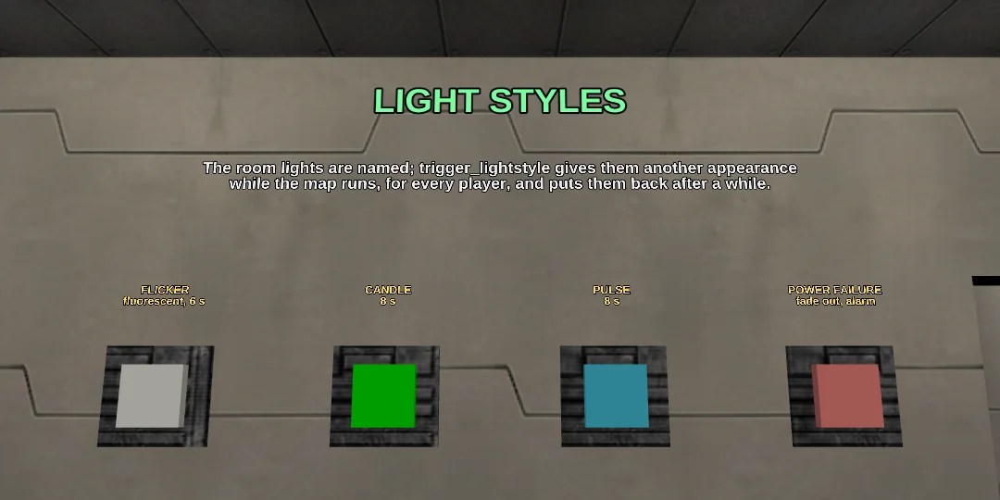
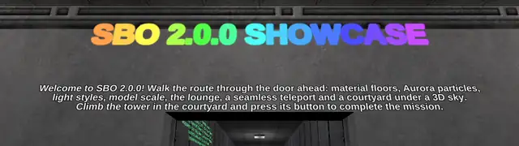
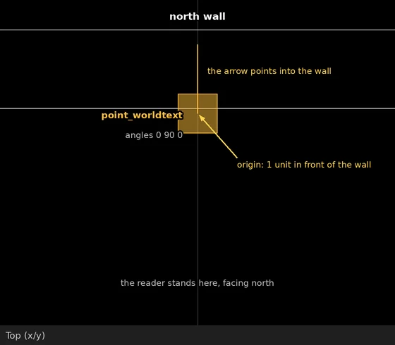

# World text

World text puts text right into your map, on a wall, on a floor or floating in the air, without a texture. A
[`point_worldtext`](../entities/point_worldtext.md) draws it in eight font styles, in any color or in cycling rainbow
colors, and a trigger can change it while the map runs. Its keys and their defaults are the same as those of the
Source entity with the same name.

`co_sbo_showcase` labels every room with world text.

*World text labels on a wall of buttons*

*A world text title with cycling rainbow colors*

## Placing text {#placing-a-text}

The origin of the entity is on the baseline of the first line. So capital letters go up from it, and the next lines
go down from it, one **Text Size** apart. Without **Center lines**, the first letter starts at the origin and the
text goes to the right of the reader. With **Center lines**, each line is centered on the origin.

Stationary text reads in the direction that the entity points, so in the editor, its arrow points into the wall that
the text is on. The text has only one side, so you can't see it from behind. Text exactly on a wall flickers with the
faces of the wall, and text 1 unit in front of the wall doesn't. These angles put text on each wall:

*How a world text is placed on a wall, seen from above*

| Text on | Angles |
|---|---|
| The north wall | Yaw 90 |
| The west wall | Yaw 180 |
| The south wall | Yaw 270 |
| The east wall | Yaw 0 |
| The floor, read from above | Pitch 90, and the yaw that the reader walks in |
| The ceiling | Pitch -90 |

## Keys

| Key | Description | Default |
|---|---|---|
| **Entity Message** `message` | The text, up to 1023 bytes, where `\n` starts a new line | |
| **Text Size** `textsize` | The height of a line in units, up to 4096, where 0 hides the text | `10` |
| **Text Spacing X** `textspacingX` | Extra space after each letter. A negative value moves the letters closer together | `0` |
| **Text Spacing Y** `textspacingY` | Extra space between the lines | `0` |
| **Color** `color` | The red, green, blue and alpha (opacity) of the text. A value that you leave out is 255 | `255 255 255 255` |
| **Font** `font` | The font, which the table below lists | Sans, black outline (0) |
| **Orientation** `orientation` | How the text turns:  &bull;&nbsp;Stationary (0) - it stays at the angles of the entity &bull;&nbsp;Face player (1) - it always turns to face the player &bull;&nbsp;Face player, upright (2) - it turns to face the player and stays upright  Text that faces the player is centered | Stationary (0) |
| **Rainbow** `rainbow` | With "Yes" (1), the letters cycle through the colors and keep the alpha of **Color** | No (0) |

| Font | Look |
|---|---|
| 0 | Sans, with a black outline |
| 1 | Sans |
| 12 | Sans, with a glow |
| 13 | Sans, with a drop shadow |
| 8 | Mono, with a black outline |
| 9 | Mono |
| 10 | Mono, with a drop shadow |
| 11 | Mono, with a glow |

It has these flags:

- **Start Off** (1) - The text shows only when you trigger it
- **Center lines** (2) - Each line is centered on the origin

## Changing text {#changing-a-text}

Triggers switch the text on or off, and the [use types](../guide/trigger-modes.md) On and Off set that state. A
[`trigger_changevalue`](../entities/trigger_changevalue.md) or a
[`trigger_copyvalue`](../entities/trigger_copyvalue.md) can change any key of a named `point_worldtext` while the map
runs, such as its text, color, size, font, position or angles, and every player sees the change. Players who join
later see the text in its current state. A `point_worldtext` without a name can't change, so it doesn't count toward
the engine's limit on entities in a map, and a named one counts as one entity.

## Characters

The game reads the text as UTF-8, and it reads a byte that isn't valid UTF-8 as Windows-1252. The fonts have
printable ASCII, Latin-1, typographic quotes and dashes, `…`, `•`, `€`, `™`, the arrows `← ↑ → ↓ ↔ ↕` and
`▲ ▶ ▼ ◀ ■ ● ✓ ✗`. All other characters show as `?`, and a tab shows as four spaces. The game doesn't look up
`#Token` entries of `titles.txt`, so the text shows exactly as you wrote it.

## Notes

- The text is always fully lit, the fog of the map covers it, and [mirrors](mirrors.md) show it
- World text shows only with the OpenGL renderer, and the software renderer draws none
- Text that faces the player turns with the view, so near a wall, part of it can go into the wall
- A map can have up to 1024 `point_worldtext` entities, and the game leaves out the others. With `developer 1` set in the console, the
  console reports this
- The 3D sky room and the overview map of spectators show no world text

## Changes since 1.38

- `point_worldtext` is new

## See also

- [`point_worldtext`](../entities/point_worldtext.md) - the entity page
- [Changing keys](../guide/changing-keys.md) - changing text while the map runs
- [`game_text`](../entities/game_text.md) - text on the HUD
- [World screens](world-screens.md) - menus and videos on a surface in the world
