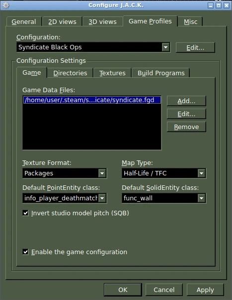
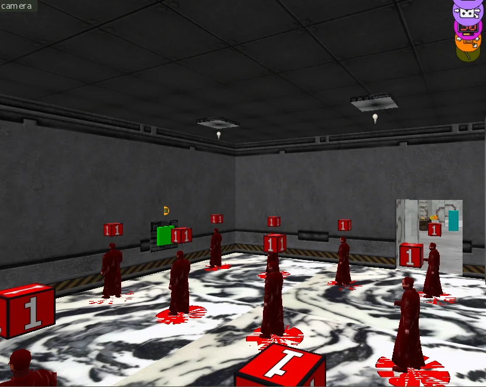

# Editor setup

SBO maps are made with the [J.A.C.K.](https://jack.hlfx.ru/en/) map editor, and once you set up an SBO game
profile, J.A.C.K. shows every SBO entity with its own model or icon and compiles and starts your map in one step. SBO comes with
everything the editor needs: the entity definitions, editor models and icons, example maps, and prefabs.

## The files

The game folder `Half-Life/syndicate/` holds the entity definition file (FGD) and the models and icons the editor
draws for point entities. The example maps and prefabs come in the SBO SDK, a separate download with each release:
download <ReleaseFile name="sbo-sdk" /> and unzip it anywhere, which gives you an `sdk/` folder with the FGD, the
example maps and the prefabs.

| File or folder | What it is |
|---|---|
| `syndicate/syndicate.fgd` | The entity definitions, with every SBO entity, key and flag and their help text (the same file as <SdkFile path="sdk/syndicate.fgd" /> in the SDK) |
| `syndicate/models/editor/`, `syndicate/sprites/editor/` | The models and icon sprites J.A.C.K. draws for point entities, which the game itself never loads |
| <SdkFile path="sdk/examples/maps/co_sbo_showcase/" /> | The showcase map, with its `.map` source, the compiled map and its files ready to play in `syndicate/`, and a `readme.md` that lists every room and its entities |
| <SdkFile path="sdk/examples/maps/co_video_test/" /> | A test map for [video](../features/video.md) |
| <SdkFile path="sdk/examples/maps/co_example_*/" /> | Small example maps for single features: [aliases](../guide/entity-triggering.md), [calc entities](../../guides/calc-entities.md), [color correction](../features/color-correction.md), [locus](../../guides/locus.md), [Move With](../features/moving-objects.md), [objectives](../entities/trigger_objective.md), [weather](../features/weather.md), [world screens](../features/world-screens.md) and [world text](../features/world-text.md), each with a `readme.md` |
| <SdkFile path="sdk/examples/maps/co_example_movewith/_full/" /> | The full [Move With](../features/moving-objects.md) map: a small city with a train, a lift, a crane, a drawbridge, a boat, a carousel and more, and a test wing whose rooms each show one tricky case, with a `readme.md` |
| <SdkFile path="sdk/examples/sequences/" />, <SdkFile path="sdk/examples/video/" /> | An example [sequence file](../features/sequences.md) and an example video |
| <SdkFile path="sdk/prefabs/world_screens/" /> | A [world screen](../features/world-screens.md) prefab |

The FGD finds the editor models and icons in the game folder once you have set up the game profile below. If J.A.C.K.
can't find an entity's model or icon, it draws the entity as a colored box.

## The game profile

J.A.C.K. keeps the settings for each game in a game profile, found in **Tools > Options > Game Profiles**. Press
**Edit...** next to **Configuration**, add a configuration named `Syndicate Black Ops`, and give it these values on
its four tabs:

| Tab | Setting | Value |
|---|---|---|
| Game | Game Data Files | `Half-Life/syndicate/syndicate.fgd` |
| Game | Texture Format | Packages |
| Game | Map Type | Half-Life / TFC |
| Game | Default PointEntity class | [`info_player_deathmatch`](../entities/info_player_deathmatch.md) |
| Game | Default SolidEntity class | [`func_wall`](../entities/func_wall.md) |
| Directories | Game Executable | `Half-Life/hl.exe` |
| Directories | Base Game Directory | `Half-Life` |
| Directories | Mod Directory | `syndicate` |
| Directories | Source Maps Directory | the folder of your `.map` files |
| Textures | Textures used | the WADs in [Textures](#textures) below |
| Build Programs | CSG, BSP, VIS and LIGHT Executable | the four [compile tools](#compile-tools) |

Leave **Enable the game configuration** on. J.A.C.K. saves the profile when you close the editor.

Some compile tools come with an FGD for their own entities, such as `info_sunlight` or `light_surface`, which you can
load in J.A.C.K. as a second game data file next to `syndicate.fgd`.



*The J.A.C.K. game profile for Syndicate Black Ops*

## Textures

Add these WADs (texture files) to the profile's texture list:

| WAD | What it holds |
|---|---|
| `Half-Life/valve/halflife.wad` | The tool textures `sky`, `AAATRIGGER`, `CLIP` and `ORIGIN`, and Half-Life's world textures |
| `Half-Life/valve/liquids.wad` | Half-Life's water textures |
| `Half-Life/syndicate/anzymut.wad` | SBO textures |
| `Half-Life/syndicate/roux.wad` | SBO textures |
| `Half-Life/syndicate/co_escape.wad` | SBO textures |
| `Half-Life/syndicate/sbo_tools.wad` | The tool textures `env_sky` for the [3D sky](../features/sky.md) and `{screen` for [world screens](../features/world-screens.md) |

### Tool textures

Tool textures have special names that the compile tools read and give a brush a special job, such as blocking
players without being seen. ReSDHLT and SDHLT come with their own tool textures in `tools/sdhlt.wad`, such as `NULL`,
`SKIP`, `HINT` and `BEVEL`. Add that WAD to the **Textures** tab of the game profile too.

`sbo_tools.wad` adds two tool textures for SBO features: `env_sky`, which shows the [3D sky](../features/sky.md) on
the faces it covers, and `{screen`, which marks the faces of a brush entity where a
[world screen](../features/world-screens.md) shows. The compile tools turn `env_sky` brushes into sky and leave their
faces out of the map, and any texture whose name starts with `env_sky` works the same way.

## Compile tools

J.A.C.K. runs the four compile tools (CSG, BSP, VIS and RAD) and then starts the game with these parameters, where
`$file` is the name of the map J.A.C.K. compiled:

```
-game syndicate -console -dev +map $file
```

See [Compiling](compiling.md) for more details on the tools and their options.

## The showcase map

The showcase map `co_sbo_showcase` comes with the SDK download, not with the game. To play it, copy the contents of
<SdkFile path="sdk/examples/maps/co_sbo_showcase/syndicate/" /> into your game's `syndicate` folder, then type
`map co_sbo_showcase` in the console.

Once the profile and the WADs are set up, open <SdkFile path="sdk/examples/maps/co_sbo_showcase/co_sbo_showcase.map" />. It opens
with the SBO textures, editor models and icons, and shows how each feature is built.



*Spawn points as player models in the J.A.C.K. 3D view*

## See also

- [Compiling](compiling.md) - the compile tools and their settings
- [Testing a map](testing.md) - how to start and test your map
- [Map names and spawns](../basics/map-names-and-spawns.md) - how the map name sets the game mode
- [Entity keyvalues](../guide/entity-keyvalues.md) - how entity keys work
