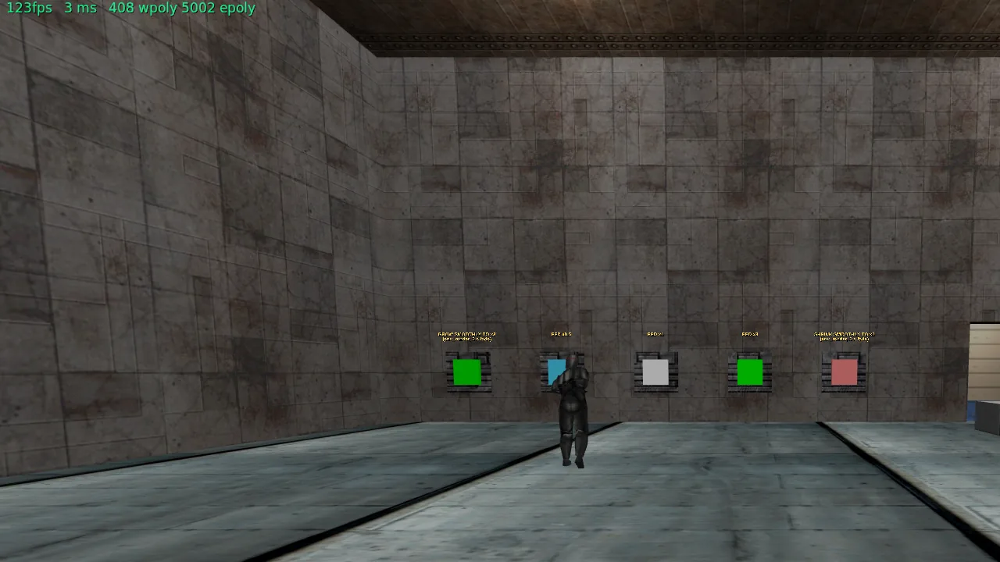
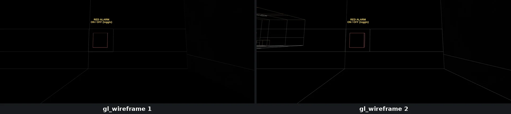

# Testing a map

Your compiled map runs like any map on a server, with its briefing, loadout menu, rounds and monsters, and started
with one player slot it also gives you the engine's debug views and the cheat commands.

## Starting the map

Type these commands in the console:

```
maxplayers 1
map co_mymap
```

To test with more players, start the map from **Create Server**.

With `maxplayers 1`, the map plays its normal game mode for one player, with the briefing, the loadout menu, the
spawn, the rounds, the monsters and the mission end, so Co-op and Bounty Killer maps run as they do for one player
on a server. A Battle Royale round needs two players, so on a `br_` map you spawn once and no round starts. The start
of the map name sets the game mode, see [Map names and spawns](../basics/map-names-and-spawns.md) for more details.

SBO has no saved games, even though the engine's save and load commands exist in this session. If you load a save,
the map starts again from the beginning, and with `developer 1` set in the console, the console shows `Saved games
are not supported: restarting <map>`.

### Debug views

These engine commands only work with `maxplayers 1`:

| Command | What it shows |
|---|---|
| `r_speeds 1` | At the top left: the frames per second, the time of a frame, `wpoly` (the world polygons drawn) and `epoly` (the polygons of the models drawn). Set `con_notifytime` above 0 to see it |
| `gl_wireframe 1` | The edges of the world's polygons |
| `gl_wireframe 2` | The same edges, also through walls |
| `r_drawentities 2` to `5` | Models as their bones, hitboxes or hulls |

TWHL's guide [Total Map Optimisation](https://twhl.info/wiki/page/Tutorial:_Total_Map_Optimisation_Part_1_(wpoly,_epoly))
explains `wpoly` and `epoly` in detail.



*The r_speeds readout at the top left*



*gl_wireframe 1 and gl_wireframe 2*

### Cheat commands

With `sv_cheats 1` set in the console, the [cheat commands](cheat-commands.md) let you become invulnerable, move
fast and fly through walls, and you can create, trigger, list, remove and show the map's entities from the console.

## Console messages

With `developer 1` set in the console, the console shows the game's messages about your map. These are the ones you
will see most often:

| Message | When you see it |
|---|---|
| `map_compat: ...` | The [compatibility file](../basics/old-maps.md) changes a key on the map, with one line for each entity |
| `materials: ...` | The map's [materials file](../features/materials.md) has an error or goes over a limit |
| `Master was null or not a master!` | An entity's **Master** names no entity, or an entity that isn't a master. See [Masters and states](../guide/masters-and-states.md) for more details |
| `Bad or missing [LR] value ...` | A [locus](../guide/locus.md) number can't be worked out |
| `vgui_screen "...": the server has no ...` | A [world screen](../features/world-screens.md) layout file is missing |
| `env_overlay: ...`, `point_worldtext: ...`, `env_static: ...`, `env_mirror: ...` | A picture, font or model of the map is missing or can't be used, or the map has more than the limit |
| `Aurora: ...` | A [particle script](../features/particles.md) is missing or has a mistake |
| `Video: ...`, `worldscreen: ...` | A video, movie or world screen file is missing, refused or can't be read |
| `color_correction: ...` | A [color correction](../features/color-correction.md) file can't be read |
| `Error parsing overview file ...`, `Couldn't load overview image ...` | The map's [overview](../basics/overviews.md) file has a mistake, or a layer's image doesn't load |

If a [sequence file](../features/sequences.md) has errors, the console shows them when the map loads, with the file
name and the line number. If your logic doesn't do what you expect, give an [`env_state`](../entities/env_state.md) or
a [`calc_state`](../entities/calc_state.md) the flag **Debug Mode** (2), and with `developer 1` set in the console,
the entity prints each trigger it gets and each result it works out.

## Changes since 1.38

- Fixed a map started with `maxplayers 1` restarting when you pressed Go in the loadout menu. SBO 1.38 treated
  a one-player game as Half-Life single player, which reloads the map when you spawn. You can now test a map alone
  with commands that only work in single player, such as `gl_wireframe`. This was a bug in SBO 1.38

## See also

- [Compiling](compiling.md) - the compile tools and their settings
- [Cheat commands](cheat-commands.md) - the console commands for testing
- [Map names and spawns](../basics/map-names-and-spawns.md) - how the map name sets the game mode
- [Old maps](../basics/old-maps.md) - how SBO keeps older custom maps working
- [`env_state`](../entities/env_state.md) and [`calc_state`](../entities/calc_state.md) - the entities with **Debug Mode**
