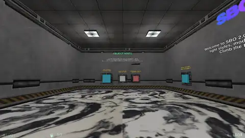

# Entity keyvalues

Every entity in a map is a list of keys and values, and SBO adds new kinds of keys: model scale, object hints that
mark what players can use, custom keys that work as your map's variables, and special names for the entities in a
chain of triggers. The keys hold an entity's class name, its position and the settings the editor shows, and the
game reads them when the map loads. Some entities can also change them while the map runs, see
[Changing keys](changing-keys.md) for more details.

## Keys shared by many entities

Many entities share the same keys, such as **Name**, **Target**, **Delay before trigger**, **KillTarget**, **Master**
and the render keys **Render Mode**, **FX Amount** and **FX Color**. An [`env_render`](../entities/env_render.md)
changes the render keys while the map runs, at once or with a smooth fade (see
[Props, models and fades](../features/props-and-fades.md)). See [Common keys](../entities/common-keys.md) for every
shared key and its values.

## Model scale [[ported:spirit]]

The key `scale` (**Model scale**) draws a model at this many times its size, so 0.5 is half size and 2 is twice the
size, and an empty value or 1 is the normal size. See [Model scale](../features/model-scale.md) for the entities that
read it and what else grows or shrinks with the model.

## Object hints

An object hint is a sprite that marks an object a player can use or pick up, so players can find buttons and chargers
in a busy room. You turn it on for one entity with the key `objecthint` (**Object Hint Template**), which the FGD
offers on buttons, [`func_recharge`](../entities/func_recharge.md), doors, items and
[`ammo_reserve`](../entities/ammo_reserve.md), and which any other entity accepts too. The template decides what the
player sees:

*Object hints on a suit charger (`charger`), a lock button and a lamp button (`button`)*

| Template | What the player sees |
|---|---|
| Empty | No hint |
| `button` | Brackets in the HUD color when the player is near, which turn yellow when the use key would press the button and orange while its master locks it |
| `charger` | Brackets in the HUD color when the player is near, which turn green when the use key would use the charger and red when it is empty or the player has no suit |
| `eyescanner` | Brackets in the HUD color when the player is near, which turn yellow when the use key would use it |
| `pickup` | Brackets in the HUD color when the player is near, which turn yellow when the use key would pick it up, and no hint while it waits to respawn or the player can't take it |

Near means within the hint distance of the player's eyes, in front of the player and not behind a wall. The key
`objecthint_distance` (**Hint Distance**) sets that distance in units, up to 4096, and an empty value or 0 gives 512.
The colored look only shows on the object the use key would use right now, within 64 units.
If you write a template name that doesn't exist, the entity shows no hint, and with `developer 1` set in the console,
the console shows a line when the map loads.

Each player sees the hints of the objects near them, while spectators and dead players see none. With the setting
[`cl_objecthint`](../../playing/options.md#player-cvars), players choose whether they see every hint, only the hint
on the object the use key would use, or none.

## Custom keys

A key whose name starts with `$i_`, `$f_`, `$v_` or `$s_` is a custom key, and you can give one to any entity, in
the editor or while the map runs. A custom key does nothing by itself, but it holds a value other entities read and
change, so custom keys work as the variables of your map's logic. The start of the name sets the kind of value:

| Prefix | Kind of value | Example |
|---|---|---|
| `$i_` | A whole number | `$i_kills` `0` |
| `$f_` | A number with decimals | `$f_power` `0.5` |
| `$v_` | Three numbers, `x y z` | `$v_spot` `0 128 64` |
| `$s_` | Text | `$s_status` `OK` |

[`trigger_changevalue`](../entities/trigger_changevalue.md), [`trigger_copyvalue`](../entities/trigger_copyvalue.md)
and [`trigger_condition`](../entities/trigger_condition.md) read and write them. A map can have up to 1024 custom
keys, and a custom key name can have up to 31 characters. See [Changing keys](changing-keys.md) for more details.

## Special names

Some keys that take an entity name also accept a special name, which stands for an entity in the current chain of
[triggers](entity-triggering.md):

| Name | What it stands for | Where it works |
|---|---|---|
| `!activator` | The entity that started the chain of triggers, such as the player who pressed a button | **Target** and **KillTarget**, the keys of `trigger_changevalue`, `trigger_copyvalue`, `trigger_condition` and [`trigger_entity_iterator`](../entities/trigger_entity_iterator.md), and [locus](locus.md) keys |
| `!caller` | The entity that triggered this one, but in **KillTarget** the entity itself | **Target** and **KillTarget**, and the keys of `trigger_changevalue`, `trigger_copyvalue`, `trigger_condition` and `trigger_entity_iterator` |
| `*locus` | The same as `!activator` | Locus keys |
| `*player` | The activator, but only when it is a player | Locus keys |

## Changes since 1.38

- The `scale` key draws models at that scale. SBO 1.38 always drew them at their normal size
- Object hints, custom keys and the special names are new

## See also

- [Common keys](../entities/common-keys.md) - every shared key group with its keys
- [Changing keys](changing-keys.md) - changing keys while the map runs
- [Locus system](locus.md) - keys that ask another entity for a value
- [Masters and states](masters-and-states.md) - entities that lock others
- [Trigger modes](trigger-modes.md) - the use types On, Off, Toggle and Set
