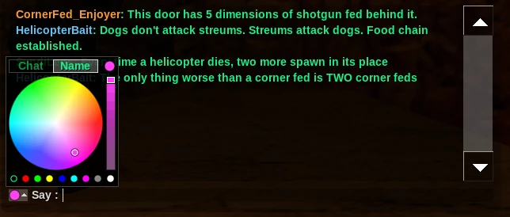

# Chat and console [[ported:bhl]]

The chat window shows messages from players, the server, and the game. Both names and messages can have custom
colors, which will show up in different places when set (the chat window, kill feed, scoreboard).

## Sending messages

- The chat key (Default: <kbd>Y</kbd>) opens the chat input, and every message goes to every player on the server
- You can also spectate by writing the following in chat: `/spec`, `/spectate`, `.spec` or `.spectate`, or by writing
  `spectate` in the console. This won't be broadcast to other players. See [Spectating](spectating.md) for more
  details.

### Chat prefixes

The sender's prefix is always in the normal chat text color, regardless of a custom chat or name color, and the
sender's name has the color of their [scoreboard group](hud-and-scoreboard.md#scoreboard) unless they set a custom name
color. The prefix is a short hint regarding that player's current status:

| Prefix | Sender |
|---|---|
| `*DEAD*` | Dead, or waiting for the next round. In Bounty Killer, also a player who hasn't chosen a loadout yet |
| `*NOLOAD*` | Hasn't chosen a loadout yet in Co-op, or hasn't picked **go** in Battle Royale |
| `*SPEC*` | In spectator mode |
| `*GM*` | The Game Master in Co-op |
| None | Alive |

### Flood protection

If you send messages less than 0.5 seconds apart, the server counts it as flooding. From the fourth such message on,
it drops your message, prints "** Stop flooding the server! **" in your console and accepts your next message only
2.5 seconds later.

## Colors

### Name color and chat color

You can choose separate colors for your player name and your messages, which every player sees, unless they have
colors turned off. Your name shows in your name color in the chat, the scoreboard, the kill feed, the voice labels
and the status bar. The chat color only changes the text of your own messages, as you and every other player see them,
not the chat as a whole.

The color button to the left of the chat input opens a color picker, where you switch between **Chat** and **Name**.
**Options > Multiplayer > Name color** and **Advanced > Chat > Chat color** set the same two colors.

*The color picker on the Name tab, with the color button next to Say showing the name color you pick*

- The game tries to lighten very dark colors, but some colors may still be hard to read
- If you turn off **Advanced > Chat > Name and chat colors**, names and messages show without these colors

## Settings

| Cvar | Default | Effect |
|---|---|---|
| `namecolor` | 0 | Your name color, the same setting as **Options > Multiplayer > Name color** and the **Name** tab of the chat color picker. 0 is no color, 1 to 8 are red, green, yellow, blue, cyan, magenta, gray and white, and `xRRGGBB` or `xRGB` is any color, such as `namecolor x4AF` |
| `hud_chat_color` | 0 | Your chat color, the same setting as **Advanced > Chat > Chat color** and the **Chat** tab of the chat color picker. A separate setting from `namecolor` that takes the same kind of values |
| `hud_colortext` | 1 | 1 shows name and chat colors, 2 turns them off. **Advanced > Chat > Name and chat colors** switches between 1 and 2 |
| `hud_saytext` | 1 | 0 hides new chat messages |
| `hud_saytext_time` | 12 | How many seconds a message stays on the screen. **Advanced > Chat > Message time** allows you to set it to 5, 8, 10, 12, 15, 20, 30 or 60 |
| `hud_saytext_sound` | 1 | The volume of the sound for a new message, from 0 (no sound) to 1 (full volume). Higher values are clamped to 1. **Advanced > Chat > Message sound** switches it on and off |
| `hud_chat_fontsize` | 17 | The chat text size in pixels, from 14 to 34. Can also be set in **Advanced > Chat > Text size** |

## Muting

If you press the mute button on the scoreboard, or **Mute** in the scoreboard's player menu, the server stops sending
that player's chat and voice messages to you.

## Game messages in the chat

Besides the players' messages, the chat shows these game messages:

- Hit messages, so a player hit in the head, chest, stomach, an arm or a leg gets a line for that body part, at most
  once every 10 seconds for each body part. These lines show where the chat appears while it's closed and then fade
  out, and they aren't added to your chat history
- Radio messages in Co-op, which the radio menu (Default: <kbd>X</kbd>) sends to the team as a short order, such as
  `(RADIO) <name> : Cover Me !`
- Lines when a player joins, leaves or changes their name

## Console [[ported:bhl]]

The console keeps a copy of every chat line with the time, such as `[12:34:56] Sadako: hello`, and a line for every
kill. It shows these lines in their colors:

- The copies of the chat lines
- The kill lines
- Console text the server sends

If you turn off **Name and chat colors**, the console shows them without colors too, as [Settings](#settings) explains.

Text the engine prints itself, such as connection messages, `status` and cvar values, has no colors. If the game
can't color the console, it shows the lines without colors, and with `developer 1` set in the console, it prints one
line, `Console colors are off: <reason>.`
`con_color` sets the color of the console text, which a new install sets to green (`17 244 136`).

## Changes since 1.38

- Chat has been completely reimplemented using VGUI2, and as a result now supports name and chat colors, copy + paste, multi-line
  messages, history, unicode characters, and more
- Fixed players in the menus or waiting for the next round seeing no chat. The game only sent chat to players it counted
  as in the game, and SBO 1.38 counted waiting players as observers instead, so they were skipped
- Team chat (`say_team`) has been removed, and <kbd>U</kbd> is no longer bound to it. In 1.38, the server ignored team
  messages, so they were never sent
- Spectator mode is new: `/spec` or `/spectate` in the chat, or `spectate` in the console, turns it on and off. SBO 1.38
  had no spectator mode
- The console keeps a copy of every chat line with its time, such as `[12:34:56]`, and also shows kill lines and server
  text in their respective colors

## See also

- [HUD and scoreboard](hud-and-scoreboard.md) - the scoreboard groups and the kill feed
- [Spectating](spectating.md) - spectator mode and the spectator commands
- [Options](options.md) - the chat settings and the other options
