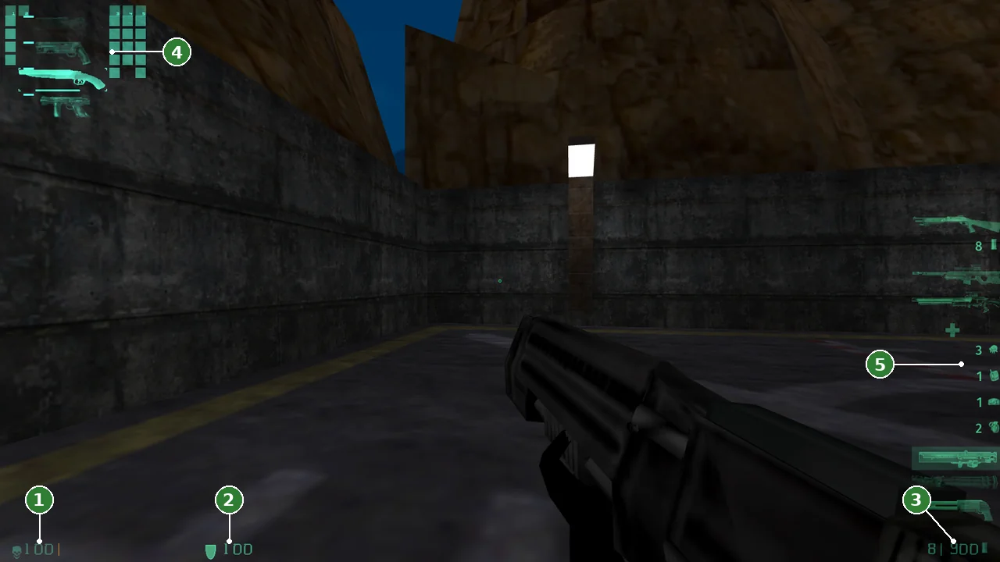
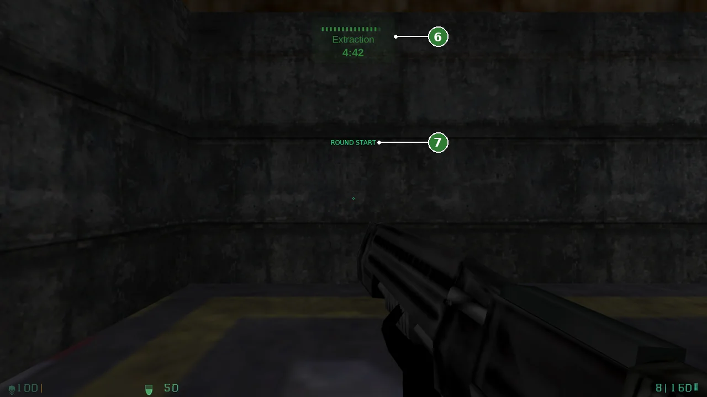
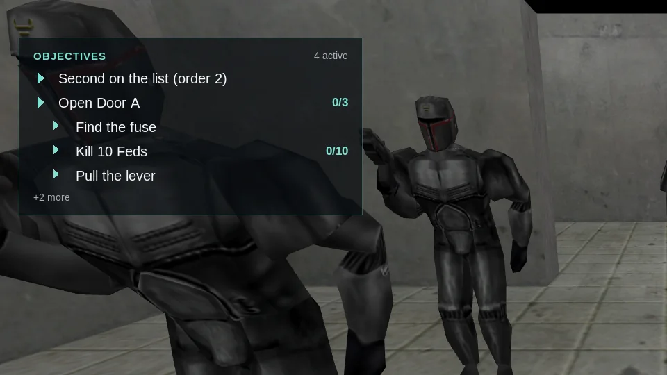
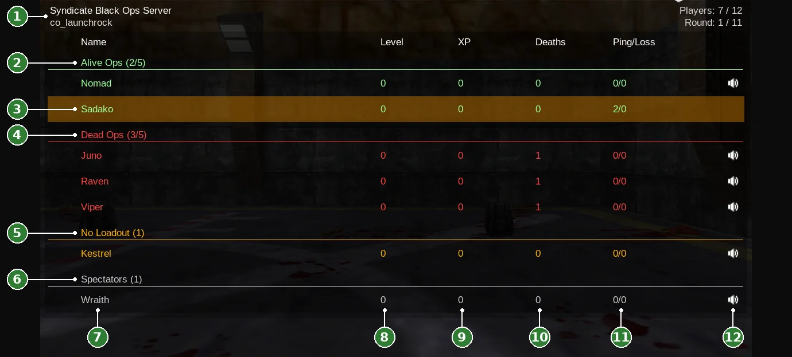

# HUD and scoreboard

The HUD (the heads-up display, which is everything the game draws over your view) shows your health, armor, ammo and
the game's messages. The scoreboard, which shows while you hold the scoreboard key (Default: <kbd>Tab</kbd>), lists the players by
state, and the kill feed lists the kills in the top right corner.

## HUD

*The HUD with the weapon menu open and the weapons and ammo you just picked up on the right*

*A map's timer at the top and a round message in the middle of the screen*

| # | Part | What it shows |
|---|---|---|
| 1 | Health | Your health, at the bottom left |
| 2 | Armor | Your armor, at the bottom left next to your health |
| 3 | Ammo | Magazine ammo for your current weapon and additional ammo in your backpack for that weapon, at the bottom right |
| 4 | Weapon menu | The [weapons](weapons-and-items.md) you carry, which you open with the number keys or the mouse wheel |
| 5 | Pickups | The weapons and ammo you just picked up, on the right side of the screen |
| 6 | Timer | A countdown or a clock, on maps that have one |
| 7 | Center text | Round and mission messages such as **ROUND START** and **LEVEL UP**, "Cloak", and hit results such as **PERFECT SHOT** |
| | Status bar | The name of the player under your crosshair, in that player's name color |
| | Object hints | Small icons over the items and buttons that a map marks, with a hint on the one you can use |
| | Objectives | The active mission objectives and how far along they are, at the top left on maps that have them. A notice slides in under the panel when an objective is new or completed |
| | Inventory | Your keycards, keys and other items on maps where you carry items, on the left below the middle, followed by the team's shared items after **TEAM** |

If a player gives no input for a while, which is a minute by default, an AFK sign (away from keyboard) shows above
their head until they press a key or move the mouse again. The server sets this time with
[`mp_afk_time`](../server/settings.md#idle-players).

*The objective panel with a group of three parts*

The objectives key (Default: <kbd>H</kbd>) switches the objective panel between short, full and hidden. The same objectives show in
one line at the bottom of the scoreboard, and if you turn on the scoreboard's mouse cursor, you can click that line to
open the whole list.

### HUD settings

| Cvar | Default | Effect |
|---|---|---|
| `hud_scale` | 0 | [[ported:hlu]] 1 scales the HUD up to fit your screen when you play with the hardware renderer. It applies at the next map load or video change |
| `hud_draw` | 1 | 0 hides the HUD |
| `cl_objecthint` | 1 | [[ported:featureful]] 0 hides the object hints, and 2 shows only the hint on the item or button you can use |
| `hud_objectives` | 1 | The objective panel, which is 0 for hidden, 1 for short and 2 for full |

## Scoreboard [[ported:bhl]]

The scoreboard shows while you hold the scoreboard key (Default: <kbd>Tab</kbd>).

*The Co-op scoreboard, with every group but the Game Master and Ghosts*

| # | Part | What it shows |
|---|---|---|
| 1 | Header | The server name, the map, the players and slots, and the round in Co-op. See [Header](#header) for more details. |
| 2 | Alive Ops (green) | Players who are alive |
| 3 | Your row | Your player details, highlighted |
| 4 | Dead Ops (red) | Players who are dead or have joined late, waiting for the next round. In Bounty Killer this also includes players who haven't chosen a loadout yet |
| 5 | No Loadout (yellow) | Players who haven't chosen a loadout yet in Co-op, or haven't picked **go** in Battle Royale |
| 6 | Spectators (gray) | Players in [spectator mode](spectating.md) |
| | Game Master (blue) | The [Game Master](../game-modes/coop.md#game-master) in Co-op |
| | Ghosts (faded gray) | Players who are still connecting or downloading, or those the game server has heard nothing from for 5 seconds |
| | Avatar | The player's Steam avatar, left of the player's name |
| 7 | Name | The player's name, including any custom colors they set |
| 8 | Level or Score | The player's level in Co-op, and their frags in the other modes |
| 9 | XP | Total XP the player earned on the map, in Co-op. This will also decrease when losing levels |
| 10 | Deaths | How many times the player died |
| 11 | Ping or Ping/Loss | The player's ping and their packet loss |
| 12 | Mute | A button that mutes the player's voice and chat for you |

The Alive Ops and Dead Ops headings show how many players are in each, out of everyone in the round, such as
`Alive Ops (3/5)`. Everyone in the round means the players in Alive Ops and Dead Ops, not the Game Master, No Loadout
or Spectators. Other groups only show the total number of players in that group as a single value. Ghosts aren't in
the game yet or have lost their connection, so their score, deaths, XP and ping are empty.

Each group's color is also the color of its players' names on the scoreboard, in the chat and in the kill feed, unless
a player has set a custom [name color](chat-and-console.md#name-color-and-chat-color). That player's name then shows in
their own color everywhere, and only the group's heading keeps the group color.

In Bounty Killer, the Hunted is the first row of Alive Ops, with a faint blue background and **(Hunted)** after the
player's name. The Hunted's name is blue on the scoreboard, in the chat and in the kill feed, unless the player has set
a custom name color. The Hunted's name then keeps that color, and only **(Hunted)** and the Hunted's row background
stay blue.

### Header

- The server name
- The map's name
- `Players: <players> / <slots>`, which includes active players and those still connecting
- In Co-op, `Round: <round> / <rounds>`, which shows round 0 before the first round starts
- In the other modes, when the server has a frag limit, `Frags left: <n>`, which is how many more frags the player
  with the most frags needs to end the map

### Badges

A few players have a badge after their name, such as the "Community Organizer" badge. If you turn on the mouse
cursor and point at a badge, it shows its title, and if the badge has a link, clicking it opens the link.

### Player menu

While the scoreboard shows, a mouse button (Default: <kbd>Mouse 1</kbd>) turns on the mouse cursor, and clicking a
player opens a menu with these items:

- **Mute** or **Unmute**
- **Open Steam profile**
- **Copy profile URL**
- **Copy nickname**
- **Copy raw nickname**
- **Copy SteamID**
- **Copy SteamID64**

### Scoreboard settings

| Cvar | Default | Effect |
|---|---|---|
| `hud_scoreboard_mousebtn` | 1 | The mouse button that turns the cursor on, which is 0 for none, 1 for <kbd>Mouse 1</kbd> and 2 for <kbd>Mouse 2</kbd> |
| `hud_scoreboard_showavatars` | 1 | 0 hides the avatars |
| `hud_scoreboard_showloss` | 1 | 0 shows the ping without the packet loss |
| `hud_scoreboard_showeff` | 0 | 1 adds an Eff column, the player's score divided by their deaths, so a player who scores much and dies little has a high value |
| `hud_scoreboard_size` | 0 | The row height. 1 always uses normal rows and 2 always uses compact rows, which are lower, so more players fit on the screen. 0 uses normal rows and switches to compact rows only when the list doesn't fit |

## Kill feed [[ported:bhl]]

*A player's kill, a monster's head shot, your own kill and a Game Master's monster in the kill feed*

1. Killer
2. The weapon's icon
3. Victim, a player or the monster's name
4. The headshot icon, which takes the place of the kill icon when a monster kills with a head shot
5. A monster's name when a monster kills
6. Your row, which has its own background when you are the killer or the victim
7. A monster that the Game Master placed, with the Game Master's name and the Game Master icon

For monster kills, the kill feed row shows the monster's name, for example "Fed", "Cop", "Sectum" or "Cyber Minotaur". A
monster that the Game Master placed shows with the Game Master's name before the monster, for example "Sadako's Fed",
and the Game Master icon. The rows where you are the killer or the victim have their own background color. Every kill
also writes a line in the console.

### Teamkills

In Co-op, when a player kills another player, the weapon icon shows in green. Kills by a Game Master's monsters,
suicides and deaths by the world keep the normal colors.

### Headshot icon [[ported:cs]]

When the killing blow hits the victim's head, an additional headshot icon displays between the weapon icon and the
victim. When a monster kills with a head shot, the headshot icon takes the place of the default kill icon.

### Turrets

When one of the map's gun turrets or turret monsters kills, the kill feed row shows the turret icon, whether or not a player is
at the controls.

### Monsters in the kill feed

By default, the kill feed shows monsters that kill players and players that kill monsters. The server can show only
the monsters that kill players, or no monster kills at all.

Server setting: [`mp_killfeed_npc`](../server/settings.md#kill-feed)

### Kill feed settings

| Cvar | Default | Effect |
|---|---|---|
| `hud_deathnotice_vgui` | 1 | 0 uses the kill feed made of sprites, as in Half-Life |
| `hud_deathnotice_time` | 6 | How many seconds a row stays |
| `hud_deathnotice_time_self` | 12 | How many seconds a row stays when you are the killer or the victim |
| `hud_colortext` | 1 | 1 shows name colors, 0 and 2 turn them off |

## Changes since 1.38

- The scoreboard groups the players by state into Game Master, Alive Ops, Dead Ops, No Loadout, Spectators and
  Ghosts
- In Co-op, the scoreboard shows the level and XP of each player, and the round with the number of rounds
- The kill feed shows a headshot icon for kills by a headshot
- In Co-op, when a player kills another player, the kill feed shows the weapon icon in green
- Maps can show mission objectives and an inventory row
- The kill feed names the monster that killed a player and shows the monsters that players kill, while SBO 1.38
  showed no killer for a monster kill and didn't show monster deaths
- The kill feed has an icon for every SBO weapon and a turret icon. SBO 1.38 had no kill feed icons for them, so the
  game used the default skull icon as a fallback each time

## See also

- [Chat and console](chat-and-console.md) - chat, voice and the console
- [Spectating](spectating.md) - watching other players
- [Options](options.md) - the game's settings
- [Co-op](../game-modes/coop.md) - rounds, levels and XP
