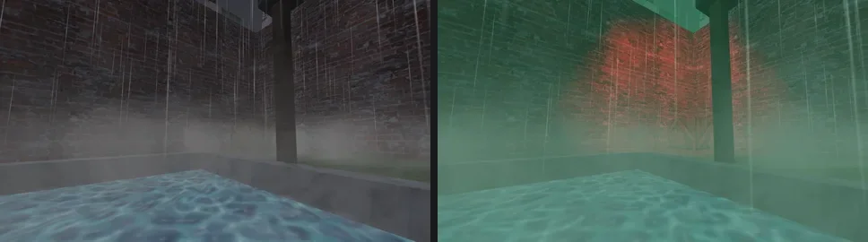
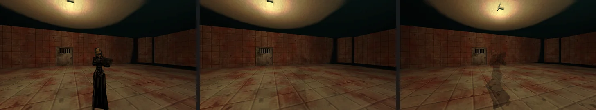
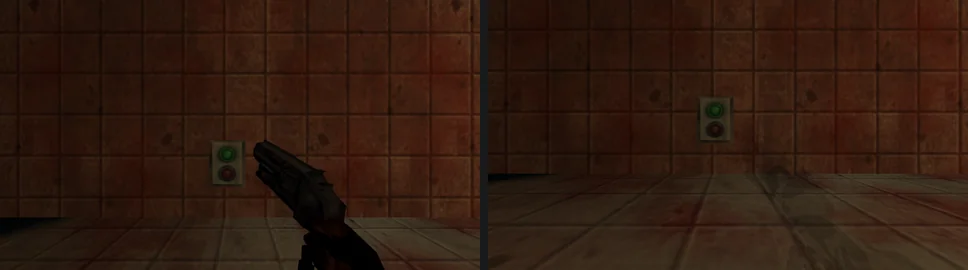

# Loadout

Your loadout is what you spawn with in [Co-op](../game-modes/coop.md) and [Bounty
Killer](../game-modes/bounty-killer.md): a blade, a light weapon, a heavy weapon, a cyberware, an equipment item, your
armor choice, and your agent choice (male or female). [Battle Royale](../game-modes/battle-royale.md) has no loadout,
each round you will spawn as a random agent with one random weapon, item or bonus.

You choose your loadout in the [selection menu](menus.md#loadout), which opens after the map briefing, and you can
open it again at any time with the selection menu key (Default: <kbd>M</kbd>). A new loadout applies the next time you
spawn.

## Speed

Your base speed starts at 300, and the items you choose have speed penalties that lower it. Other things change it
too:

- In Co-op, each [level](../game-modes/coop.md#levels) changes your base speed by 5, so you get faster when you gain a
  level and slower when you lose one (for example, from a teamkill penalty). Below level −40, your base speed stays
  capped at 100 regardless of how much lower your level goes
- In Co-op, your speed after the speed penalties of your loadout is never below 80, so a heavy loadout at a low level
  can still move
- Some items, such as [Cyber legs](#cyberware) and [Assassin](#assassin), give you a speed bonus
- When zooming with the Vindico Federal, the Vindico plasma sniper or the Croon NM 33 sniper, your speed drops to 80
  until you stop zooming

## Agent

You can choose a female or a male agent, this changes only your player model and your
[radio voice lines](chat-and-console.md#game-messages-in-the-chat). In Bounty Killer, the Hunted player has a separate
model which differentiates them from other players. See [The Hunted](../game-modes/bounty-killer.md#the-hunted) for
more details.

## Blade

| Blade | Speed | Damage per hit | Time between hits |
|---|---|---|---|
| Fusion warhammer | −30 | 280–516 | 1 s |
| Chainsaw sword | 0 | 44–110 | 0.5 s |
| Energy sword | −15 | 222–280 | 0.7 s |

While you hold a blade or your fists, you take half damage. See [Blades and fists](weapons-and-items.md#blades-and-fists)
for more details.

## Light weapon

| Weapon | Speed | Spare ammo at spawn in Co-op / Bounty Killer |
|---|---|---|
| Croon RC 28 | 0 | 120 / 30 |
| .444k Bear killer | 0 | 143 / 24 |
| Canon of terror | −15 | 180 / 10 |
| Croon PM 66 | −15 | 150 / 50 |

Every weapon spawns with a full magazine plus the spare ammo in the table, except the minigun, which spawns with 300 of
its 500 rounds loaded. A Co-op map can change the spare ammo of each weapon with a
[`Limitator`](../mapping/entities/Limitator.md) entity, which also sets how much ammo the map's ammo boxes give.

See [Light weapons](weapons-and-items.md#light-weapons) for more details.

## Heavy weapon

| Weapon | Speed | Spare ammo at spawn in Co-op / Bounty Killer |
|---|---|---|
| Croon FA 18 | −30 | 250 / 50 |
| Vindico Federal | −20 | 210 / 30 |
| Vindico plasma sniper | −45 | 50 / 10 |
| Croon NM 33 sniper | −30 | 150 / 30 |
| Saan auto-shotgun | −20 | 160 / 8 |
| Benelli | −20 | 120 / 8 |
| Vindico grenade launcher | −60 | 1 / 1 |
| Vindico Avenger minigun | −80 | 100 / 100 |
| Nuclear rocket launcher | −80 | None, only the 1 rocket it holds |

See [Heavy weapons](weapons-and-items.md#heavy-weapons) for more details.

### Heavy weapon limits in Co-op

Co-op maps have the following limits: 3 Vindico grenade launchers and 2 nuclear rocket launchers at any given time. If
other players have already selected them, the game displays "3 grenade launchers max / team" or "2 Nuclear launchers
max / team", and you must pick another weapon. With [**New in-game menus**](options.md#advanced) on, the loadout
window grays out a launcher when none are free.

A launcher becomes free again when the player who has it leaves the server, picks another loadout or becomes a
spectator. A spectator who comes back keeps their launcher only if one is still free. Bounty Killer has no limit.

## Cyberware

| Cyberware | Effect |
|---|---|
| Cyber legs | Speed +50 in Co-op and +150 in Bounty Killer |
| Targeting system | Doubles the damage you do to monsters, and makes your damage against players four times as much |
| Medikit | Gives you the [medikit](weapons-and-items.md#medikit) |
| Adrenaline surge | +75 health when you spawn |
| Assassin | A full kit, described [below](#assassin) |
| Cyber eyes | Night vision, which you turn on and off with the night vision key (Default: <kbd>J</kbd>) |

*The same view without and with night vision*

*Left: a dark area without night vision. Right: the same view with night vision on, which tints the screen green and
lights the area in front of you red*

### Assassin

Assassin replaces your light weapon, heavy weapon, equipment and armor. You still choose your blade and your agent.
Assassin gives you:

- the .444k Bear killer, with one magazine and 3 spare rounds
- the medikit, grenades and satchels
- the armor skin, with 50 armor and its speed penalty of −30
- the cloak, which you turn on and off with the cloak key (Default: <kbd>P</kbd>)
- the [Cyber eyes](#cyberware) and the [Targeting system](#cyberware)
- in Co-op, speed +25 and +50 health when you spawn
- in Bounty Killer, speed +300 and 150 health when you spawn

How well the cloak hides you depends on what you are doing, and your weapon fades with you so you can see how hidden
you are. Monsters see a cloaked player within these ranges:

| What you are doing | Seen within |
|---|---|
| Crouching or standing still | 96 units, only when they bump into you |
| Walking | 152 units |
| Running | 430 units |
| Jumping or falling | 1017 units |
| Getting hit, for half a second | 1017 units |
| Firing a normal gun | 1214 units, fading back over about 3 seconds |
| Firing a loud gun, such as the .444k Bear killer | 2048 units, fading back over about 4.5 seconds |

Darkness lowers these ranges by up to half, unless your flashlight is on. Once a monster has spotted you, it keeps
seeing you at any range for as long as you stay in its line of sight, so freezing in plain view won't shake it off,
you have to break line of sight or move away. A monster that has seen you in the last 3 seconds sees you from twice as
far, after 3 seconds out of its sight it only searches where it last saw you, and after 8 seconds it forgets you. A monster you shoot without being seen turns toward the shot and searches there, and only
fires back once it can see you. In Bounty Killer, other players can always see at least a faint shape of you.

*Left: an agent with the Assassin loadout. Middle: the same agent cloaked and standing still. Right: the same agent cloaked and running*

*Left: your weapon without the cloak. Right: your weapon while cloaked and crouching*

## Equipment

| Equipment | Speed | At spawn |
|---|---|---|
| [Grenades](weapons-and-items.md#equipment) | 0 | 2 grenades |
| [Mines](weapons-and-items.md#equipment) | −6 | 1 mine |
| [Satchels](weapons-and-items.md#equipment) | −15 | 1 satchel |
| [Pitbull](weapons-and-items.md#equipment) | 0 | 3 Pitbulls |

## Armor

| Armor | Speed | Armor points | Protects | Damage absorbed |
|---|---|---|---|---|
| Armor skin | −30 | 50 | The chest, stomach, arms and legs | 60% |
| Cyber torso armor | −15 | 100 | The chest and stomach, front and back | 50% |
| Torso + skull armor | −30 | 100 | The head, chest and stomach, front and back | 70% |
| No armor | 0 | 0 | Nothing | None |

*The body parts each armor protects*

- A hit on a part your armor doesn't protect goes to your health in full, and so does damage that hits no single
  part, such as an explosion
- Armor doesn't protect you from falls or drowning
- About 1 in 9 hits on your armor do almost no damage, and a message shows "Your armor saved your life"
- With the torso + skull armor, about 1 in 19 hits on the head do almost no damage, and a message shows "Your cyber
  skull saved your life"

## Health at spawn

You spawn with 100 health, plus what [Adrenaline surge](#cyberware) or [Assassin](#assassin) adds. In Co-op, your
spawn health also changes with each [level](../game-modes/coop.md#levels) up, and decreases with penalties. After you spawn, you take
no damage for 2 seconds in Co-op and Battle Royale, and for 1 second in Bounty Killer.

## Changes since 1.38

- The Assassin's cloak now hides you from monsters, turrets and mounted guns, which only spot you within a range that
  shrinks the less you move, and shrinks further in the dark
- Croon Armor Skin absorbs 60% of the damage, as its original description says. In SBO 1.38 it absorbed 57%
- Croon Cyber Torso Armor also protects the stomach, as its original description says. In SBO 1.38 it protected the chest only
- Croon Cyber Torso and Skull Armor absorbs 70% and also protects the stomach, as its original description says. In SBO 1.38 it
  absorbed 67% and left the stomach out
- Assassin's speed no longer depends on the armor you picked before choosing Assassin. In SBO 1.38 the server kept the
  armor you had picked before Assassin and used its weight
- The Adrenaline Surge gives 75 extra health in every mode. In SBO 1.38 Bounty Killer gave 50
- In Co-op, your speed after the speed penalties of your loadout is never below 80. In 1.38, a player at level −40 with
  a heavy loadout couldn't move
- Picking another loadout after Assassin while dead no longer leaves you with only the blade. In SBO 1.38 the loadout
  menu spawned you before your new choice had arrived

## See also

- [Weapons and items](weapons-and-items.md) - every weapon and item, and how damage works
- [Menus](menus.md) - the selection menu and the other windows
- [Co-op](../game-modes/coop.md) - rounds, levels and the heavy weapon limits
