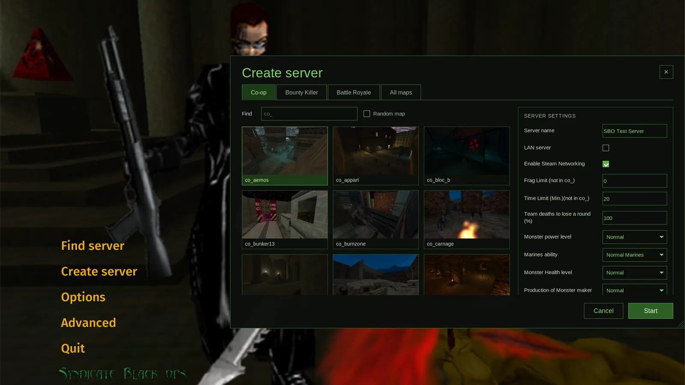
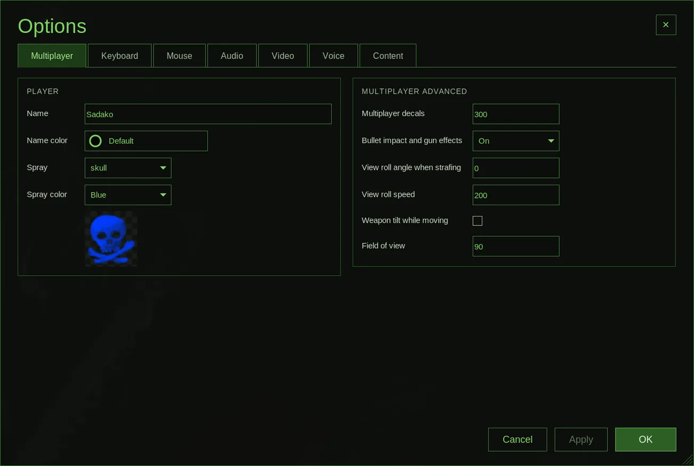
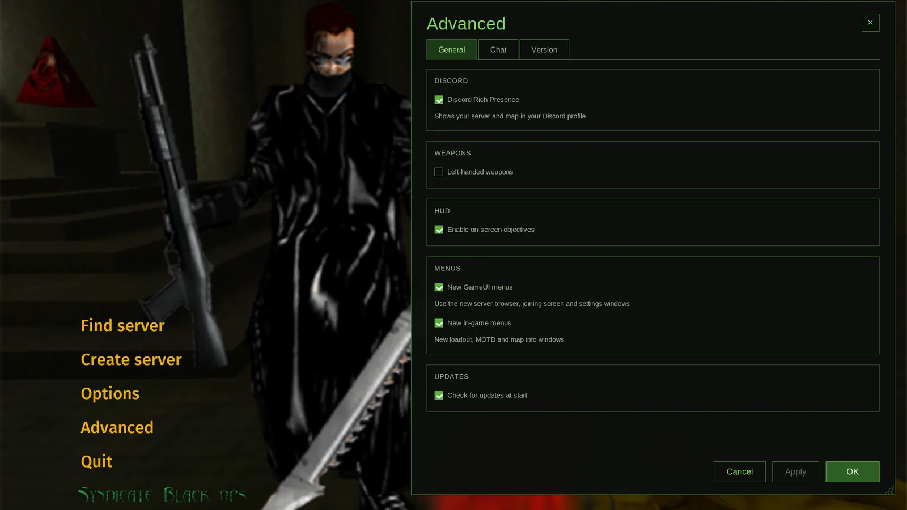
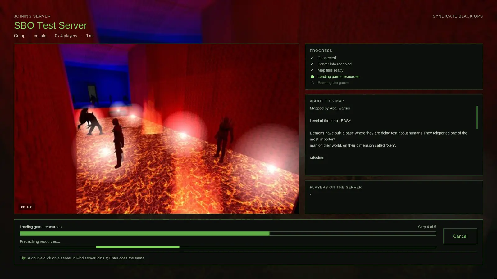
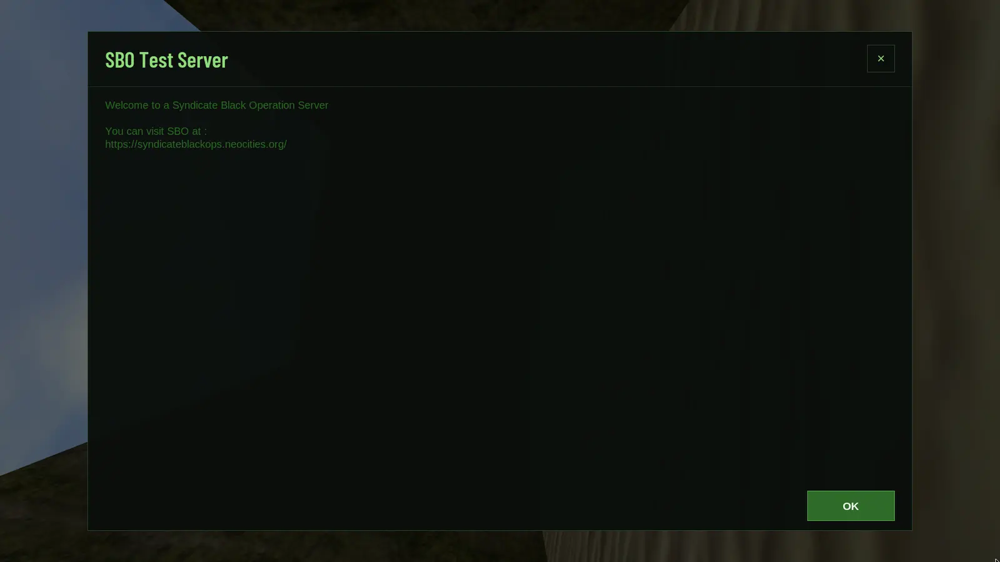
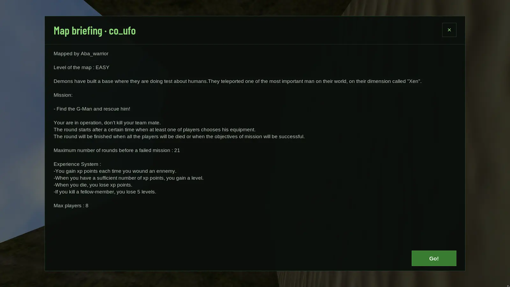
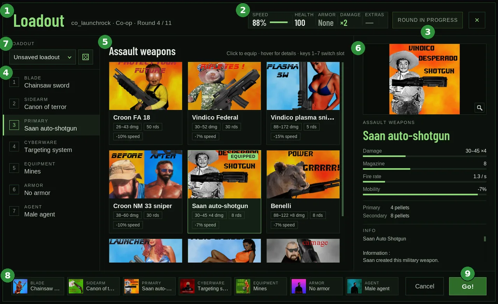
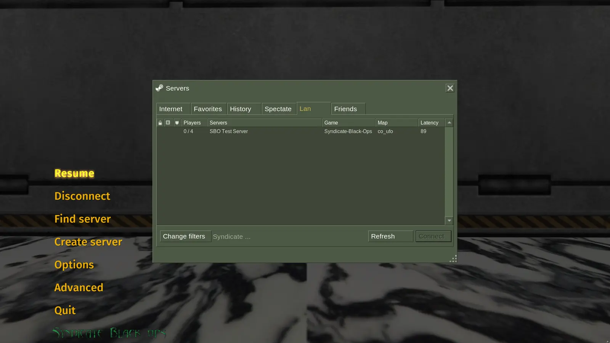
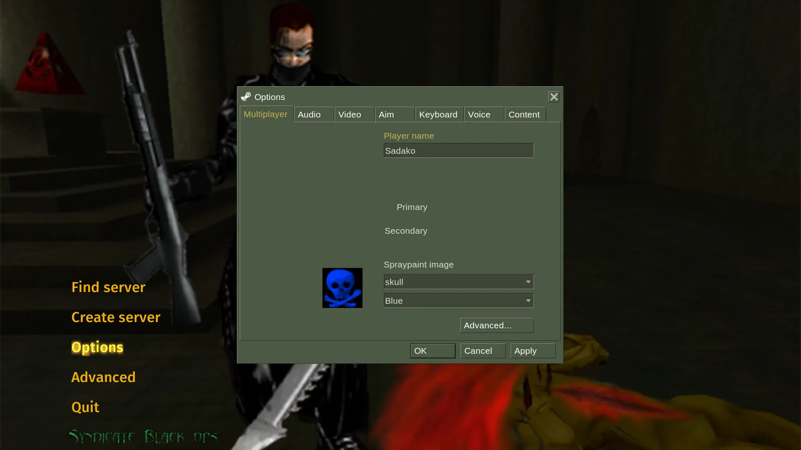
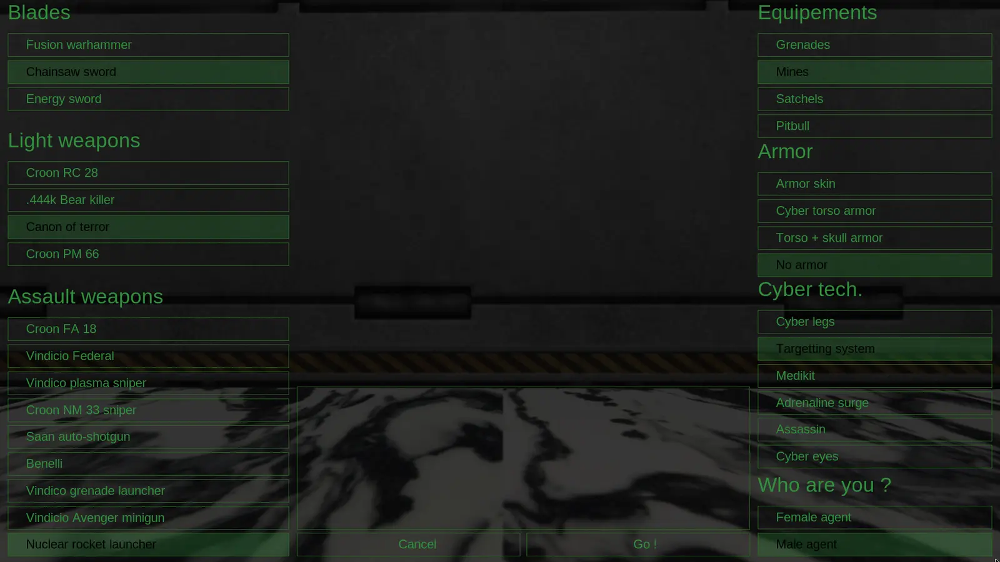

# Menus

SBO 2.0.0 has a completely revamped menu system. Every window you open from the main menu (Find server, Create
server, Options, Advanced and the update window) has been rebuilt in one new dark style that scales to your screen.
The same goes for everything you see on the way into a game and while you play: the joining screen, the message of the
day, the map briefing, the loadout window and server menus.

What the new menus give you:

- **Find server** shows each server's mode, human players, bots and map picture, and a detail
  panel with the round, the time left, friendly fire and who is playing
- **Create server** shows the maps as picture tiles sorted by mode, with a search box and a random map pick
- **The joining screen** replaces Half-Life's small loading window with a full screen that shows the server, the map's
  picture and briefing, the players on the server, and a checklist of every step while you connect, download and load
- **The loadout window** shows every item as a picture card with its stats, adds up your whole loadout's speed,
  health, armor and damage, and can save your loadouts or roll a random one
- **Server menus**, such as a map vote or a shop, use the same style, with cards, tabs, a search box and pictures

Half-Life's default menu style is still there if you prefer it. See [Half-Life's default menu style](#half-life-menus)
for more details.

## Main menu

The main menu has **Find server**, **Create server**, **Options**, **Advanced** and **Quit**. While you are in a game,
it also has **Resume** and **Disconnect**.

Every new window opens to the right of the main menu, so the menu stays in view and you can still use it. You can drag
a window by its title bar and resize it from its edges and corners, and it opens in the same place and size the next
time you start the game. <kbd>Esc</kbd> or the window's close button closes it.

## Find server

*The Find Servers window*

The server browser has these parts:

- **Tabs** - Internet, Favorites, History, Friends and LAN. Favorites and History are shared with Half-Life's server
  browser
- **Filters** - Mode, Map, Max ping, **Has players**, **Not full** and **No password**. Map matches any part of a map's
  name, Max ping can be "Any", "\< 50", "\< 100" or "\< 150", and Has players shows only servers with at least one
  human player. The window keeps your filters and your tab between games
- **Columns** - a lock for servers with a password, the VAC shield, Server, Mode, Map, Players, Bots and Ping. Players
  shows the number of human players and the server's slots, with bots in their own column, and the ping is green under
  80 ms, yellow under 150 ms and orange above that
- **Sorting** - click a column heading to sort by that column, and click it again to reverse the order. You can drag a
  column's edges to resize it, and the window keeps the widths between games
- **Mode** - each server's game mode, taken from its map name: `co_` maps are Co-op, `br_` maps are Battle Royale and
  `bk_` maps are Bounty Killer
- **Detail panel** - the selected server's map picture, Mode, Round, Time left, Friendly fire, Address, and its players
  with how long each of them has been connected. In Co-op, Round shows the current round and the number of rounds. The
  details refresh every 10 seconds
- **Buttons** - **Add server**, **Add to favorites**, **Refresh** and **Connect**. **Add server** adds an address to
  your favorites, with an optional port (27015 by default). You can also double-click a server or press <kbd>Enter</kbd>
  to connect, and a server with a password asks for it first
- **Map pictures** - pictures of the stock maps come with the game, and pictures of other maps download once and are
  kept in `syndicate_downloads`. If a map has no picture, the window shows the map's overview or its name. See
  [Map picture](../mapping/basics/map-picture.md) for how a map gets its picture

If you refresh the Internet list too often, Steam stops answering for about 20 seconds. The window keeps the servers
it already shows and counts down the seconds until you can refresh again.

## Create server

*The Create server window*

Create server starts a listen server, a server that runs inside your own game, and it shows every map you have as a
picture tile, sorted by game mode. The window has these parts:

- **Tabs** - Co-op with the `co_` maps, Bounty Killer with the `bk_` maps, Battle Royale with the `br_` maps, and All
  maps
- **Find** - filters the maps by name. With **Random map** checked, **Start** picks a random map from the ones shown
- **Maps** - a tile with a picture for each map. Double-click a tile to start the server on that map
- **Server settings** - Server name, LAN server, Enable Steam Networking, Max players, Password and the game settings,
  such as the frag limit, the time limit, the round loss percentage and the monster strength. Hold the mouse over a
  row for half a second to see a description of that setting. See [Server settings](../server/settings.md) for more
  details
- **Start** - starts the server and saves your settings for next time

## Options

*The Options window on the Multiplayer tab*

| Tab | Settings |
|---|---|
| Multiplayer | Name, Name color, Spray and Spray color with a preview, and under Multiplayer Advanced: Multiplayer decals, Bullet impact and gun effects, View roll angle when strafing, View roll speed, Weapon tilt while moving and Field of view |
| Keyboard | Every action with its key and alternate key, and **Use defaults**, which you must click a second time to confirm |
| Mouse | Sensitivity, Reverse mouse, Mouse filter, Raw mouse input, Low latency mode and Auto-aim |
| Audio | Sound effects, Music and Sound quality |
| Video | Renderer, aspect ratio, resolution, Run in a window, Brightness, Gamma, Wait for vertical sync, Widescreen field of view, Prefer texture filtering and Use shaders |
| Voice | Enable voice, Receive volume, transmit volume, Boost microphone gain, Test microphone, Max voice boost and Voice leveling |
| Content | Detail textures, original models, addon content and the content lock |

Some rows show a description of their setting when you hold the mouse over them. See [Options](options.md) for more
details on each setting.

## Advanced

*The Advanced window on the General tab*

| Tab | Settings |
|---|---|
| General | Discord Rich Presence, Left-handed weapons, Enable on-screen objectives, New GameUI menus, New in-game menus and Check for updates at start |
| Chat | Text size, Chat color, Name and chat colors, Message sound and Message time |
| Version | The game's version, the newest version, **Check for updates** and a link to the SBO repository for the credits |

See [Options](options.md) for more details on each setting.

## Joining screen

*The joining screen*

While the game connects to a server, downloads its files and loads the map, a full screen shows you what you are
joining and how far along it is:

- The server's name, mode, map, players and ping
- The map's picture
- **Progress**, a checklist of the steps: Connected, Server info received, Map files ready, Game resources loaded and
  Entering the game
- **About this map**, the map's briefing
- **Players on the server**
- A progress bar for the current step, such as "Step 4 of 5", and one for the current file or task
- A tip and a **Cancel** button, and pressing <kbd>Esc</kbd> also cancels

The joining screen stays open through downloads, map changes and `retry` typed in the console, and it closes when you
enter the game.

## Message of the day

*The message of the day window*

A server's message of the day (MOTD) shows when you join, with the server's name as its title, and it can be text or
a web page. **OK** closes it and opens the map briefing. See [Server files](../server/files.md#message-of-the-day) for
more details.

## Map briefing

*The map briefing window*

The map briefing shows the map's description from `maps/<map>.txt`, or from the web page `maps/<map>.htm`. **Go!**
closes it and opens the loadout window.

You can open the map briefing again at any time with the map briefing key (Default: <kbd>B</kbd>), whether you are
alive, dead, waiting or spectating, and the window then has an **OK** button that closes it. The spectator panel's
**Options** menu also has a **Map Briefing** entry.

## Loadout

*The loadout window on the Primary slot*

| # | Part | What it shows |
|---|---|---|
| 1 | Header | The map, the game mode and, in Co-op, the current round |
| 2 | Stats | The whole loadout's SPEED, HEALTH, ARMOR, DAMAGE and EXTRAS. SPEED is a percentage of a level 0 player's speed with a bar, and in Co-op your level counts. ARMOR shows the armor points and how much of the damage the armor absorbs, DAMAGE is ×1 or ×2, and EXTRAS lists Night vision, Cloak and Medikit |
| 3 | Round state | The time until the next round ("NEXT ROUND IN"), "WAITING FOR PLAYERS" or "ROUND IN PROGRESS" |
| 4 | Slots | Blade, Sidearm, Primary, Cyberware, Equipment, Armor and Agent, and the keys <kbd>1</kbd> to <kbd>7</kbd> switch between them |
| 5 | Items | The current slot's items as picture cards with their main stats, and a click on a card equips that item |
| 6 | Details | The item under your mouse, or the equipped item, with a picture you can enlarge, its stats with bars, its primary and secondary attacks and its description |
| 7 | Saved loadouts and the dice button | Your saved loadouts with **Save**, **Rename** and **Delete**, and the dice button, which picks a random item for every slot |
| 8 | Chosen items | The item you chose for each slot |
| 9 | Cancel and Go! | **Go!** confirms your loadout, and **Cancel** closes the window without changing anything |

With **New in-game menus** on, the loadout window replaces the selection menu with lists. It opens after the map
briefing, or when you press the selection menu key (Default: <kbd>M</kbd>).

Choosing Assassin fills the sidearm, primary, equipment and armor slots with the Assassin kit, and **Remove Assassin**
takes it off again. Your saved loadouts are kept in `loadouts.txt` in the `syndicate` folder. See
[Loadout](loadout.md) for more details on each item.

## Server menus

Servers can show their own menus, such as a map vote or a shop, in the same style as the loadout window, with cards or
a list, tabs, a search box, buttons and pictures. When a map vote ends, the winning map's card is highlighted in gold.
<kbd>Esc</kbd> closes a server menu, and with **New in-game menus** off, the server shows its menus as text menus
instead.

## Half-Life's default menu style {#half-life-menus}

Two settings in **Advanced > General** switch between the new menus and Half-Life's default menu style, and both are on
by default:

- **New GameUI menus** - Find server, Create server, Options, Advanced, the update window and the joining screen
- **New in-game menus** - the loadout window, the message of the day, the map briefing and server menus

Changing **New GameUI menus** applies right away, and any open windows close and reopen in the other style. The
joining screen changes the next time you connect. With both settings off, the game uses Half-Life's default menu style
and the selection menu with lists, which shows every slot at once.

*Half-Life's server browser*

*Half-Life's Options dialog on the Multiplayer tab*

*The selection menu with lists*

## Settings

You can also set both settings in the console with these console variables (cvars):

| Cvar | Default | Effect |
|---|---|---|
| `cl_experimental_menus` | 1 | Uses the new server browser, Create server, Options, Advanced and update windows and the new joining screen. Setting it to 0 uses Half-Life's default window style. The same setting can be found in **Advanced > General > New GameUI menus** |
| `cl_new_ingame_menus` | 1 | Uses the new loadout, message of the day and map briefing windows and the new server menus. Setting it to 0 uses the selection menu with lists and text menus. The same setting can be found in **Advanced > General > New in-game menus** |

## Changes since 1.38

- The server browser, Options, Create server and the joining screen are new, and Half-Life's default menu style is
  still available in Advanced options
- The loadout, map briefing and message of the day windows are new
- <kbd>B</kbd> opens the map briefing (`showbriefing`). In 1.38, the only way to see the map briefing was by hitting
  <kbd>Enter</kbd> in spectator, which was removed in 2.0.0
- Servers can show a web page as their message of the day
- The **Advanced** window has a **Version** tab with the game version, **Check for updates** and a link to the credits
- Servers can show their own menus in the new in-game style
- Server menus show their color codes, such as `\y` and `\r`, as colors. In SBO 1.38 they showed the codes as text

## See also

- [Options](options.md) - what each setting in Options and Advanced does
- [Loadout](loadout.md) - every item you can pick in the loadout window
- [Server files](../server/files.md) - the message of the day and the other server files
