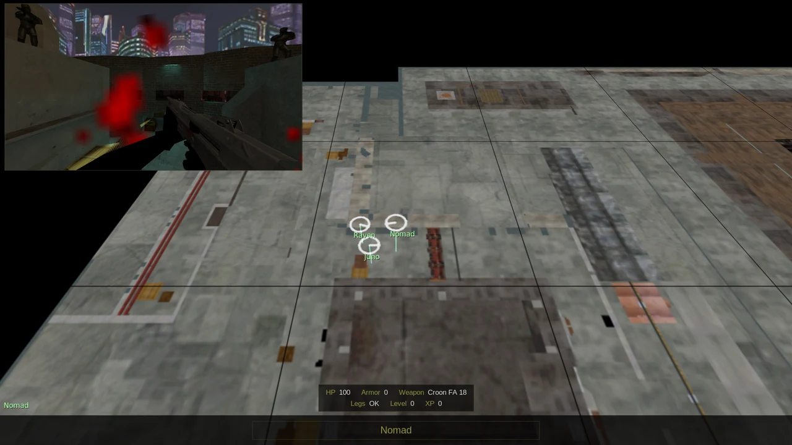
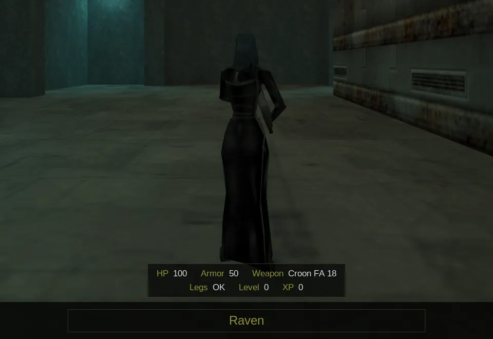
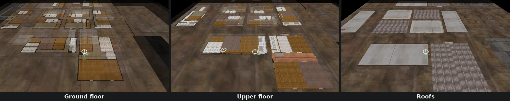

# Spectating

Spectating has two modes: while you are dead or waiting for a new round, and persistent spectator mode, which keeps
you out of the game until you turn it off.

## Spectator mode

Persistent spectator mode can be turned on and off by writing `spectate` in the console, or writing `/spec`,
`/spectate`, `.spec` or `.spectate` in chat. You can switch the mode
at most once every 3 seconds, and if you try sooner, a message shows "Wait a moment before switching spectator mode
again."

- **On** - you are immediately sent to spectator and a message shows "You are spectating. Say /spectate to join the
  game." You will stay in persistent spectator mode on each new map automatically
- **Off** - in Co-op and Battle Royale you join the next round, and in Bounty Killer you spawn at once
- **Go! in the [selection menu](menus.md#loadout)** - also turns the mode off, and you play with the loadout you just
  chose

A Game Master must leave GM Mode before they can spectate.

### What spectators count for

Spectators are not players of the game, so:

- they don't count toward how strong [monsters](../game-modes/coop.md#monsters) are, the
  [round start](../game-modes/coop.md#round-start) or [losing a round](../game-modes/coop.md#losing-a-round)
- the heavy weapon they chose doesn't count toward the heavy weapon limits in Co-op
- in Bounty Killer, a hunted player who starts spectating hands the role on, just as if they had left the server
- the scoreboard lists them under **Spectators**, and their chat messages have the `*SPEC*` prefix

### What persists

Spectator mode stays on through rounds, mission ends, map changes, reconnects and server restarts until you turn it
off. The server keeps the Steam IDs of its spectators in the file `spectators.txt` in the game folder. See
[Server files](../server/files.md#spectator-list) for more details.

### AFK players

A server can move players who give no input for a set time into spectator mode, which is off by default. A player who
is moved sees a message "You were moved to spectator mode for being AFK. Say /spectate to join the game.", and the
other players see a chat message about it.

Server setting (in `server.cfg` or the server console): [`mp_afk_spectate_time`](../server/settings.md#idle-players)

## Camera modes

The jump key (Default: <kbd>Space</kbd>) switches the camera mode, the primary attack key (Default:
<kbd>Mouse 1</kbd>) switches to the next player and the secondary attack key (Default: <kbd>Mouse 2</kbd>) switches to
the previous player.

| Mode | Screen text | View |
|---|---|---|
| Chase locked | Ghost Mode 1 : Chase Locked | From behind the watched player, turning with them automatically |
| Chase free | Ghost Mode 2 : Chase Free | Around the watched player, mouse turns the camera manually |
| First person | first personnal view | The watched player's own first person view |
| Free | Ghost Mode 3 : You are a Free Ghost | You fly around freely |
| Free map | Free map | The map overview, which you move with the mouse. The forward and back keys (Default: <kbd>W</kbd>, <kbd>S</kbd>) zoom in and out, and the strafe keys (Default: <kbd>A</kbd>, <kbd>D</kbd>) slide it sideways |
| Chase map | Chase map | The map overview, centered on the watched player |

*Chase map, with the watched player's first person view in picture-in-picture*

The jump key cycles through modes in the order of the table above, and after chase map it goes back to chase locked.
A few rules decide what you see:

- You can only watch players who are alive. When the player you watch dies, the camera stays on them for 2 seconds
  and then moves to the next player, and when there is nobody to watch, the camera is free and a message shows
  "No Target"
- When you join a server, the camera starts in chase locked, and after that in the last mode you used
- If there is nobody to watch when you join the game or start spectating from the menus, you start at one of the
  map's intermission points ([`info_intermission`](../mapping/entities/info_intermission.md)), looking at its
  target. On a map without one, you start at a spawn point

## Spectator panel

The bars at the top and bottom of the screen show the map's name, the time left on the map (on Co-op maps, the time
played) and the name of the player you watch. The duck key (Default: <kbd>Ctrl</kbd>) opens the spectator controls
menu: **Options**, the camera mode button, and **&lt;** and **&gt;** for the previous and the next player. The **Options**
menu has the different settings, the picture-in-picture inset and the **Map Briefing** (which can also be opened using
the Map Briefing key (Default: <kbd>B</kbd>)).

### Picture-in-picture

The inset shows a second view at the top left of the screen, and pressing the use key (Default: <kbd>E</kbd>) cycles
through its modes. When the main view is a camera view, the inset shows the free map, the chase map or nothing, and when
the main view is a map overview, the inset shows the watched player in chase locked, in first person or nothing.

### Target info

A box above the bottom bar shows the state of the player you watch:

*The target info box while you watch a Co-op player*

| Item | Value |
|---|---|
| HP, Armor | Their health and armor |
| Weapon | The weapon in their hands |
| Legs | "OK", or "BROKEN" if the player has broken legs. It goes back to "OK" when they respawn, or in Co-op when their level ups bring their speed back (see [Hit location](weapons-and-items.md#hit-location)) |
| Level, XP | Their level and XP from the scoreboard, in Co-op |
| Points | Their score, in Bounty Killer |
| Won | The rounds they won on the map, in Battle Royale |

When the player you watch levels up, you see their **LEVEL UP** message too.

## Settings

| Cvar | Default | Effect |
|---|---|---|
| `spec_drawinfo` | 1 | Shows the target info box, the same setting as **Options > Settings > Target Info** |
| `spec_drawnames` | 1 | Shows the player names on the map overview, the same setting as **Options > Settings > Player Names** |
| `spec_drawcone` | 1 | Shows the view cone on the map overview, the same setting as **Options > Settings > View Cone** |
| `spec_drawstatus` | 1 | Shows the map's name and the time, the same setting as **Options > Settings > Show Status** |
| `spec_pip` | 1 | Sets the inset: 0 for off, 1 for chase locked, 2 for chase free, 3 for first person, 4 for free map and 5 for chase map. **Options > Picture-In-Picture** turns it on and off |

## Overviews [[ported:xdm]]

The map overview modes show a top-down picture of the map, which comes from `overviews/<map>.txt`. A map with several
floors can have one picture for each floor, and the overview then shows the floor the watched player is on. On a map
without an overview file, the map overview modes show no picture.

*The three overview layers of co_oldcity, from the ground floor to the roofs*

See [Overviews](../mapping/basics/overviews.md) for more details.

## Changes since 1.38

- Spectator mode is new: `/spec` or `/spectate` in the chat, or `spectate` in the console, turns it on and off. SBO 1.38
  had no spectator mode
- Spectators have six camera modes: free look, locked chase, free chase, first person, free map overview and chase map
  overview. In SBO 1.38 there were only free look and the two chase modes, so first person, the map overviews and
  picture-in-picture weren't available
- A box above the spectator bar shows the watched player's health, armor, weapon, legs and score. Turn it on and off
  with `spec_drawinfo` in the console or **Options > Settings > Target Info**
- Map overview pictures can have up to eight layers now
- With nobody to watch, joining players and new spectators start at the map's intermission points. In SBO 1.38 they
  started at a spawn point
- Fixed spinning objects pushing spectators around and turning their view. The game still treated dead and waiting
  players as walking, so a spinning object they touched carried them along

## See also

- [HUD and scoreboard](hud-and-scoreboard.md) - the scoreboard's Spectators group
- [Chat and console](chat-and-console.md) - the chat commands and the `*SPEC*` tag
- [Server settings](../server/settings.md) - the AFK settings and the other server settings
