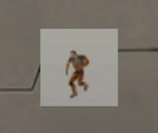

# Sprays

When you press the spray key (Default: <kbd>T</kbd>), your logo goes onto the wall in front of you. You choose it from the
game's logos with **Spray** and **Spray color** in **Options > Multiplayer**, and it is saved as `tempdecal.wad` in your
`syndicate` folder. If you replace `tempdecal.wad` yourself, the game uses the new file as your spray the next time it
starts.

## Animated sprays

Your spray can also be a looping animation made from a GIF which every other player can see. To make one, convert
your GIF with the [spray converter](https://syndicate-black-ops.github.io/spray-converter/) and save the result as
`syndicate/tempdecal.wad`. The preview in **Options > Multiplayer** plays your animated spray, and if you choose a
logo there afterwards, the game replaces that file with the new logo.

*An animated spray playing in a loop on a wall*

An animated spray must stay within these limits:

- The file is between 1024 and 20480 bytes
- The width and the height are multiples of 16, and neither is more than 256
- It has 2 to 64 frames, and each frame shows for 20 milliseconds up to 10 seconds
- All frames share one set of 255 colors, plus transparent

Players using the software renderer will only see the first frame of your spray.

## Changes since 1.38

- Animated sprays are new in 2.0.0

## See also

- [Controls](controls.md) - the spray key and the other keys
- [Menus](menus.md) - the Options window, where you choose your logo
