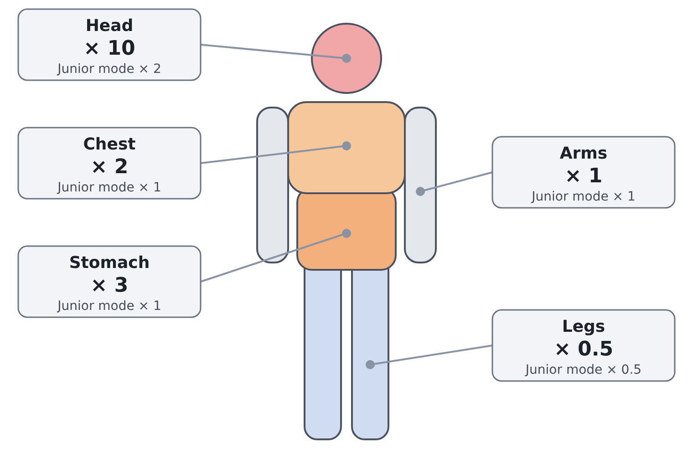

# Weapons and items

This page lists every weapon and item in SBO with their stats. The damage values are the base damage of one bullet,
pellet or hit, which the hit location and the other rules in [Damage](#damage) then change.

## Blades and fists

While you hold a blade or your fists, you take half damage.

| Weapon | Damage per hit | Time between hits | Speed penalty |
|---|---|---|---|
| Fists | 8–15 | 0.3 s after a hit and 1 s after a miss | 0 |
| Fusion warhammer | 280–516 | 1 s | −30 |
| Chainsaw sword | 44–110 | 0.5 s | 0 |
| Energy sword | 222–280 | 0.7 s | −15 |

You always receive fists by default every time you spawn, in every game mode, unless a
[`player_weaponstrip`](../mapping/entities/player_weaponstrip.md) strips them from you. The warhammer and sword show
special effects when they hit a monster or player, which add no additional damage as they are purely cosmetic.

## Light weapons

| Weapon | Damage per bullet | Bullets per shot | Magazine | Primary attack | Secondary attack |
|---|---|---|---|---|---|
| Croon RC 28 | 26–41 | 1 | 30 | One shot per click, at most every 0.08 s | Automatic, every 0.08 s, with a wider spread |
| .444k Bear killer | 150–270 | 1 | 4 | One shot per click | None |
| Canon of terror | 88–122 | 6 with the primary attack and 12 with the secondary | 2 | One barrel, every 0.5 s | Both barrels |
| Croon PM 66 | 20–37 | 1 with the primary attack and 2 with the secondary | 50 | Full Auto, every 0.04 s | Fuller Auto, two bullets at once |

See [Loadout](loadout.md#light-weapon) for the speed penalty and the spare ammo of each weapon.

## Heavy weapons

| Weapon | Damage per bullet | Bullets per shot | Magazine | Primary attack | Secondary attack |
|---|---|---|---|---|---|
| Croon FA 18 | 26–43 | 1 with the primary attack and 4 with the secondary | 50 | Automatic, every 0.06 s | Shotgun with 4 pellets, every 0.2 s |
| Vindico Federal | 30–52 | 1 | 30 | Automatic, every 0.05 s | Zoom (3.5x) |
| Vindico plasma sniper | 88–172, and 30–50 more when a plasma bolt hits | 1 | 5 | When not zoomed in, a plasma bolt every 0.5 s, which can ricochet off walls about 2 times in 3. When zoomed in, an instant shot with a blast effect every 1 s | Zoom (3.5x, 11.5x) |
| Croon NM 33 sniper | 38–60 | 1 | 30 | Semi-automatic, every 0.1 s | Zoom (5.5x, 11.5x) |
| Saan auto-shotgun | 30–45 | 4 with the primary attack and 8 with the secondary | 8 | 4 pellets, every 0.75 s | 8 pellets, every 1.5 s |
| Benelli | 88–122 | 8 | 8 | 8 pellets, every 0.4 s | None |
| Vindico grenade launcher | 230 | 1 grenade | 2 | A fast, flat shot | A slower shot with a high arc |
| Vindico Avenger minigun | 12–25 | 3 | 500 | Spins up for 0.4 s, then fires every 0.04 s | None |
| Nuclear rocket launcher | 250–400 | 1 rocket | 1 | Fires a rocket | Turns laser guidance on and off |

- While zooming, your speed drops to 80
- All weapons can have a maximum of 900 rounds of spare ammo, except the Vindico grenade launcher (20 grenades) and
  the nuclear rocket launcher (no spare rockets). How much spare ammo you spawn with is set by each map with a
  [`Limitator`](../mapping/entities/Limitator.md), so it can differ from map to map, and maps without one use the
  amounts in [Loadout](loadout.md)
- The .444k Bear killer, Croon RC 28, PM 66, FA 18, Vindico Federal and Croon NM 33 spread more while you move or jump. While you
  duck, the RC 28 and the Vindico Federal have no spread at all, even when you move

See [Loadout](loadout.md#heavy-weapon) for the speed penalty and the spare ammo of each weapon.

## Equipment

| Item | Damage | At spawn | Most you can carry |
|---|---|---|---|
| Grenades | 100 | 2 | 6 |
| Mines | 280 | 1 | 6 |
| Satchels | 200–300 per charge | 1 | 6 |
| Pitbull | None | 3 | 5 |

- The longer you hold a grenade before you throw it, the sooner it explodes

## Medikit

The medikit can be selected individually from the Cyberware menu, and it is also included with the Assassin loadout. See [Cyberware](loadout.md#cyberware) for more details.

- **Primary attack** - heals the player or monster right in front of you a random 10 to 100 HP, up to a maximum of 100
  health. You can use it again 2 seconds later, or 4 seconds later if you missed
- **Secondary attack** - heals you a random 10 to 100 HP, up to a maximum of 100 health. You can use the primary
  attack again 2 seconds later and the secondary attack 4 seconds later
- In Co-op, every heal that raises a living player's health gives you 500 to 1000 [XP](../game-modes/coop.md#xp)
- The medikit never raises a player's health above 100, regardless of their current level and bonuses

## Pick-ups

| Item | What it gives |
|---|---|
| Ammo reserve ([`ammo_reserve`](../mapping/entities/ammo_reserve.md)) | Spare ammo for every gun except the grenade launcher and the rocket launcher: 900 rounds for the light weapons, 150 for the FA 18, 180 for the Federal, 200 for the Saan, 210 for the Benelli, 100 for the plasma sniper, 210 for the NM 33 and 500 for the minigun. A Co-op map can change these amounts with a [`Limitator`](../mapping/entities/Limitator.md) |

## Damage

### Hit location

These multipliers apply to hits on players.

| Body part | Damage | Junior mode |
|---|---|---|
| Head | × 10 | × 2 |
| Chest | × 2 | × 1 |
| Stomach | × 3 | × 1 |
| Arms | × 1 | × 1 |
| Legs | × 0.5 | × 0.5 |

*The damage multiplier of each body part*

Junior mode is a server setting, [`mp_junior`](../server/settings.md#players), that lowers the damage to the head,
chest and stomach.

- A hit on the legs slows you down, and you can't heal your legs until you respawn. In Co-op, each hit on the legs
  takes 20 off your speed, down to a minimum of 110, but level ups during that life still add speed, so enough of them
  can bring you back up. When you respawn, you get your normal speed back with all of your level bonuses. In Bounty
  Killer and Battle Royale, a hit on the legs sets your speed to 110 until you respawn
- A chat message naming the body part you were hit in shows at most once every 10 seconds for each body part. This
  will show up as "My fucking head", "My chest !!!", "Arg !!! my stomach !!", "This is my arm fucker !" or "Oh no my
  leg !"

### Random hits

Every hit rolls for a random result with a message which shows on your screen:

| Result | Chance | Damage |
|---|---|---|
| **PERFECT SHOT** | 1 hit in 100 | × 2 |
| **CRITICAL SHOT** | 1 hit in 100 | × 1.5 |
| **FAIL SHOT** | 1 hit in 100 | × 0.5 |
| **VERY BAD SHOT** | 1 hit in 100 | × 0.25 |

A hit on a monster rolls once, so each result comes up 1 hit in 100. When you shoot another player, the hit rolls
twice, so each result comes up about 2 hits in 100, and one hit can get two results at once, such as a PERFECT SHOT and
a CRITICAL SHOT together, which multiply (× 2, then × 1.5) for × 3 damage.

### Other rules

- The Targeting system doubles the damage you do to monsters, and makes your damage against players four times as
  much. It can be selected individually from the Cyberware menu, and it is also included with the Assassin loadout
- Armor lowers the damage on the body parts it covers. See [Armor](loadout.md#armor) for more details
- After you spawn, you take no damage for 2 seconds in Co-op and Battle Royale, and for 1 second in Bounty Killer
- A server can turn on endless ammo with [`sv_infinite_ammo`](../server/settings.md#players), so weapons use no ammo
  and never need a reload

## Changes since 1.38

- A satchel charge deals 200 to 300 damage, as its original description says. In SBO 1.38 it always dealt 200
- Fixed other players not seeing your character play its shoot animation when you fire the RC 28. The RC 28 was the only
  pistol that did not play it. This was a bug in SBO 1.38
- Fixed not being able to pick up satchels, from the map or a dead player's backpack, while you have satchels deployed
- Fixed VERY BAD SHOT almost never happening. PERFECT SHOT, CRITICAL SHOT, FAIL SHOT and VERY BAD SHOT now each come one
  hit in 100. This was a bug in SBO 1.38
- Fixed the flashlight cutting off the chainsaw's sound when you switch it on or off
- Fixed an empty minigun playing its firing animation for as long as you hold the fire button
- Fixed the Vindico grenade launcher not reloading when one grenade is left in the magazine
- Fixed the Vindico grenade launcher and the RC 28 firing an extra shot when you hold both fire buttons
- Fixed the next hand grenade popping into your hand without its draw animation after a throw

## See also

- [Loadout](loadout.md) - what you spawn with and the speed penalty of each item
- [Co-op](../game-modes/coop.md) - rounds, XP and levels
- [Server settings](../server/settings.md) - junior mode, endless ammo and the other server settings
